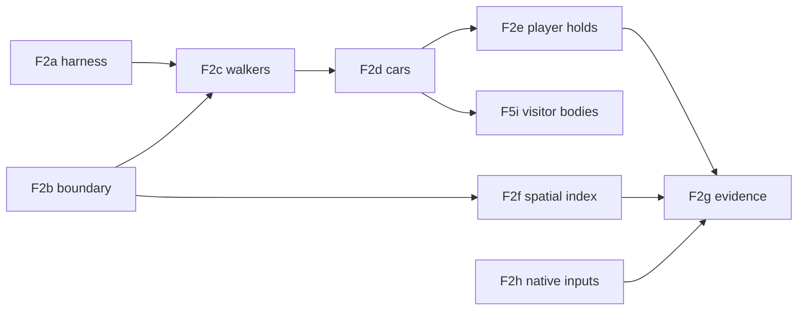

# F2: one movement authority across visible and background simulation

Planning record, 6 November 2026. Refs [#89](https://github.com/PeterHartwieg/big-ambitions-persistent-city/issues/89). **Docs only; no implementation change.** Base: `origin/codex/persistent-city` at `b798b7e` (contains `e9995e5`; writer **25**; city audit F1, F3, F5a/b/f, F6a/b/c and F7a/b/f merged). The audit cites `00506ed`; every code reference below was re-read at `b798b7e` and cites that head. Owner decisions of 6 November 2026 apply ([delivery rules](../decisions/2026-11-06-delivery-rules.md)): no save migration, no switch-over days, batched in-game checks that do not gate merge. Proposed types, members, limits and effort are designs, not existing APIs or measured results.

This plan takes the movement-authority and spatial-indexing part of parked hotspot #1 (physical population). F5f already replaced the all-citizen selection scan with the active-journey index ([F5 plan](f5-population.md) section 4).

## 1. Goal and acceptance

**What the player gets.** The city behaves the same whether or not you are watching. Where you stand, how you move the camera, how many bodies the settings allow and how fast your computer is do not change who gets to work on time, who eats where or what your shops earn. The people you see walk and drive where the city says they are. When you physically get in someone's way, that delay is real and the city remembers it.

**Contract in one sentence.** The logical simulation (`CitySimulator` and `TrafficKernel`) is the only authority for progress, occupancy, arrival and admission at every detail level; a body is a follower that reads the logical pose and never writes it; the only movement input from the visible world is an explicit, bounded player hold.

Acceptance, from issue #89 and the audit's [F2 section](../reviews/2026-11-03-city-vision-audit.md#f2-presentation-detail-changes-journey-authority):

| # | Acceptance item | Where it is met |
| --- | --- | --- |
| A1 | Document authority for progress, occupancy, arrival and admission in each detail level and during transfer (#89). | Section 3, *Authority table*. Enforced by the F2b source-boundary test and the F2c/F2d API removal. |
| A2 | Compare stationary, sweeping and away/return camera paths without player interactions, including different body caps (#89). | F2a harness arms (focus paths × caps 0/1/24/48/256), green after F2d; native focus-dependent inputs removed by F2h; final run in F2g. Rig checks 1–3, 11. |
| A3 | Compare journey times, admitted visits, missed routines, meals and revenue under a declared equivalence or tolerance contract (#89). | Section 3, *Equivalence contract*: exact equality (E1, E2), with visual tolerance only (E3). F2a reports each metric; F2g asserts them. Rig checks 1–3, 6. |
| A4 | Cover detail transitions, body acquisition failures, interrupted journeys, fast-forward and reload (#89). | F2a/F2g arms for transitions, injected acquisition failures, mid-journey reload and hidden travel. Rig checks 4, 5, 6, 7. |
| A5 | Test player collision and blockage effects separately as explicit external interactions (#89). | F2e player holds and the replay oracle E2. Rig checks 8, 9. |
| A6 | Preserve identity, queue order, car ownership and actual saved position throughout (#89). | Section 3: bodies never write state, so saved bytes equal the no-body run. E1 covers ids, traffic FIFO order, car/parking fields and journey fields. Rig checks 1, 7. |
| A7 | One authoritative movement contract across distances; native bodies follow its permissions (audit). | Section 3, F2c (walkers), F2d (cars). |
| A8 | Signals, queues, capacity and access restrictions that affect arrival have logical behaviour outside the camera (audit). | Already logical in `TrafficKernel` and the route planner (section 2). F2 removes the native-only constraints from the outcome path; F2a and rig check 10 measure the visible-only waits that remain presentation. |
| A9 | If exact equivalence is impractical, define acceptable divergence and test it (audit). | Outcomes are exactly equivalent by construction. The only declared divergence is visual (E3: body lag, catch-up, corrections), measured in F2c/F2d and rig check 4. |
| A10 | Camera changes without player interaction do not change missed shifts, completed meals or revenue; tests include detail transitions and save/reload (audit). | E1 (F2b–F2d, F2h), F2g, rig checks 1–7 and 11. |

Out of scope, owned elsewhere: visitor bodies (F5i, after F2d), the integrated 60 FPS gate (F4 #91), compact save wire (F7 #94), native hook capability contracts (F8 #95), the portable acceptance entry point (F9 #96).

## 2. Current state at the base

### Who owns movement today

- **Selection.** `PhysicalPopulation.Update` re-selects every 0.25 s around `NativeTravelPace.Focus`, which is the player's position (or the interior-view anchor), not the camera (`Runtime/PhysicalPopulation.cs:195-196`, `Runtime/NativeTravelPace.cs:120-130`). It walks the F5f active-journey index (`:211`), samples each candidate's logical position, keeps those within 120 m, sorts by `SelectionCandidate.ByPriority` and tries at most four acquisitions per tick (`:208-241`). Caps are 48 pedestrians / 24 cars / 120 m (`Runtime/PrototypeSettings.cs:181-184`).
- **Lease freezes logic.** `TryAcquirePhysicalJourney` removes the journey's due event, or switches the traffic vehicle to physical control (`Core/PhysicalJourneys.cs:69-88`). From then on, progress moves only when the body reports it: `ObservePhysicalJourney` credits the measured progress, caps it at the kernel's permission, rebases `DepartureMinute` and returns the arrival event only when the body reaches the end (`:107-138`). Release resumes background travel from the last observed point (`:141-148`). `JourneyProgress` reads the lease's progress while it exists (`Core/TrafficJourneys.cs:201-207`).
- **Body measures progress.** Runtime projects the body's actual position onto the current leg (`Core/PhysicalProgress.cs:13`). A body pushed aside by avoidance credits nothing (`Runtime/PhysicalPopulation.cs:681-686`). A car needs Gley's reached-waypoint evidence to cross a road node (`:687-690`). Material overshoot beyond permission invalidates the lease (`:704-716`).
- **Physical vehicles hold road storage.** Under physical control a vehicle's discharge and curb exit wait for reported progress (`Core/TrafficKernel.cs:544-551`, `:556-579`), the snapshot reports observed rather than background progress (`:631-634`), and forecasts extrapolate from the physical head (`:241-250`, `:292-304`). A slow visible head car therefore delays every follower, visible or not.
- **Departure hold.** A body returning from an optional stop holds the new journey at its origin through `TryHoldPhysicalDeparture` (`Core/PhysicalJourneys.cs:63-67`; `Runtime/PhysicalPopulation.cs:538-546`).
- **Arrival handoff.** A walker that reached a shop or venue door waits there until the simulator processes the arrival (`Runtime/PhysicalPopulation.cs:436-467`). Admission itself is logical: a slot-zero meal is admitted only when the person is `AtPlace` at the shop with a recent visit (`Core/FoodCommerce.cs:356-364`). Because the lease delays that arrival, a body can still change whether a meal is bought.
- **Other body-originated logical writes.** A body cancels its saved optional stop when a queue holds the spot, when its path is refused, after 20 s of real walking time or in native rain (`Runtime/PhysicalPopulation.cs:557-561`, `:576-579`). Cancellation also cancels partners (`Core/OptionalStopScheduling.cs:171-179`) and frees the spot for other planners (`:320-326`). `QueueAtOpening` writes a weather capture when a body plans a door queue for a wait that has none (`Core/WeatherPolicy.cs:127-136`).
- **Lifecycle.** Bodies are released before hidden travel and fast-forward (`Runtime/PhysicalPopulation.cs:127-142`, `Runtime/NativeTravelPace.cs:117-119`) and observed before a save (`Runtime/PhysicalPopulation.cs:143-149`, `:787-792`). A clock-rate change disposes them (`Runtime/PersistentCityMod.cs:282-294`). Physical update runs after `AdvancePopulation` each frame (`:322-333`).
- **Save.** No lease is saved. Leases are rebased into `DepartureMinute` and `NextEventMinute` (`Core/PhysicalJourneys.cs:233-239`; `Core/TrafficJourneys.cs:215-238`). `TrafficVehicleState.PhysicalControl` is on the wire (`Core/TrafficContracts.cs:149`); `TrafficKernel.Restore` releases it to background travel by default (`Core/TrafficKernel.cs:670-783`). `SaveCodec` accepts a lease-rebased departure within a few ulps (`Persistence/SaveCodec.cs:603-612`).

Net effect: which persons have bodies depends on where the player stands, on the caps and on frame rate. Their journeys then run at native speed, with native avoidance, native signals and native acquisition failures. Off-camera persons run at logical speed. That is finding F2.

### Native reads that feed Core and may depend on the player's position

Bodies are not the only possible focus-dependent input. These native reads feed logical decisions through `activeInHierarchy`, and native objects may be activated or spawned near the player. Whether each one actually depends on distance is not established at the base. F2h records it.

| Read | Where | Logical effect |
| --- | --- | --- |
| Shop frontage availability for optional-stop spots | `Runtime/OptionalStopEnvironment.cs:77` | Which spots exist when a stop is planned (`Core/OptionalStopScheduling.cs:299-312`) |
| Street-performer discovery (`StationaryAiSpawner`) | `Runtime/OptionalStopEnvironment.cs:244` | Which audience stops can be planned |
| Park and performer target availability | `Runtime/OptionalStopEnvironment.cs:291` | `RefreshOptionalStops` cancels saved stops reported `Unavailable` (`Core/OptionalStopScheduling.cs:155-158`), every frame (`Runtime/PersistentCityMod.cs:280`) |
| Subway station discovery | `Runtime/MultimodalRoutes.cs:636`, refreshed from `Runtime/PersistentCityMod.cs:268` | Which stations, and so which transit routes, exist |
| Outdoor scene triggers | `Runtime/OutdoorPlaces.cs:67` | Which outdoor scene places exist |

Cancelling or not planning an optional stop changes saved state, partner stops and spot occupancy. A missing station changes routes and journey times.

### What already exists logically and is reused

- `TrafficKernel`: FIFO finite-storage links, headways, signal schedules taken from native junction timing (`Runtime/TrafficRoadNetwork.cs:197-200`), closures, spillback and an analytical background motion model per vehicle (`MotionStartedAt`, `MotionStartFraction`, `ReadyAt`; `Core/TrafficKernel.cs:595-645`). The snapshot's `MaximumNominalMinutes` already is the furthest point a vehicle may be at now.
- `CitySimulator.SampleJourney` and `PositionOf`: exact pose on committed geometry, including waits, transit and the parked or driven car (`Core/PhysicalJourneys.cs:159-222`; `Core/CitySimulator.cs:538`).
- Walking routes and access: native-pace walking quotes, public-gate rules and route discovery (F3-bounded). Committed routes are immutable between commit and arrival.
- `ActiveJourneyIndex` (F5f): event-filed set of travelling, queueing, optional-stop and outdoor persons, with a 30 s shadow check (`Core/PhysicalJourneys.cs:265-355`; `Runtime/PhysicalPopulation.cs:200-204`, `:292-308`).
- Runtime body plumbing: pools, appearance, NavMesh targets, `PhysicalTrafficMotion` speed and rotation limits, interior-view caps, RLO reservations. These stay; only their authority changes.
- F1 and F6a harness patterns: minute-stamped inputs, whole-save-byte comparison, ordered native sales and mid-epoch reloads (`tools/accounting-backlog-regression`, `tools/economy-interventions`).

### Invariants every slice keeps

- **Native sale authority.** Sales are booked only by `NativeFoodMarket.BuyLive` against the current native hour and saved receipts (`Runtime/NativeFoodMarket.cs:357-360`). A body never books, admits or refuses a sale.
- **Exact money.** Money stays in exact units; no movement change touches wallets except through the unchanged meal path.
- **F1 accounting boundary.** Minute epochs, drained-epoch observation and backpressure stay as they are (`Core/CitySimulator.cs:180-200`). Player holds are timestamped inputs at the simulator minute; they never create a historical purchase.
- **F3 bounded units.** No new unbounded Core work per frame. Player holds are O(1); spatial-index filing is proportional to one route's cells.
- **F7b save epoch.** No new save path, no change to the epoch marker or strict refusal.
- **No rival finance writes.** Unchanged.
- **RLO unchanged.** All RLO access stays in `Compatibility/`; RLO-reserved actors keep their release rule (`Runtime/PhysicalPopulation.cs:181`).
- **Identity.** Body pools never create, rename or reassign identities (unchanged pool reuse rules).

## 3. Design

### Decision 1: the logical simulation is the only movement authority

Three options were considered. (a) Keep body authority and bound its delay. (b) Bound divergence with a tolerance. (c) Make the logical simulation authoritative everywhere and let bodies follow.

**Chosen: (c).** It is the only option where camera independence holds by construction, so the acceptance test can be exact byte equality instead of a statistical tolerance that would need calibration per metric. It also removes per-frame Core writes from the frame path. The cost is visual: a visible person can briefly be a few metres away from where the city says they are, and is corrected. Section 9 Q1, Q3 and Q4 ask Peter how that should look.

### Authority table

| Detail level | Progress | Occupancy (road storage, queue order, door queues) | Arrival | Admission (shops, work, venues, meals) |
| --- | --- | --- | --- | --- |
| Background (no body) | `CitySimulator` due events; `TrafficKernel` background motion | `TrafficKernel` FIFO; logical door waits | Due event at logical time | Existing Core rules |
| Visible, following | Same as background. Body reads `SampleJourney`/traffic permission | Same. The body may not pass the kernel's `MaximumNominalMinutes` | Same. The body walks an arrival tail to the door afterwards | Same |
| Transfer in (acquire) | Unchanged; the body spawns at the logical pose | Unchanged | Unchanged | Unchanged |
| Transfer out (release, cap change, radius, interior, RLO reservation) | Unchanged; nothing is rebased because nothing froze | Unchanged | Unchanged | Unchanged |
| Hidden travel, fast-forward, loading | Same as background; bodies suspended | Same | Same | Same |
| Save and reload | Saved state is the logical state; no presentation state is saved | Same | Same | Same |
| Player hold (F2e) | Core shifts the person's journey later by the reported blocked interval, at the moment of the report | The held vehicle's earliest discharge moves later; followers queue behind it under FIFO | Delayed by the hold | Existing rules at the delayed time |

The visible world's only write into Core is the player hold. Everything else Runtime calls on the simulator is read-only. F2b adds a test that enforces this list.

### Equivalence contract

- **E1 (no player contact).** For any focus path, body caps (including bodies off), acquisition failures, native body lag, frame cadence and interior or hidden-travel transitions, with the same F1-style minute-stamped external inputs: the saved city bytes at every drained epoch boundary and the ordered native sale list equal those of the run with bodies off. This covers journey times, admitted visits, missed routines, meals, revenue, wallets, identity, traffic queue order, car ownership and parked positions.
- **E2 (player contact).** A run with player holds equals the bodies-off run fed the same complete hold stream (Decision 4). Holds are the only movement input from the visible world, and they are world events.
- **E3 (visual tolerance, not outcome).** A following body's along-route lag behind its logical pose is the only allowed divergence. It is measured (p50/p95/max lag, catch-up time, off-screen corrections, releases for lag) and reported in each slice's perf file. Targets for the first measurement: walker p95 lag ≤ 2 m, car p95 lag ≤ 8 m.

E1 is exact once two things hold: Core reads nothing a body produces (F2b–F2d), and Core reads no native input that depends on the player's position (F2h, section 2 inventory). E2 is exact because each hold is applied at once and the stream is complete. E3 bounds only what the player sees.

### Decision 2: followers, not leases

- `PhysicalJourneyLease`, `TryAcquirePhysicalJourney`, `ObservePhysicalJourney`, `ReleasePhysicalJourney`, `TryHoldPhysicalDeparture` and the kernel's `SetPhysicalControl`/`ReportPhysicalProgress` callers are removed (walk legs in F2c, traffic legs in F2d). Core keeps no presentation registry at all, so there is nothing to persist, rebase or invalidate.
- Runtime binds a body to the `CitizenState` and its committed `Journey` reference. A changed journey reference or phase ends the follow, as `AwaitJourney` already does (`Runtime/PhysicalPopulation.cs:459-460`).
- **Walker follow.** Each frame Runtime samples the logical pose, projects the body onto the current leg with the existing `PhysicalProgress.TryProject` and computes the lag. Below 1.5 m the body walks at native pace. Above that it walks up to 1.5× native pace. It is never commanded past the logical pose. Above 8 m, or when the logical leg's mode differs from the body's (the person is already in the subway or the car), the body is corrected: moved to the logical pose if it is off screen, otherwise handled by the Q3 rule. These thresholds are technical starting values, logged and tuned from F2c measurements.
- **Car follow.** The body is commanded toward the kernel's background coordinate, capped at `MaximumNominalMinutes` through the existing `CommandLimit` path (`Runtime/PhysicalPopulation.cs:611-631`). The kernel never waits for the body. Gley's waypoint evidence and the corner-handoff helpers (`Core/PhysicalCornerHandoff.cs`, `PhysicalTrafficCornerPermission.cs`, `PhysicalTrafficPrecision.cs`) stop gating logical crossings. They remain only where they still shape the visible turn. Car correction thresholds start at 5 m (catch-up) and 30 m (correction).
- **Mode boundaries** (walk to car, car to walk, transit) re-acquire a body of the new kind at the logical pose. They are never a hold.
- **Arrival tail.** When the logical arrival is processed, a visible walker keeps walking to the door for up to 10 s real time, then enters (body released) or joins the presentation door queue. This replaces the arrival handoff that kept the lease (`:436-467`).
- **Departure tail.** A body returning from an optional stop when its next journey commits keeps walking back while the logical journey has already started. It then follows with catch-up. `TryHoldPhysicalDeparture` goes.
- **Correction telemetry.** Every correction (move to the logical pose, fade, lag release) is recorded in a bounded ring (last 512) with a sequence number, frame, person ID, kind, body pose before and after, and whether the body was on screen at that frame (inside the camera frustum and with a visible renderer). `pc movement corrections since <seq>` returns the entries after a sequence number and reports a gap if older entries were evicted. `pc movement status` counts on-screen moves, which the Q3 default prohibits. F2c adds this for walkers and F2d for cars.

### Decision 3: remove body-originated logical writes (F2b)

- Optional stops: a body no longer calls `CancelOptionalStop`. If the body cannot reach its spot, or the spot is visually taken by a door queue, it stands at the nearest reachable point or stays near the entrance. The saved stop, its partners and spot occupancy stay logical. The Runtime rain check is dropped: logical rain cancellation already runs in `RefreshOptionalStops` (`Core/OptionalStopScheduling.cs:148-170`).
- Door queue weather: the capture is taken when the logical wait begins. `QueueAtOpening` becomes read-only and returns no queue dwell if a capture is missing.
- A source test lists every `simulation.` member that `Runtime/Physical*.cs` may call. After F2b the list is read-only except the lease API; after F2d it is read-only except `HoldForPlayer` (F2e). Adding a member needs a reviewed change to that test.

### Decision 4: player interactions are explicit world events (F2e)

- **Detection** (Runtime, new `Runtime/PlayerContact.cs`). A contact is a following body that is visibly blocked (no projected progress or lag growing) while the player's avatar is within 1 m ahead of the walker, or the player's vehicle is within 4 m ahead of the car on the same road segment. Native bodies, RLO actors and service vehicles never count as the player.
- **Core API: holds are retroactive and instant.** `CitySimulator.HoldForPlayer(string citizenId, double blockedMinutes, PlayerHoldCause cause)` reports that the person was blocked for the last `blockedMinutes` (in (0, 0.25], and at most the time since that person's previous report). Core applies it inside the call and keeps no hold state afterwards:
  - Walk leg: `DepartureMinute` and `NextEventMinute` move later by the applied minutes and the due event is rescheduled. Progress becomes what it was at the start of the blocked interval. The applied value is clamped so that progress never goes below the current leg's start or a traffic handoff already made.
  - Traffic leg: a new `TrafficKernel.HoldVehicle(id, minutes)` moves the vehicle's earliest discharge (`ReadyAt`) later by the applied minutes, an ordinary future value of an existing saved field. Followers queue behind it under unchanged FIFO rules. That spillback is a real effect of the player's blockage.
  - A hold for an arrived person, a completed vehicle or a waiting source with no link is refused, applies nothing and is not logged.

  Because nothing outlives the call, saving changes nothing: a save is observation-only, and continuation and reload see the same state.
- **Bounds.** Runtime re-reports while contact persists. A person can be held for at most 1 game minute per journey in total (Q2), after which the walker steps around or the car waits for the next gap. The consumed minutes are saved on the person and cleared when the journey ends, so reloading during a blockage cannot reset the allowance. Core enforces the cap and clamps the last report to the remaining allowance.
- **Complete hold stream.** Each applied hold gets the next value of a saved city-wide `PlayerHoldSequence` and is written as one Player.log line (`[Persistent City] hold seq=… minute=… person=… cause=… applied=…`), the complete stream. It is also kept in a bounded ring (last 256) for `pc movement holds since <seq>`, which reports a gap when entries were evicted. A replay segment is a starting checkpoint plus the contiguous stream from that checkpoint's saved sequence to the end checkpoint's sequence. The harness replay refuses a segment with a missing, duplicated or out-of-order sequence number, or one that does not start and end at the checkpoints' sequences. Holds are the only cadence-dependent movement input, and only when the player touches someone.

### Decision 5: spatial presentation index (F2f)

A pure Core `PresentationGrid` with 64 m cells, filed from inside `ActiveJourneyIndex.File` and `Rebuild` (`Core/PhysicalJourneys.cs:302-322`), so no caller changes. `File` also re-files a member whose committed journey reference changed. A travelling person is registered in every cell its committed legs cross. A stationary candidate (door wait, optional stop, outdoor scene) is registered in its place or stop cell. Committed routes are immutable until arrival, so filing happens only on phase or journey change, never per frame. Selection and `PlanQueues` query the cells within the admission radius, deduplicate with a generation stamp, then apply today's exact distance filter and `ByPriority` sort, so the selected set and order are unchanged. The F5f shadow check extends to the grid, with the same fallback to the full index on mismatch.

### Decision 6: what F2 does not add

- **No logical pedestrian crossing signals now.** Visible walkers may wait at native red lights, which off-camera walkers do not. Under F2 those waits are presentation lag absorbed by catch-up. F2a and rig check 10 measure the crossing share of walker lag. If the per-journey p95 crossing wait exceeds 0.5 game minutes, a later slice adds an expected crossing term to walking quotes for new routes.
- **No change to signal phase.** Kernel signals already come from native junction timing. F2d logs how often a visible car is held by the kernel at a native green or stopped natively at a kernel green, so a phase mismatch is measured, not assumed.

### Decision 7: focus-independent native inputs (F2h)

- F2h first records, for each read in the section 2 inventory, whether the native object deactivates or spawns by distance to the player. It uses read-only assembly inspection and rig check 11.
- For each read that does, availability comes from static scene data validated once and cached by static scene key. Inactive objects are included, as station discovery already does with `FindObjectsInactive.Include`. A later deactivation no longer makes a spot, target or station unavailable. Objects disabled for game reasons (DLC not owned, closed or inaccessible building) keep today's rule.
- Optional stops are then cancelled only for logical reasons: rain, closing, phase or a cancelled partner.
- Audience stops are planned from the performer spawner's static location, not from a live performer. If no native performer is present when a visible audience member arrives, the body waits facing the spot (Q4).
- A test feeds the environment a scene double and asserts identical answers before and after the objects are deactivated.

## 4. Slice breakdown

Effort is in working days for one implementer. Every slice writes `docs/checks/<slice>.md` and `docs/perf/<slice>.md` and runs build plus `dotnet test tests/PersistentCity.Tests.csproj`. Only F2e bumps the schema (section 5).

| Slice | Scope | Effort | Owns (files) | Offline tests | Perf measurement | Schema | Depends on / parallel |
| --- | --- | --- | --- | --- | --- | --- | --- |
| **F2a — movement-equivalence harness and baseline** | Detached Core harness with a presentation driver double that uses today's public lease API exactly as Runtime does. Arms: focus paths (none, stationary, sweep, away/return), caps 0/1/24/48/256 pedestrians with 0/1/12/24/64 cars, native-lag model (seeded walker speed 0.8–1.0×, blocking episodes, slow head car), acquisition failure 0/10/50 %, cadence 30/60/120, mid-journey reload, hidden-travel suspension. Fixture: the F1/F6a 957-resident shape plus a small signalled road grid with capacity-2 links and car owners. Metrics: per-mode journey durations, admitted visits, missed activities, meals bought/missed, own revenue, wallets, per-link FIFO order samples, parked positions, save-byte hash per drained 03:00 boundary, ordered sale hash. Records today's divergence (expected red). No Core or Runtime change. | 2–3 | `tools/movement-equivalence/`, `tests/MovementEquivalenceTests.cs` | Harness self-checks: same seed byte-identical; bodies-off arm equals plain simulation; injected faults (duplicate arrival, skipped event) fail loudly; reload arm resumes. | Tool cost per simulated day; no mod work. | None | Starts now. Parallel with F2b and F2f. |
| **F2b — read-only presentation boundary** | Decision 3: remove body-driven `CancelOptionalStop` and the Runtime rain check, capture door-queue weather at the logical wait, add the allowed-member source test. | 1–2 | `Core/WeatherPolicy.cs`, `Core/OptionalStopScheduling.cs`, the optional-stop and queue regions of `Runtime/PhysicalPopulation.cs` (`:346-430`, `:538-610`), `tests/PresentationBoundaryTests.cs` | Optional stop survives an unreachable spot, a queue conflict and 20 s of blocked walking; partner stops unchanged; capture taken at the wait event; `QueueAtOpening` writes nothing (spy); source test lists only allowed members. | `PhysicalPopulation.Update` component time before/after on the physical-selection doubles; expected neutral. | None | Starts now. Parallel with F2a; F2f's Core part may run alongside. |
| **F2c — walkers follow logical progress** | Decision 2 for non-traffic legs: walk, wait and transit legs no longer freeze; walker follower with catch-up and corrections; arrival and departure tails; `TryHoldPhysicalDeparture` removed. Journeys on a traffic leg keep today's lease until F2d. Adds `pc movement status` (lag p50/p95/max, corrections, on-screen moves, lag releases, followers), walker correction telemetry and `pc movement corrections since <seq>` (Decision 2), and the test-profile key `MovementFaultAcquirePercent` (default 0). | 3–4 | `Core/PhysicalJourneys.cs`, `Runtime/PhysicalPopulation.cs` (walker paths, Observe), `Runtime/PhysicalPedestrians.cs`, `tests/PhysicalJourneyTests.cs`, `tests/PhysicalPersistenceTests.cs`, `tests/PhysicalProgressTests.cs` | F2a walker arms turn green (E1) for walking-only cities; arrival at the logical minute with the body 10 m behind; mode boundary re-acquires; follow ends on journey replacement; every correction is recorded with its on-screen flag, and the ring reports a gap after eviction; reload with walkers visible equals bodies-off; source test shrinks. | Follower cost per body per frame; `PhysicalPopulation.Update` at 48 walkers vs today; lag distribution in the harness. | None | After F2a and F2b (and F2f's Runtime edit, if it lands first). |
| **F2d — cars follow the traffic kernel** | Decision 2 for traffic legs: no `SetPhysicalControl(true)`, body commanded to the background coordinate, Gley evidence presentation-only, lease type deleted, writer never emits `PhysicalControl = true`, phase-mismatch counter, car correction telemetry. Kernel internals and `Restore`'s release stay for older writer-25 development saves. | 4–5 | `Core/PhysicalJourneys.cs`, `Core/TrafficJourneys.cs`, `Core/PhysicalCornerHandoff.cs`, `Core/PhysicalTrafficCornerPermission.cs`, `Core/PhysicalTrafficPrecision.cs`, `Runtime/PhysicalVehicles.cs`, `Runtime/PhysicalTrafficHooks.cs`, `Runtime/PhysicalPopulation.cs` (car paths), the `tests/PhysicalTraffic*`, `PhysicalCornerHandoffTests.cs` and `TrafficJourneyTests.cs` files | All F2a arms green (E1), including slow visible head cars; FIFO order and spillback equal bodies-off; no vehicle has physical control after any step; a saved writer-25 city with a physical vehicle still loads and releases; golden hash unchanged. | Kernel `Reconsider` count per frame before/after; `PhysicalPopulation.Update` at 24 cars; car lag distribution. | None | After F2c. |
| **F2e — player holds as world events** | Decision 4: contact detection, retroactive `HoldForPlayer`, `TrafficKernel.HoldVehicle`, saved per-journey allowance, saved `PlayerHoldSequence`, Player.log hold stream, `pc movement holds since <seq>`, E2 replay arm with segment validation in the harness. | 3–4 | `Runtime/PlayerContact.cs` (new), `Core/PlayerHolds.cs` (new `CitySimulator` partial), `TrafficKernel.HoldVehicle` in `Core/TrafficKernel.cs`, the two new fields in `Core/Model.cs` and their codec lines in `Persistence/SaveCodec.cs`, the one call site in `Runtime/PhysicalPopulation.cs`, `tests/PlayerHoldTests.cs`, the E2 arm in `tools/movement-equivalence/` | E2 replay equality from a checkpoint plus its stream; replay refuses a gap, duplicate, reordering or wrong start/end sequence; save in the middle of a blockage, then continue vs reload, gives equal bytes; reload near the per-journey limit while blockage continues applies only the remaining allowance; clamps at leg start, traffic handoff and arrival; followers queue behind a held car; no hold from non-player actors (double); older writer refused with the new-city status; new golden hash pinned. | Detection cost per body per frame; hold application cost. | **One bump** to the next free writer number at merge; no migration | After F2d. |
| **F2f — spatial presentation index** | Decision 5. | 2–3 | `Core/PresentationGrid.cs` (new), the `ActiveJourneyIndex` region of `Core/PhysicalJourneys.cs` (`:257-355`, `File` and `Rebuild` call the grid; no caller changes), the selection block (`Runtime/PhysicalPopulation.cs:206-230`) and the `PlanQueues` scan (`:346-364`), `tests/PresentationGridTests.cs`, `tools/physical-selection-regression/` | Grid equals a full scan after every event, reload, route rebuild and skip; selected set and order identical to the F5f index at matched states; no identity or economy effect. | Selection p95/max and allocation at 1,914/10,000/50,000 persons with 100/1,000/5,000 active journeys, against F5f. | None | Core part parallel with F2a/F2b and F2h; its `Core/PhysicalJourneys.cs` edit merges before F2c starts. Its `PhysicalPopulation.cs` edit lands after F2b and before F2c starts, or after F2e. Never concurrent with F2c–F2e. |
| **F2h — focus-independent native inputs** | Decision 7: record which section 2 inventory reads depend on player distance; cache validated static geometry for those; no cancellation on deactivation; audience stops from static spawner locations. | 2–3 | `Runtime/OptionalStopEnvironment.cs`, the station-discovery region of `Runtime/MultimodalRoutes.cs` (`:625-650`), `Runtime/OutdoorPlaces.cs`, `tests/FocusIndependentInputsTests.cs` | Environment answers identical before and after deactivating the scene double's objects; stops not cancelled on deactivation, still cancelled by rain, closing and partner loss; DLC-gated and inaccessible objects still excluded; station set unchanged by deactivation. | Discovery and `RefreshOptionalStops` cost before/after; cache size. | None | Starts now. Parallel with F2a, F2b and F2f (no shared files). Before F2g. |
| **F2g — integrated equivalence evidence** | Run the final harness across every arm (focus paths × caps × failures × cadence × reload × hidden travel, plus E2 with recorded holds) and record the acceptance table with numbers. Docs and tool arms only. | 1–2 | `tools/movement-equivalence/` arms, `docs/checks/f2g.md`, `docs/perf/f2g.md` | Every A1–A10 row has a passing check. | Whole-harness cost; summary of E3 lag from F2c/F2d. | None | Last. |

File ownership on `Runtime/PhysicalPopulation.cs` is serial: F2b → (F2f) → F2c → F2d → F2e. `Core/PhysicalJourneys.cs` is serial: F2f → F2c → F2d. F2a touches only new files. F2h shares no file with any other slice.

## 5. Save schema impact

**Writer stays 25 through F2a–F2d and F2f–F2h. F2e takes one bump. No slice migrates.**

- F2a–F2d and F2f–F2h add no saved state. Followers, lag, correction telemetry and contact detection live in Runtime memory.
- Saves get simpler. Without leases no `DepartureMinute` is rebased from body progress, and from F2d the writer never emits `PhysicalControl = true`. The field stays on the wire, so the format is unchanged.
- Holds leave no pending state: a walk hold shows on the wire only as later `NextEventMinute`/`DepartureMinute` values, and a car hold only as a later `ReadyAt`. A save is observation-only.
- **F2e's bump.** F2e saves the per-journey consumed hold minutes on the person (cleared at arrival) and the city-wide `PlayerHoldSequence`. Both are needed for reload equality and complete replay (Decision 4). F2e takes the next free writer number at merge, refuses older development cities with the distinct "start a new city" status, and pins the new current-writer golden hash. No migration, no switch-over day.
- A writer-25 development city saved before F2 with a physical vehicle still loads until F2e: `Restore` releases it as it does today. That is the current reader, not a migration. No switch-over day is needed, because no saved state means anything different under the new authority.
- The pinned writer-25 golden hash is unaffected by F2a–F2d (its fixture has no bodies); F2d asserts it.

## 6. Performance

Gate: mod-work p95 < 5 ms; flag every mod-work sample ≥ 30 ms; whole-frame timing reported separately. Historical hotspot #1: `PhysicalPopulation.Update` p95 0.64 ms / max 21.7 ms in game (30 October review). F5f offline selection: p95 0.012 ms at 100 active journeys and 0.18–0.23 ms at 1,000 ([F5f perf](../perf/f5f.md)).

Expected direction:

- F2c/F2d remove per-body per-frame Core writes: `ObservePhysicalJourney` rebasing, kernel `ReportPhysicalProgress` with a link `Reconsider`, and the 16-step corner loop (`Runtime/PhysicalPopulation.cs:660-741`). They add one pose sample and one projection per body, which today's loop already does. Expected: lower or equal mod-work at 48/24 bodies.
- F2d also removes physical-head wakeups in the kernel's discharge path, so background traffic events no longer depend on frame-rate observations.
- F2h replaces per-call `activeInHierarchy` checks with cached static answers; expected neutral or lower.
- F2e adds a distance test per following body against one player position: under 0.01 ms at 72 bodies, by estimate, to be measured.
- F2f makes selection proportional to nearby candidates instead of all active journeys. Target: selection p95 ≤ 0.05 ms at 5,000 active journeys.
- No slice adds work at save time; F2e saves two small fields.

| Slice | Measures (in `docs/perf/<slice>.md`) |
| --- | --- |
| F2a | Harness cost per simulated day and per arm; no mod work. |
| F2b | `PhysicalPopulation.Update` component p50/p95/max on the selection doubles, before/after. |
| F2c | Follower cost per body; `Update` with 48 walkers before/after; walker lag p50/p95/max; corrections and lag releases per hour. |
| F2d | Kernel events and `Reconsider` calls per game hour with 24 visible cars, before/after; `Update` with 24 cars; car lag; phase-mismatch count. |
| F2e | Contact detection per frame at 48/24 bodies; holds per hour in the harness's contact arm. |
| F2f | Selection p95/max and allocation at 1,914/10,000/50,000 persons × 100/1,000/5,000 active, against F5f; grid filing per route commit; shadow check cost. |
| F2h | Discovery and `RefreshOptionalStops` cost before/after; cache size. |
| F2g | Totals from the above; the in-game numbers come from rig checks 1 and 10. |

Offline component timings are not in-game mod-work. In-game mod-work p95, ≥ 30 ms spikes and whole-frame timing come from rig check 10.

## 7. In-game checks for the batched rig

Fixture for all checks: a disposable FT city on the owned rig with Persistent City and RLO, at least one owned food shop with a signalled junction and a door within 120 m of a reachable player spot, autosave off and verified before every window (also after reload). Persistent City exposes `pc movement status`, `pc movement person <id>` (logical pose, follow state, lag) `pc movement corrections since <seq>` and `pc movement holds since <seq>` (from F2c/F2e), read through FT `console`. Outcome equality uses the RIG-PCSAVE `receipts` and `money` projections; the native ledger comparison is added once the PC ledger export exists (section 7 requests). Every equality check without intended player contact places the player off walking lines and asserts that `pc movement holds since <start seq>` is empty at the end of each arm. Each check states the slice that makes it meaningful. Red means the pre-F2 build; green means the build after that slice.

1. **Body caps do not change outcomes (F2d).** Setup: checkpoint at 07:00 on a weekday. Steps: run arms `bodies-min` (1/1), `default` (48/24) and `max` (256/64) from the same checkpoint to 22:00 at speed 6 with the player standing inside the shop, off walking lines; collect the PC save extraction. Expected: hold stream empty in each arm; `pcsave_compare` equal on `ids`, `money`, `receipts`, `journeys`, `queues`, `meals_campaigns`; red before F2d is allowed and recorded. **rig-automated (existing capability: RIG-CADENCE `arms` with RIG-PCCONFIG `MaximumPedestrians`/`MaximumVehicles`, RIG-PCSAVE `pcsave_compare`, FT `time`/`console`; pending capability: RIG-LEDGER comparison, which needs the PC `pc-ledger/v1` export owned by the F6 plan).**
2. **Bodies off equals bodies on (F2d).** Same as check 1 with arms `PhysicalEnabled = false` and `default`. Expected: hold stream empty in each arm; identical projections. **rig-automated (pending capability: RIG-PCCONFIG row for the existing PC key `PhysicalEnabled`).**
3. **Player paths do not change outcomes (F2d).** Setup: check 1's checkpoint. Steps: three arms. *Stationary*: the player stands at the shop. *Sweep*: FT `teleport` across six street points 200 m apart, 10 game minutes each, repeated. *Away/return*: teleport 1 km away for 6 game hours, then back. Teleport targets are kerb points off walking lines. Expected: hold stream empty in each arm; equal projections across the three arms. **rig-automated (pending capability: RIG-ARMS-STEPS, per-arm step lists in `arms` with `assert_identical`; existing: FT `teleport`/`console`, RIG-PCSAVE).**
4. **Detail transitions and visual lag (F2c, F2d).** Steps: `pc movement person` on a resident about to walk then drive to work; record the logical arrival minute; teleport the player beside them, walk alongside with `camera follow` and `capture` every 30 s, teleport away mid-route, return before arrival. Read `pc movement corrections since <seq>` from a sequence taken before the first teleport. Expected: arrival minute unchanged from the recorded prediction; lag p95 within section 3 E3 targets in `pc movement status`; no gap in the correction stream; zero entries with kind `move` and on-screen true; every correction entry has before/after poses. Captures are supporting evidence only. **rig-automated (existing capability: FT `teleport`/`console`/`time`, RIG-VIEW `camera follow`/`capture`).**
5. **Acquisition failures (F2c).** Steps: check 1 arms with `MovementFaultAcquirePercent` 0 and 50. Expected: hold stream empty in each arm; identical projections; failure counter > 0 in the 50 arm. **rig-automated (pending capability: RIG-PCCONFIG row for `MovementFaultAcquirePercent`).**
6. **Fast-forward and frame cadence (F2d).** Steps: from a checkpoint with bodies visible near the shop, arms at frame caps 30/60/120. Each runs 4 game hours at speed 6, then a native `skiptime 120m`, then 4 more hours. Expected: hold stream empty in each arm; identical projections across caps; `pc movement status` shows zero followers during the skip. **rig-automated (existing capability: RIG-CADENCE `frame_caps`, RIG-WEEKS `time_machine` mode, RIG-PCSAVE).**
7. **Reload with visible movers (F2c, F2d).** Steps: reach checkpoint state `physical_lease_visible` (followers visible, at least one car and one walker mid-leg); save; continue 2 game hours and extract; load the checkpoint and run the same 2 hours; repeat with `PhysicalEnabled = false` from the same checkpoint. Expected: hold stream empty; all three extractions equal; the saved `journeys` projection equals the logical pose (no body offset); no `PhysicalControl = true` in the save after F2d. **rig-automated (existing capability: RIG-CHECKPOINTS `physical_lease_visible`, FT `save`/`load`, RIG-PCSAVE; pending capability: RIG-PCCONFIG `PhysicalEnabled` for the third arm).**
8. **Player blocks a walker (F2e).** Steps: `pc movement person` gives a walker's next leg point; teleport the player onto it 5 s before the walker reaches it and stand still for 2 game minutes. Take a checkpoint before the teleport and one 10 game minutes after. Expected: the Player.log hold lines between the two checkpoints' saved sequences are contiguous, with cause player-foot, totalling at most 1 game minute for this journey; the walker then steps around; logical arrival is delayed by the applied minutes; the offline E2 replay of that segment (F2e harness) reproduces the second checkpoint's `journeys`, `money` and `receipts` projections, and refuses the segment if a line is removed. **rig-automated (existing capability: RIG-CHECKPOINTS, FT `teleport`/`console`, `log_check`, RIG-VIEW `camera follow`/`capture`, RIG-PCSAVE).**
9. **Player car blocks a resident car (F2e).** Steps: place the player's car stopped in the lane ahead of a visible resident car for 2 game minutes. Expected: holds with cause player-vehicle, at most 1 game minute per journey; followers on that link stay in FIFO order behind the held car; replay equality as in check 8. **rig-automated (pending capability: RIG-DRIVE, place and hold the player's owned car at a road lane pose, then release).**
10. **Performance and crossing waits (F2c, F2d, F2f).** Steps: in a clean RIG-PERF-UNION window at default caps, teleport the player along a dense street and a quiet district for 30 game minutes (check 3's sweep), reading `pc movement status` each minute. Expected: mod-work p95 < 5 ms; every ≥ 30 ms sample listed with its component; whole-frame metrics reported separately; walker lag share from native crossing waits recorded for section 3 Decision 6. **rig-automated (existing capability: RIG-PERF-UNION `perf_window`, FT `teleport`/`console`).**
11. **Native objects near the player do not change stops or routes (F2h).** Setup: checkpoint at 10:00 with a park, a street-performer spot and a subway station in the fixture district. Steps: arms *stationary* (player stays 1 km away) and *sweep/away-return* (player teleports to the performer spot, the park and the station for 15 game minutes each, then away) to 18:00. Read `pc population census` and the optional-stop counters at the end. Expected: hold stream empty; equal `journeys` and `meals_campaigns` projections, including saved optional stops and their cancellation flags; same planned and cancelled audience and park stop counts; same station set. Red before F2h is allowed and recorded with the reads that changed. **rig-automated (pending capability: RIG-ARMS-STEPS; existing: FT `teleport`/`console`, RIG-PCSAVE).**

### Rig capability requests (PeterHartwieg/big-ambitions-agent-rig)

- **RIG-PCCONFIG `PhysicalEnabled`**: a bool row for the existing PC key (`Runtime/PrototypeSettings.cs:181`). It supplies the true bodies-off arm that the pending `PopulationBodyCapOverride` row was meant for. Checks 2 and 7.
- **RIG-PCCONFIG `MovementFaultAcquirePercent`**: an int row 0–100 for the test-profile key F2c adds. Check 5.
- **RIG-ARMS-STEPS**: per-arm step lists (player paths) inside `arms`, with `collect` and `assert_identical` across those arms, from one source checkpoint. Checks 3 and 11.
- **RIG-LEDGER** comparison in checks 1–3, 5 and 6, once the PC `pc-ledger/v1` export from the F6 plan exists. Until then those checks compare RIG-PCSAVE `money` and `receipts` only.
- **RIG-DRIVE**: put the player's owned car stopped at a given road lane pose, hold for N game minutes, release, with readback of pose. Check 9.
- `pc movement status|person|corrections|holds` are PC console lines read through the existing FT `console`, and the hold stream is read from Player.log; no rig change.

## 8. Dependencies on other plans and running slices

| Plan / slice | What F2 needs | What F2 provides | Notes |
| --- | --- | --- | --- |
| **F5 #92** | F5f's `ActiveJourneyIndex` (merged), reused by F2f. F5b's `PersonKind` for the visitor filter. | The movement contract F5i waits for. F5i may start after **F2d**; it does not need F2e or F2f. | F2 keeps `ActiveJourneyIndex.VisitorsReceiveBodies = false`; F5i flips it. F5c and F2e each take the next free writer number at merge; neither migrates. |
| **F6 #93** | Nothing. | After F2d, resident demand is camera-independent, so F6's measurements no longer need to exclude body effects (F5 plan B5 condition). | F6a's harness is detached; F2a extends the same fixture shape. |
| **F7 #94** | Nothing. | `PhysicalControl` always false from F2d; F2e's two small saved fields (per-journey hold minutes, `PlayerHoldSequence`). | F7d's compact writer may drop the field when it bumps the schema; that is F7's change. |
| **F1 #88** | The accounting boundary and stamped-input discipline (merged). | Holds as stamped inputs at the simulator minute. | The F1 note that physical motion is not proven cadence-independent is closed by E1 after F2d. |
| **F3 #90** | Nothing. | F2 adds no route queries; corrections use committed geometry. | |
| **F4 #91** | Nothing. | Mod-work, lag and selection numbers per slice; rig check 10. | |
| **F8 #95** | Nothing. | F2d reduces dependence on Gley waypoint evidence for correctness. | Native hook contracts stay F8's. |
| **F9 #96** | Nothing. | The F2g harness can become one stage of the integrated acceptance path. | |
| Running docs restructure (#122) | Nothing. | Nothing. | F2 slices edit no shared docs. |

## 9. Game-design questions for Peter

1. **A visible person is slowed by something other than you (a crowd, a native car, a red light). What should happen?** Recommended default: the person quietly catches up by walking or driving a little faster, and the city never waits for what you see, so watching changes nothing. Other option: the city waits for what you see (today's behaviour), which can change who is late and what shops earn depending on where you stand.
2. **Can you delay people by physically blocking them?** Recommended default: yes. Standing in a walker's way or blocking a car with your car delays them for real, up to 1 game minute per journey. After that they step around you or drive on. Other options: no effect (blocking is cosmetic), or no limit.
3. **A visible person has fallen well behind and is on screen. How should they be corrected?** Recommended default: they keep hurrying for up to 10 seconds, then fade out at the next corner or doorway and reappear in the right place when you look again. They never jump on screen. Other option: jump to the right spot immediately, even on screen.
4. **A visible person stops to watch a street performer, but no performer is out right now. What should they do?** Recommended default: they still stop for the planned time and stand facing the spot. This keeps who stops, and for how long, the same whether or not you are nearby. Other option: they skip the stop when no performer is visible, which makes your position decide who stops.

All other choices in this plan are technical and recorded in section 3.

## 10. Risks and refusals

Risks:

- **Bodies cannot keep up.** NavMesh paths can be longer than the committed walking legs, and native car acceleration and Gley behaviour can lag the kernel. More corrections are a visual cost, not an outcome change. F2c/F2d measure lag and tune thresholds; rig check 4 looks for on-screen jumps.
- **Signal disagreement.** If native and kernel signal phases disagree, visible cars wait at a native green or stop at a kernel green. F2d counts both cases. Aligning the phases would be a separate slice.
- **Visible waits that logic lacks.** Native pedestrian red-light waits become lag. Section 3 Decision 6 sets the measurement and the threshold for adding a logical term.
- **Player-hold detection.** A false positive delays someone the player did not block. Detection needs both a blocked body and the player within the contact distance, each hold is bounded, and every hold is logged with its cause.
- **Repeated blocking.** A player can make someone late by blocking them; the saved per-journey cap (Q2) bounds it, including across reloads.
- **Native activation by distance (F2h).** If a native object turns out to matter only while active and cannot be cached from static scene data, F2h records it and keeps the read out of Core decisions instead of accepting a focus-dependent outcome.
- **Test rewrites.** Lease tests (`tests/PhysicalJourneyTests.cs`, `PhysicalTraffic*Tests.cs`) assert crediting rules that F2 removes. They are rewritten as follower and lag tests, keeping their interrupted-journey and identity cases.
- **Intermediate state.** Between F2c and F2d, walk legs follow logic while traffic legs keep leases, so E1 holds for walking-only cities only. The F2c checks file states that boundary.

Refusals. F2 will not:

- let a body credit progress, cause an arrival, admit or refuse a visit, or book or block a sale;
- add any Core write from Runtime presentation code other than the bounded player hold;
- save presentation state, or read camera, focus or body state in any logical decision;
- migrate saves, add switch-over days or keep frozen predecessors;
- change native sale authority, exact money, the F1 accounting boundary, F3 bounds or the F7b save epoch;
- write rival finances or change RLO;
- give visitors bodies (F5i owns that);
- lower body caps or the selection radius to pass a performance gate;
- create, rename or reassign identities on body acquisition, pool reuse, correction or reload.

## Verification boundary of this planning change

This change adds one plan file. It runs no build, test, game or rig. Code references were read at `b798b7e`.
