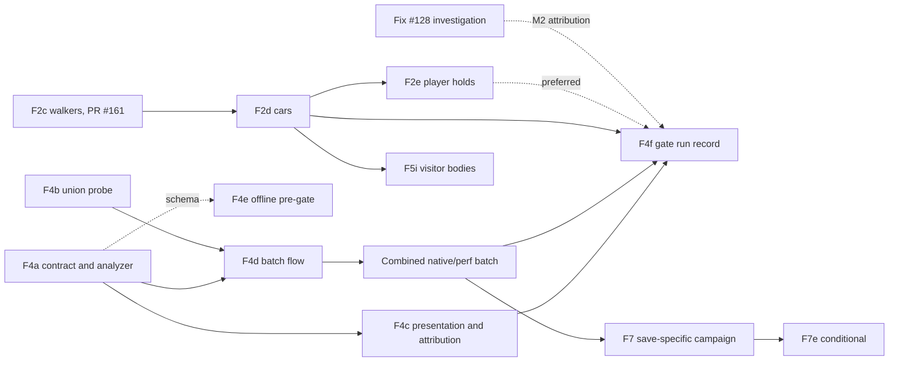

# F4: an integrated 60 FPS experience gate

Planning record, 9 November 2026. Refs [#91](https://github.com/PeterHartwieg/big-ambitions-persistent-city/issues/91). **Docs only; no implementation change.** Base: `origin/codex/persistent-city` at `c2fc1b0` (F5h #163). Current writer **34** (`Core/Model.cs:339-340`, `CurrentSchema = CompactSchema`, from F7d #158). The audit cites `00506ed`. Every code reference below was re-read at `c2fc1b0` and cites that head; line numbers quoted from older records are marked as theirs. Owner decisions of 6 November 2026 apply ([delivery rules](../decisions/2026-11-06-delivery-rules.md), [no-migration re-scope](../decisions/2026-11-06-no-migration-rescope.md), [design defaults](../decisions/2026-11-06-design-defaults.md)): no save migration, batched in-game checks that do not gate merge. Proposed tools, fields, thresholds and effort are designs, not existing APIs or measured results.

The F8, F9 and E5b-remainder plans are being written in parallel. This plan refers to them by name only and does not depend on their content.

## 1. Goal and requirements

**What the player gets.** On the declared test PC and settings, a full Persistent City runs at a steady 60 FPS through the busy parts of the day: morning commute, lunch, evening, midnight bookkeeping, a crowded street, a moving camera and the management screens. The city keeps its calendar pace while doing it, and no sale is lost because the computer was busy. Loading, reloading, skipping time and saving have their own limits and are measured on their own.

**Contract in one sentence.** One frozen, versioned gate (`perf-gate/v1`) measures presented frames, the complete Persistent City mod-work union, simulation lag and pace, and separate latency criteria, on declared fixtures and settings, against a matched dependency-only reference, and reports every unexplained stall as open evidence instead of attributing or dismissing it.

The standing per-slice rule does not change: **mod-work p95 < 5 ms, every mod-work spike ≥ 30 ms flagged, whole-frame timing reported separately** ([roadmap](../roadmap.md#performance-gate), AGENTS.md). F4 adds the experience gate on top of it. The [#128](https://github.com/PeterHartwieg/big-ambitions-persistent-city/issues/128) investigation stays separate; F4 supplies its attribution data (Decision 7).

### Requirements table

Issue #91 acceptance (I), audit [F4 section](https://github.com/PeterHartwieg/big-ambitions-persistent-city/blob/docs-history-2026-11-10/docs/reviews/2026-11-03-city-vision-audit.md#f4-the-performance-gate-does-not-establish-the-requested-experience) and related audit text (A), and this task's scope (T):

| # | Requirement | Where it is met |
| --- | --- | --- |
| I1 | Declare supported hardware/settings, logical population, business load, calendar pace and observed body load. | Decision 1 (machine and settings), Decision 2 (fixtures and loads); report header in Decision 8. F4d records them per run; rig check G1. |
| I2 | Freeze presented-frame p95/p99/stall, total mod-cost, simulation-lag and recovery criteria before measuring. | Decision 4, the `perf-gate/v1` threshold table, committed by F4a as `tools/perf-gate/contract-v1.json` before any gate window runs. Changing a value needs a new contract version and a decision record. |
| I3 | Cover Update, FixedUpdate, native hooks and UI, plus CPU/GPU/presentation evidence and instrumentation limits. | Decision 5 (union scope inventory, fail-closed coverage), Decision 6 (presentation and CPU/GPU trace). F4b, F4c. Rig checks G2, G3. |
| I4 | Matched dependency-only and candidate workloads with dense real vehicles and pedestrians, moving cameras, commute/meal/accounting peaks and management UI. | Decision 3 (windows, camera scripts, ABAB interleaving, density validity). F4d. Rig checks G4–G8. |
| I5 | Attribute or retain unexplained stalls; no nested percentiles; do not assume narrow union timing explains whole frames. | Decision 7 (stall classes, `unattributed` kept open) and Decision 4's statistics rules. F4c. Rig check G11. |
| I6 | Clean gameplay timing autosave-off with verified restoration. | Decision 3 *Invalidation*; preflight receipts in every window. Rig checks G1 and every window check. |
| I7 | Separate startup/reload/skip latency criteria; saving assessed only in a separately requested save-specific run. | Decision 4 latency rows L1–L4; rig check G10. Saving: F7's save-specific campaign (F7 plan section 7, checks 1–8), requested as its own segment; rig check G12. |
| I8 | A short hands-on management session on the measured integrated candidate. | Rig check G13: a scripted management session on the same measured build, timed under the gate. The roadmap's existing "Hands-on session" row is Peter's playtest and is unchanged; no F4 check depends on it. |
| A1 | Replace the headline gate with a combined contract: presented pacing, complete mod cost, native/GPU pressure, simulation lag, recovery. | Decisions 4–7. The standing 5 ms / 30 ms rule stays as criterion M1/M2 inside it. |
| A2 | Distinguish component CPU savings from whole-frame improvement. | Decision 4: matched presented-frame deltas (P4) are reported apart from mod-work numbers; components are never summed or subtracted from whole frames. |
| A3 | Measure throughput and workload-caused missed transactions alongside FPS; do not hide lack of capacity by slowing the calendar beyond the declared pace (audit F1). | Decision 4 rows S1–S5; F4e offline pre-gate; rig check G9. |
| A4 | Dense streets, moving cameras, UI use, reloads, fast-forward and long runs on the actual candidate (milestone 7). | Rig checks G4–G10 and G14 (soak). |
| A5 | Record the exact source, artifact, fixture, settings and active capabilities for every result (audit F9). | Decision 8 report header; F4a refuses a report with a missing header field. |
| T1 | Measure the whole city: F5 representative population, F6 economy, F7 saves, F2 movement, and the fastest-traveller city. | Decision 2. The fastest-traveller arm is defined there. |
| T2 | Keep mod-work p95 < 5 ms and ≥ 30 ms flagging; record whole-frame FPS and frame-time percentiles separately; attribute #128 stalls without conflating them. | Decision 4 (M1/M2 unchanged, P rows separate), Decision 7 (#128). |
| T3 | Camera/route scripts, warm-up, sample sizes, pass/fail thresholds, reporting format, and how the gate plugs into the next combined native/perf batch. | Decisions 3, 4, 8 and section 7 *Batch placement*. |

Out of scope, owned elsewhere: the #128 fix itself (fix slice, [fix-128 checks](https://github.com/PeterHartwieg/big-ambitions-persistent-city/blob/docs-history-2026-11-10/docs/checks/fix-128-rush-spike.md)); movement authority (F2 #89); save pause reduction (F7 #94, F7e); native hook capability contracts (F8 #95); the portable offline acceptance entry point (F9 #96).

## 2. Current state at the base

### What the standing gate measures today

- **Advancement counters in Persistent City.** `AdvancePopulation` times every advancement call and each unit inside it, with the slowest unit's kind, its optional-stop read time and the Mono GC count during it (`Runtime/PersistentCityMod.cs:421-504`; unit kinds at `:477-478`; slowest-advance capture at `:486-492`). The 60-second Player.log summary prints them together with route preparation, closure refresh, planning slices and the physical diagnostics string, and says itself that "these figures cover advancement calls only" (`:361-415`). These counters were the only PC timing available to the 6 November rig.
- **Frame budget.** `PopulationFrameBudget` gives 128 units, 16 citizen events and 2 ms at 60 FPS, scaling to 1,024 / 128 / 4 ms, and 128 / 128 / 16 ms for a hidden skip (`Core/AccountingClock.cs:66-80`). The soft time limit cannot preempt one unit (`Runtime/PersistentCityMod.cs:439-440`).
- **Entry points.** The only PC `MonoBehaviour` with `Update` is `PopulationRuntime` (`Runtime/PersistentCityMod.cs:53`), whose `Update` wraps `UpdateCity` in a save-epoch unit (`Runtime/SaveEpochRuntime.cs:24-33`). `UpdateCity` runs discovery, route preparation, optional-stop refresh, closure refresh, advancement, physical update and the inspector in one call (`Runtime/PersistentCityMod.cs:248-418`). UI drawing is `PopulationRuntime.OnGUI` (`Runtime/FoodEconomyPanel.cs:60`). Physics callbacks also exist on `PhysicalPedestrianCrosswalk` (`OnTriggerEnter`/`OnTriggerExit`, `Runtime/PhysicalPedestrians.cs:283-287`).
- **Native hooks PC installs** (Harmony, verified at the base): `NativeCityClock` tick, accounting and ride prefixes/postfix (`Runtime/NativeCityClock.cs:70`, `:73`, `:82-83`); `NativeTravelPace.ObserveTickPostfix` (`Runtime/NativeTravelPace.cs:36`); `NativeFoodOwnership.AfterNativeTick` on `RunMainGameTick` plus its customer prefixes (`Runtime/NativeFoodOwnership.cs:57-58`, `:68`); `NativeFoodMarket.ResidentPrice` on `CitizenData.IsPriceAcceptable` (`Runtime/NativeFoodMarket.cs:138-139`); `AmbientPedestrians` spawn and state prefixes (`Runtime/AmbientPedestrians.cs:107-109`); `StationaryCrowds.SpawnPrefix` (`Runtime/StationaryCrowds.cs:32`); `ResidentInspector` input, camera and raycast guards (`Runtime/ResidentInspector.cs:79`, `:93-94`, `:105`); `PhysicalTrafficHooks` speed, crash, waypoint and selection hooks, a transpiler, and the `TrafficManager.FixedUpdate` prefix/postfix/transpiler/finalizer (`Runtime/PhysicalTrafficHooks.cs:46-88`); `PhysicalIntersections` set-active prefix and update postfix (`Runtime/PhysicalIntersections.cs:85-86`); `ResearchBilling.RunDailyPostfix` (`Runtime/ResearchBilling.cs:45`); `ResearchAgencyDialog.CampaignSettingsPostfix` (`Runtime/ResearchAgencyDialog.cs:72`).
- **The union timing probe.** `tools/e5b-native-rig-proof` is a rig-only DLL. Its frame row holds union mod-work, observer-to-observer whole-frame wall interval and partial trace overhead (`Probe.cs:101`, `:376-389`). Its timed scopes are PC `Update` and `OnGUI`, `AfterNativeTick`, the `TrafficManager.FixedUpdate` prefix/postfix/finalizer, `PhysicalVehicles.DeferNativeForce`/`ApplyNativeRotation`, `PhysicalIntersections.UpdatePostfix` and five food-owner callbacks (`Probe.cs:236-250`). It does **not** time the `NativeCityClock`, `NativeTravelPace`, `AmbientPedestrians`, `StationaryCrowds`, `ResidentInspector`, `ResidentPrice`, research hooks, the other `PhysicalTrafficHooks` prefixes, code that the transpilers insert, or the crosswalk triggers. `arm` requires 1–8 selected player businesses (README action table), which is why it could not arm in the 6 November fresh city. `analyze.py` computes nearest-rank p50/p95/max over clean frames, refuses partial coverage, and lists every frame with mod-work or whole-frame ≥ 30 ms. Its qualification says whole-frame is wall time, not CPU/GPU timing (`Probe.cs:426`).
- **Diagnostics the rig can read.** On-demand projections with no per-frame cost: `AccountingDiagnostics` (lag, held ticks, withheld minutes, waiting and maximum recovery seconds, `historicalClockMisses`; `Runtime/AccountingStatus.cs:15-29`), `SaveEpochDiagnostics` (save sequence and refusals; `Runtime/SaveEpochRuntime.cs:16-21`) and F7a's `SaveCostDiagnostics` ([F7a checks](https://github.com/PeterHartwieg/big-ambitions-persistent-city/blob/docs-history-2026-11-10/docs/checks/f7a.md)). Console: `pc population census [workplaces]`, `pc population person <id>`, `pc population manifest`, `pc ordinary status` (`Runtime/PopulationCensusDiagnostics.cs:43-44`, `:83-89`), `pc vendor status|sales|withdraw`, `pc food decisions` (`Runtime/VendorDiagnostics.cs:23-24`). There is no `pc perf` command and no `pc movement` command yet (F2c adds `pc movement status`, PR #161 in review).
- **Settings relevant to load.** `GameClockFactor` defaults to 1/3 and is accepted from 0.1 to 1 (`Core/CityBalance.cs:6`, `Runtime/PersistentCityMod.cs:232-233`). `PhysicalEnabled`, `MaximumPedestrians = 48`, `MaximumVehicles = 24`, `PhysicalRadiusMetres = 120` (`Runtime/PrototypeSettings.cs:185-189`).

### Evidence so far

| Record | Workload | Result | Limits |
| --- | --- | --- | --- |
| [30 Oct Windows review](https://github.com/PeterHartwieg/big-ambitions-persistent-city/blob/1273abd9a8ec23017deb12cbfe181f9f891b2682/docs/reviews/perf/2026-10-30-performance-review.md) (via the audit) | 957 residents, stationary camera, 1920×1080 Low, target 90, factor 1/3, caps 48/24 | Whole-frame wall p95 13.2–14.0 ms; mod-work p95 ≤ 1.259 ms; evening maximum interval 174.9 ms | Endpoint car samples 0–3; some fixed-step hooks outside the union; no allocation attribution; no presented-frame claim; source predates the audit |
| [Rig 6 Nov](https://github.com/PeterHartwieg/big-ambitions-persistent-city/blob/docs-history-2026-11-10/docs/checks/rig-2026-11-06-results.md#performance) | Fresh head city at `e9995e5`, 957 residents, speed 1, factor 1/3, background `-rig-test` (about 30 fps), player at High priority | Advancement mean 0.12–0.44 ms/frame; one 134.96 ms advance at the evening rush (#128); whole-frame p95 ≤ 40–56 ms and max 0.2–0.8 s at High | Advancement counters only; union probe could not arm without a business; background frame rate; no presented frames |
| [Fix #128 replay](https://github.com/PeterHartwieg/big-ambitions-persistent-city/blob/docs-history-2026-11-10/docs/perf/fix-128-rush-spike.md) | Offline matched 957-resident city at rig pace | No Core unit ≥ 30 ms (slowest 4.38 ms); evening p95 0.13 ms | Doubles for native seams; the native cause of the 135 ms advance is unidentified |
| [F5h](https://github.com/PeterHartwieg/big-ambitions-persistent-city/blob/docs-history-2026-11-10/docs/perf/f5h.md) | Offline declared load 2,552 persons, stress to 99,996, Runtime 60 FPS caps | p95 ≤ 0.39 ms at every size; ≥ 30 ms flags only at ≥ 10,017 persons (GC inside units); day takes 1.53× the frames of an unheld clock at the declared load at 0.5 game min/frame | .NET, not Mono; planner double; no whole frame |
| [F6h](https://github.com/PeterHartwieg/big-ambitions-persistent-city/blob/docs-history-2026-11-10/docs/perf/f6h.md) | Offline seven-day economy at 1,914/10,000/100,000 consumers | Slice p95 ≈ 0.008 ms; 17 slices ≥ 30 ms at 100,000 in one of three runs, unattributed | Detached slices, not the union |
| [F7d](https://github.com/PeterHartwieg/big-ambitions-persistent-city/blob/docs-history-2026-11-10/docs/perf/f7d.md) | Offline save pause, writer 34 | Typical pause p95 171.4 ms (957×2) against the F7 ≤ 40 ms synthetic budget: **not met** | Save is its own latency criterion; F7e is the planned answer |
| [F3](https://github.com/PeterHartwieg/big-ambitions-persistent-city/blob/docs-history-2026-11-10/docs/perf/pc-f3-bounded-bulk-work.md) | Offline bounded posting and meal-day replay | Posting units p95 ≤ 0.023 ms; 49 stress intervals ≥ 30 ms at 100,000 consumers | Native query tails need the rig |
| [F2a](https://github.com/PeterHartwieg/big-ambitions-persistent-city/blob/docs-history-2026-11-10/docs/perf/f2a.md) | Offline movement harness, caps up to 256/64 | Harness cost only | Rig check 10 of the [F2 plan](https://github.com/PeterHartwieg/big-ambitions-persistent-city/blob/docs-history-2026-11-10/docs/plans/f2-movement.md#7-in-game-checks-for-the-batched-rig) owns in-game movement perf |

What is missing for the experience claim: presented frames in a foreground window, the complete PC union in a city without a player business, FixedUpdate and hook coverage, dense car load, management UI, accounting peaks with a staffed shop, a matched dependency-only reference, a stall attribution method and frozen thresholds. The 6 November results also list rig blockers that F4 inherits: native rental in a fresh head city was refused, native equipment placement failed on 3 November, and the player launches at BelowNormal priority by default.

### State of the tracks this gate integrates

- **F5** population: F5a–F5h merged; F5i (visitor bodies) waits for F2.
- **F6** economy: F6a–F6k merged, including attendance wages, household resources and the change journal.
- **F7** saves: F7a–F7d, F7f, F7p merged; F7e is conditional and waits on the save-phase measurement (F7 plan section 3.5, rig check 2).
- **F2** movement: F2a, F2b, F2f, F2h merged; **F2c PR #161 in review**; F2d, F2e and F2g remain. The chain F2c → F2d → F2e owns `Core/PhysicalJourneys.cs` and `Runtime/PhysicalPopulation.cs`.

## 3. Decisions

### Decision 1: one declared reference machine and settings

The 60 FPS claim applies to one declared configuration: the owned Windows rig PC and the settings below. The report header records the CPU, GPU, RAM, OS build, GPU driver, display refresh rate and Windows power plan as read on the day; the plan does not assume any of them.

- **Primary settings:** 1920×1080, the game's Low preset, vsync off, frame cap 90. This matches the 30 October campaign, so the dependency-only numbers can be compared with it. A cap above 60 shows headroom; vsync off keeps presented intervals tied to work instead of refresh timing.
- **Report-only arm:** the same evening window at the High preset, recorded for information but outside the pass/fail verdict. Q1 asks whether the claim should cover more settings.
- **Foreground, focused, at High priority.** The 6 November runs were in background `-rig-test` mode at about 30 fps and BelowNormal priority by default; neither represents play. Gate windows need a focused foreground window at the declared resolution (pending RIG-FOREGROUND) and the player at High priority with the CPU contamination sampler on (pending RIG-PRIORITY, the 6 November rig follow-up).

### Decision 2: fixtures and declared loads

| Fixture | Content | Purpose | Provenance |
| --- | --- | --- | --- |
| **FT-F4-Declared** | Fresh city at the head build, aged to day 3 so F5g fill has reached its targets (`pc population manifest`), with three staffed and stocked player food shops on one district, F6 economy at defaults (wages, households, journal, rival limits). Expected population from the [F5h reference](https://github.com/PeterHartwieg/big-ambitions-persistent-city/blob/docs-history-2026-11-10/docs/checks/f5h.md): 957 residents, about 1,020 commuters and 576 pool members. Business load: the native rivals the city contains plus the three owned shops. | Main gate fixture | `produce_fixture.py` (existing, built a fresh city in about 3 minutes on 6 Nov) plus pending RIG-SHOPFIX for the staffed shops |
| **FT-F4-Stress10k** | About 10,000 persisted persons, fill stopped growing | Stress windows; reported, threshold M1/M2 only | Pending RIG-PCFIX (`pc-stress-10k@1`, requested by the F5 plan) |
| **Fastest-traveller arm** | FT-F4-Declared with `GameClockFactor = 1`, the largest accepted value. One game minute then passes in the least real time, so the most travel and events land in each frame. Measured at native speeds 1–3 with bodies, then at native fast-forward (speed 6) and a time-machine skip, where bodies are released and the city runs in the background | Throughput and pace (S rows) | Pending RIG-PCCONFIG row for `GameClockFactor`; existing RIG-WEEKS `time_machine` and FT `time` |
| **Dependency-only reference** | The same checkpoints with Persistent City removed from the mod set and every other mod unchanged, loaded from a disposable copy that is never saved. The F4b probe runs in reference mode and applies the declared calendar pace (Decision 3, *Reference arm*) | Matched reference for every window | Existing RIG-MODSET per-flow DLL set; pending RIG-PERF-UNION with the probe's reference mode |

"Fastest-traveller city" is interpreted here as the fastest calendar pace the player can configure; the task did not define it further. The movement state is whatever has merged when the batch runs. The final gate verdict (F4f) needs F2d merged, so that body cost reflects cars following the kernel. Until then, windows are labelled `movement=pre-F2d`, and their verdict counts only as a baseline.

### Decision 3: windows, scripts, warm-up, samples and invalidation

**Window conditions** (game time at speed 1, factor 1/3; about 3.3 real seconds per game minute on the 6 November rig, so a 5-minute window covers about 90 game minutes):

| Window | Game time | What it stresses |
| --- | --- | --- |
| W-idle | 03:00 | Background floor |
| W-morning | 07:00–08:30 | Commute departures, the #128 morning burst |
| W-lunch | 11:45–13:15 | Meal decisions, owned-shop checkouts |
| W-evening | 17:45–19:15 | Evening commute and leisure, the #128 spike window |
| W-midnight | 23:30–01:00 | F3 posting units, F5g fill boundary, F6 wages and journal |
| W-accounting | Any native hour rollover inside W-lunch and W-evening with the owned shops open | `AfterNativeTick`, native hourly customers, ownership transfers |

**Camera and route scripts**, each a fixed step list driven by the rig from the window's checkpoint:

- **S-stationary:** the player stands at a kerb point by an owned shop, off walking lines (the F2 plan's check 1 placement).
- **S-path:** a continuous camera path along a dense street and through a quiet district and back, at walking pace (RIG-VIEW `camera look_at` along waypoints).
- **S-sweep:** FT `teleport` across six kerb points 200 m apart, 10 game minutes each (the F2 plan's check 3 sweep). Evening only; it measures acquisition and release churn.
- **S-drive:** the player drives the owned car along a fixed route through the dense street (pending RIG-DRIVE, also requested by F2).
- **S-manage:** the Ctrl+F8 panel open, the resident inspector opened on three residents, then native management screens (business overview, staff, inventory) opened and closed in a fixed order (pending RIG-UI-SCRIPT; the 6 November run reported these as NEEDS-INPUT).

**Reference arm.** Removing Persistent City also removes `NativeCityClock.TickPrefix`, which multiplies ordinary native ticks by `GameClockFactor` (`Runtime/NativeCityClock.cs:94-98`; "ordinary" means active, not loading and no time machine running, `:51-52`). Without a correction the reference would run three times as many game minutes per real second as the candidate at factor 1/3, so its windows would carry a different calendar workload. The reference therefore runs with the F4b probe in **reference mode**:

- **Pace shim.** The probe installs its own prefix on `GameManager.RunMainGameTick(float)` with the same rule: while the game is not loading and no time machine is running, a positive, finite delta is multiplied by the declared factor of the matched candidate arm (1/3, or 1 for the fastest-traveller arm). It runs no Persistent City simulation and no calendar holds, so the reference gets the declared *unheld* pace. The shim is rig-only, like the rest of the probe. It is the only probe action that changes native state, and the report header records it.
- **Readiness.** A reference window starts when the native load has finished, the pace shim reports active, and 60 further real seconds have passed. Persistent City readiness, the accounting text, PC scope coverage and `AccountingDiagnostics` do not apply and are marked `n/a` in the reference's receipts. Autosave, contamination, priority, focus, settings read-back, presentation-trace coverage and the probe's frame-export flags (overflow, cross-frame, error) still apply.
- **Matched coverage.** P4 is computed only for a reference/candidate pair whose windows start at the same checkpoint minute and cover the same game-time span within ±1 game minute, and whose reference pace (game minutes per real second, from the probe's per-frame clock reads) is within 2 % of the declared unheld pace. Candidate holds make the candidate's real duration longer; that difference is reported under S3, not hidden in P4. A pair that fails matching is reported, and its P4 is `not established`.

**Interleaving.** For each window × script, the rig runs reference and candidate in ABAB order from the same checkpoint: two repetitions per build, four for W-evening and W-morning. Each run loads the checkpoint, so builds see the same city state.

**Warm-up.** After a load, timing starts only when Persistent City reports simulation ready, the accounting text no longer says the calendar is held, and 60 further real seconds have passed. Those frames are discarded. The first window of each game process is discarded entirely (Mono JIT and asset streaming).

**Sample size.** Each measured window lasts at least **300 real seconds of clean frames** (18,000 frames at 60 FPS, so p99 then rests on at least 180 tail frames). The minimum is real duration, not a frame count: a complete window with fewer frames because the build ran slower is judged on P1/P2 like any other, and fails them if it is slow. Only an aborted window, or one invalidated by a receipt, is "short"; it is reported and does not count.

**Density validity.** A window counts toward the dense-street criterion only if, during S-path's dense segment, median observed bodies are at least 36 pedestrians (0.75 × 48) and 12 cars (0.5 × 24), read from the 60-second physical diagnostics and RIG-VIEW `screen_pos list`. The 6 November log shows cars ≤ 7 in a fresh city ([f5f-1](https://github.com/PeterHartwieg/big-ambitions-persistent-city/blob/docs-history-2026-11-10/docs/checks/rig-2026-11-06-results.md)), so dense car load may not be reached. If it is not, the window is reported as "not dense" and I4's dense-traffic part stays unestablished. Lowering the threshold does not make it pass. A presentation stress arm at caps 256/64 (as in F2a) runs once in W-evening, reported only.

**Run budget.** The core matrix (6 windows × S-stationary and S-path × 2 builds × 2–4 repetitions, plus S-sweep, S-drive and S-manage in W-evening) is about 50 windows of 8 real minutes including load and warm-up: roughly 7 hours of locked rig time, plus the stress, fastest-traveller, latency and soak checks.

**Invalidation.** A window is invalid, kept in the report and excluded from the verdict, if any of these receipts fails:
- autosave: the original setting is recorded once, off before each window (also after every reload), no save callback inside the window (`SaveEpochDiagnostics.sequence` unchanged across it), restored at cleanup;
- no task-owned or foreign dotnet build or test was active (the 6 November sampler);
- player at High priority, window focused, declared resolution, preset, cap and vsync read back;
- the probe reports complete coverage (Decision 5) with no overflow, cross-frame, off-main or error flags;
- the presentation trace covers the whole window (Decision 6).

### Decision 4: frozen thresholds, `perf-gate/v1`

All criteria are per valid window on the primary settings unless stated. F4a commits them as `contract-v1.json` before any gate window runs. Percentiles are nearest-rank over every clean frame of one window. Pooled figures pool raw frames across windows of the same condition. The gate never averages percentiles and never takes a percentile of percentiles.

| Row | Measure | Pass |
| --- | --- | --- |
| **M1** | PC mod-work union p95 | < 5 ms (standing gate, unchanged) |
| **M2** | Every frame with mod-work ≥ 30 ms | Flagged with condition, component, GC count and frame (standing rule; a flag, not a fail by itself) |
| M3 | PC mod-work union p99 | ≤ 10 ms |
| M4 | PC mod-work mean (total mod cost per frame) | ≤ 1.5 ms |
| **P1** | Presented-frame interval p95, candidate | ≤ 16.7 ms |
| P2 | Presented-frame interval p99, candidate | ≤ 25 ms |
| P3 | Stalls: presented interval ≥ 50 ms | ≤ 2 per 5-minute window and none ≥ 250 ms whose class (Decision 7) is `pc-union` |
| **P4** | Matched delta, candidate − reference, same window and script | p95 ≤ 1.5 ms and p99 ≤ 3 ms |
| S1 | `historicalClockMisses` | 0 in every window, all arms |
| S2 | Lag (`AccountingDiagnostics.lagMinutes`) | ≤ 1 game minute at every sample (the supported maximum, `Core/AccountingClock.cs:11`) |
| S3 | Calendar holds at native speeds 1–3 | Held real time ≤ 1 % of the window; window-local longest single hold ≤ 3 s (both from the probe's hold/resume events, Decision 5) |
| S4 | Recovery after a hold or stall | Lag back to ≤ 0.1 game minute within 5 real seconds |
| S5 | Fastest-traveller pace | Per game hour, real time ≤ 2.0 × the unheld clock; per game day ≤ 1.25 × (Q2 default); S1 and S2 still hold |
| L1 | Cold start: city loaded to population active | ≤ 60 real s at the declared load |
| L2 | Reload main-thread activation (`CompleteInitialization`, F7a diagnostics) | ≤ 50 ms native, F7's frozen budget ([F7 plan](https://github.com/PeterHartwieg/big-ambitions-persistent-city/blob/docs-history-2026-11-10/docs/plans/f7-save-snapshots.md#31-budgets) section 3.1); every sample ≥ 30 ms flagged |
| L3 | Calendar held after load ("Preparing Persistent City") | ≤ 30 real s |
| L4 | Time-machine skip of 120 game minutes | Completes with S1/S2 holding and real duration ≤ 2 × the dependency-only reference |
| R1 | Soak, 3 game days at speed 3 | Managed heap after each daily GC grows ≤ 5 % per day; M1 p95 drifts ≤ 20 % from day 1 to day 3 |

Reading the rows:

- **P1/P2 are the 60 FPS claim; P4 is Persistent City's share of it.** If the dependency-only reference itself misses P1 or P2 on the declared machine, the report says "60 FPS not established on this machine (native baseline)". The verdict then rests on P4 and the M rows, and nothing is attributed to Persistent City without evidence. The 30 October reference p95 of 13–14 ms leaves about 2.7 ms below 16.7 ms, so P4's 1.5 ms is the budget Persistent City may use.
- **Component savings are not frame improvements.** A slice that lowers a component's time reports that in its perf file. Only a matched P4 change counts as a whole-frame improvement.
- **Stress and report-only arms** (FT-F4-Stress10k, High preset, 256/64 caps) are judged on M1/M2 and S1/S2 only. Their other rows are recorded.
- **Save** is not a row. Gameplay windows contain no saves. Save pause criteria are F7's section 3.1 budgets, measured in F7's save-specific campaign (G12).
- **Why these numbers.** M3/M4 bound the tail and the total that M1 lets through: on 6 November the advancement mean was 0.12–0.44 ms, and the 30 October union p95 was 1.26 ms. S3's 1 % and 3 s keep holds unnoticeable at normal speed. S5's limits are the Q2 default. L2 takes F7's frozen native main-thread budget unchanged, so the two plans never hold two values for one measurement. L1, L3 and L4 are first values set from the 6 November start-up observations; they are frozen in v1 like the rest.

### Decision 5: the complete union, measured from outside the product

The gate's mod-work is the nested union of every Persistent City entry point that runs on the main thread, measured by a rig-only probe. It is never compiled into the package.

- **F4b builds `tools/perf-union-probe/`** from the E5b probe's frame and scope machinery (`Probe.cs:101`, `:376-389`) without its business, cargo and fault actions. `arm` needs no player business. In **candidate mode** it works in any FT city where Persistent City is active. In **reference mode** (Decision 3, *Reference arm*) Persistent City is absent: the probe installs only its pace shim and frame, GC, QPC, save and scene recording, and the PC scope inventory, hold records and diagnostic sampling are reported `n/a`.
- **Scope inventory, fail closed.** At `arm`, the probe enumerates every Harmony patch whose owner ID belongs to Persistent City (Harmony's patch info for all patched methods). It adds the `PopulationRuntime` `Update`/`OnGUI` messages and the `PhysicalPedestrianCrosswalk` trigger messages. Every prefix, postfix and finalizer gets an inclusive timing scope. A transpiler cannot be timed as its own scope, because its code runs inside the native method. The probe lists each transpiled method as `untimed-transpiled` and times the PC helpers that the transpiler calls when they are separate methods. A PC patch owner that the probe cannot bind makes coverage incomplete, and the gate refuses the window. Section 2's list is today's expected inventory. `tools/perf-union-probe/check_scopes.py` scans `Runtime/*.cs` for `Patch(`, `HarmonyMethod` and MonoBehaviour message methods and fails when the source has an entry the probe's expected list lacks, so a new hook cannot silently fall outside the union. When F8's hook inventory exists, the check reads it instead.
- **Components** (not additive): PC-internal methods timed as nested sub-scopes, for attribution only: `AdvancePopulation`, `MultimodalRoutes.Prepare`, `CitySimulator.RefreshOptionalStops`, `CitySimulator.RefreshTrafficClosures`, `PhysicalPopulation.Update`, `UpdateInspector`, the food market refresh and the vendor `Prepare`. A method the Mono JIT inlines cannot be patched. The probe reports it as `component-unbound`, and the union stays authoritative.
- **Per frame**, the probe also records the Mono GC collection count, the Stopwatch (QPC) timestamp of the frame boundary for joining with the presentation trace, a save-callback counter and a scene-load flag.
- **Calendar holds, per tick.** One-second `AccountingDiagnostics` samples cannot establish S3/S4. The projection exposes held tick counts, withheld minutes, the current wait and a lifetime maximum (`Runtime/AccountingStatus.cs:23-25`), with no cumulative held time. `NativeCityClock.AccountingPrefix` also resets `waitingSince` as soon as readiness returns (`Runtime/NativeCityClock.cs:114-123`), so short holds between samples are lost. The probe therefore adds a postfix on `NativeCityClock.AccountingPrefix`, a PC method it can patch like the others. After every native tick the postfix reads `AccountingLimited`, `HeldOrdinaryTicks`, `HeldEconomySkipTicks`, `BoundaryClips` and `WithheldMinutes` and writes a per-frame record: held or not, boundary clip or not, withheld minutes this tick, and the QPC time. A tick is **held** only when `HeldOrdinaryTicks` or `HeldEconomySkipTicks` increased across the call (the population was not ready). `AccountingLimited` alone does not mean held: the prefix also sets it while ready when a delta is clipped at a minute boundary, and then counts a `BoundaryClips` (`Runtime/NativeCityClock.cs:116-126`). Boundary clips are reported separately and excluded from hold events, S3 and S4. It also reads the native and logical minute for per-frame lag. On each held→released or released→held transition the probe appends a timestamped `hold`/`resume` event. A hold already in progress at window start opens at the window's first frame (flagged `carried-in`); a hold still open at window end closes at the last frame (flagged `ongoing`). The analyzer computes total held real time, the window-local longest hold and recovery time (S3, S4) and lag (S2) from these records. The one-second projection samples are kept for reporting and cross-checks only.
- **Once per real second**, outside timed scopes and flagged as diagnostic frames, it samples `AccountingDiagnostics` and `SaveEpochDiagnostics`.
- **Limits** reported in every window: the union includes nested probe cost; `observerMs` measures only part of it; native work that PC forces inside a scope stays in that scope; native work outside PC scopes is not mod-work.

This adds no Runtime code, so it cannot change the shipped DLL's behaviour or timing. It also needs no edit to `Runtime/PhysicalPopulation.cs` or the physical hook files the F2 chain owns.

### Decision 6: presented frames and CPU/GPU evidence from a system trace

The rig records presentation with a Windows ETW presentation trace (a PresentMon-class capture; the tool choice is the rig's, pending **RIG-PRESENT**). It gives each present's QPC time, the interval between displayed frames, and, where the tool reports them, GPU busy time and CPU wait. The probe's frame boundaries carry QPC timestamps, so F4c joins the trace to probe frames by time without new game hooks. Whether the game's Unity build exposes `FrameTimingManager` data is not established and is not assumed. Process CPU and per-thread CPU time come from the same trace or from the rig's existing load sampler. The report states whether each frame looks CPU-bound or GPU-bound only when the trace provides GPU busy. Otherwise the field is `unknown`.

### Decision 7: stall attribution, with unexplained stalls kept open

Every presented interval ≥ 50 ms, and every probe whole-frame interval ≥ 50 ms, gets one or more classes, each with its evidence:

| Class | Evidence required |
| --- | --- |
| `pc-union` | PC union mod-work in that frame ≥ 50 % of the frame's excess over the window's reference p50; component and slowest unit named |
| `gc` | Mono GC count rose in that frame (probe) |
| `save-load-scene` | Save callback, load or scene-load flag in that frame (excluded from clean windows by definition; listed when found) |
| `native-frame` | RLO's frame diagnostics in Player.log name a long phase in that frame (the 6 November stalls coincided with long `UpdateRectTransform`/`LateUpdate` frames there), or the trace shows the time in game threads outside PC scopes |
| `gpu-present` | Trace shows GPU busy or present queueing covers the interval |
| `reference-rate` | The dependency-only arm has stalls of the same size at a similar rate in the matched window |
| `unattributed` | None of the above. Kept as open evidence with its frame, game minute, condition and raw numbers; never counted for or against Persistent City |

Rules: a frame may carry several classes, and the remainder (whole frame − PC union) is never attributed to PC. The 6 November record already does this ("Not attributed to PC"), and F4c makes it mechanical.

**#128.** Advancement spikes are mod-work and appear in the M2 list. Per-frame attribution comes only from the probe:

- its component sub-scopes (Decision 5) give each M2 frame's time per component;
- for every `AdvancePopulation` call ≥ 30 ms it writes a per-call record with the call's duration, the Mono GC count delta across the call, and the optional-stop read time as the difference of the `OptionalStopEnvironment` seam total (`SeamMilliseconds`) before and after the call.

The fix-128 summary fields (slowest unit kind, optional-stop read ms, GC count; `Runtime/PersistentCityMod.cs:373-377`) describe only the observation's **maximum** advancement call, because `AdvancePopulation` updates them only on a new observation maximum (`:486-490`). The report attaches them to the one M2 frame whose advancement time matches that maximum and treats them as observation-level context for every other frame. It never copies them onto a second spike. A spike outside advancement gets no advancement-unit fields. The slowest *unit* inside a call cannot be read from outside, because `Unit` is a local function; the probe marks it `unknown` except where the summary's maximum matches. Any per-frame field the probe could not bind is `unknown`, not inferred.

Whole-frame stalls go in the stall table. A frame that has both appears in both, with the mod-work part shown. F4 does not close or fix #128. It hands the #128 investigation every evening and morning M2 flag with this attribution.

### Decision 8: report format and provenance

F4a's analyzer writes `perf-gate-report/v1` as JSON plus a generated Markdown summary:

- **Header (all required, or the report is refused):** source commit, PersistentCity.dll SHA-256, probe DLL SHA-256 and expected-scope list hash, game build, complete mod set with hashes, rig commit and overlay, machine fields (Decision 1), settings read back, PC config keys in effect, fixture names and provenance hashes, contract version, movement state label, and the list of active rig capabilities and their versions.
- **Invalidation receipts** per window (Decision 3).
- **Per-window table:** condition, script, build, repetition, frames, M1–M4, P1–P3, reference and delta (P4), S rows, density fields, body counts, GC count.
- **Verdict per row:** `pass`, `fail` or `not established` (missing capability, invalid windows or native baseline), with the reason. The overall verdict is `pass` only when every primary row passes in every primary window.
- **Spike list (M2)** and **stall table** (Decision 7).
- **Offline and native results stay apart.** F4e's offline pre-gate writes the same schema with `source=offline`. The analyzer refuses to mix offline and native windows in one verdict.

### Decision 9: what F4 does not add

- No new Runtime telemetry. The probe is the only new instrument; Persistent City's existing counters and projections are read as they are.
- No change to frame budgets, caps, radius, clock factor default or the event order to pass the gate.
- No save inside a gameplay window, and no save profiling outside F7's separately requested campaign.
- No dependency-only claims about the native game beyond the reference arm's numbers.

## 4. Slice breakdown

Effort is in working days for one implementer. Every slice writes `docs/checks/<slice>.md` and `docs/perf/<slice>.md` and runs the build and `dotnet test tests/PersistentCity.Tests.csproj`. None bumps the schema (section 5, *Schema notes*). None edits Core, Persistence or Runtime.

| Slice | Scope | Effort | Owns (files) | Offline tests | Perf | Schema | Depends on / parallel |
| --- | --- | --- | --- | --- | --- | --- | --- |
| **F4a — gate contract and analyzer** | Decision 4 as `contract-v1.json`; the analyzer and report writer for Decision 8; ingestion of probe exports and the 60-second summary lines (fields as emitted at `Runtime/PersistentCityMod.cs:361-415`: frames, events, total and maximum advance, maximum events in one frame, the slowest advance's unit, optional-stop ms and GC count, optional-stop totals, route and planning counters, physical diagnostics; the 6 November parser was a local rig artifact and is not in Git); verdict logic, invalidation, offline/native separation. | 2–3 | `tools/perf-gate/contract-v1.json`, `tools/perf-gate/analyze.py`, `tools/perf-gate/report.py`, `tools/perf-gate/summary_lines.py`, `tools/perf-gate/test_perf_gate.py`, `tools/perf-gate/fixtures/` (synthetic exports) | Nearest-rank percentiles match hand-computed values; no pooled percentile of percentiles; a missing header field refuses the report; any failed receipt invalidates a window; a mixed offline/native verdict is refused; P4 delta pairs only matched windows; `not established` when the reference misses P1; a summary-line parser test covers the fix-128 fields and attaches them only to the frame matching the observation maximum, leaving other spikes' advancement-unit fields `unknown`. | Analyzer run time on a synthetic 50-window export (expected seconds; no mod work). | None | Starts now. Parallel with F2c–F2e, F4b, F4e. |
| **F4b — complete union probe** | Decision 5: a rig-only probe with no business requirement, fail-closed scope inventory, component sub-scopes, per-frame GC, QPC marks, save and scene counters, diagnostic sampling; the per-tick hold postfix on `NativeCityClock.AccountingPrefix` with hold/resume events and boundary clips kept apart (Decision 5); per-call records for `AdvancePopulation` calls ≥ 30 ms (Decision 7); reference mode with the pace shim on `GameManager.RunMainGameTick` (Decision 3); `check_scopes.py`; build script with pinned references like `build_probe.py`. Never packaged. The shim rule, the hold state machine and the per-call threshold live in one Unity-free source file so they can be tested offline. | 4–5 | `tools/perf-union-probe/` (new: `Probe.cs`, `ScopeInventory.cs`, `ProbeLogic.cs`, `build_probe.py`, `check_scopes.py`, `test_check_scopes.py`, `logic-check/` (a small console project compiling `ProbeLogic.cs`), `README.md`) | `check_scopes.py` passes on the base and fails on a synthetic extra `Patch(` call; the expected list equals section 2's inventory; the build script's hash manifest is stable across two builds; README states the limits. `logic-check`: the shim multiplies only ordinary (not loading, no time machine) positive finite deltas and leaves zero, negative, infinite and NaN deltas unchanged; a synthetic tick sequence yields the expected hold/resume events, with `carried-in` and `ongoing` flags at window edges; ticks with `AccountingLimited` but no held-counter increase are boundary clips, not holds; a per-call record is written for a 30.0 ms call and not for a 29.9 ms call. | Probe overhead per scope call and `observerMs` share, measured offline on a stub loop; the native share is measured in G2. | None | Starts now. Reads, never edits, the F2-owned physical files; if F2d renames a hook first, F4b updates its expected list. Parallel with F2c–F2e and F4a. |
| **F4c — presentation trace and stall attribution** | Decision 6 ingestion (trace CSV to per-frame presented intervals, GPU busy, CPU wait); QPC join with probe frames; Decision 7 classifier including RLO frame-diagnostic lines; P1–P4 inputs for the analyzer. | 2–3 | `tools/perf-gate/present.py`, `tools/perf-gate/attribute.py`, `tools/perf-gate/test_attribution.py`, `tools/perf-gate/fixtures/present/` | QPC join tolerates clock offset and dropped presents; each class fires only on its evidence; a frame with no evidence is `unattributed`; whole minus union is never assigned to `pc-union`; observation-level fix-128 fields are never copied to a second spike; a non-advancement spike has no advancement fields. | Join cost on a 7-hour synthetic trace. | None | After F4a (shares `tools/perf-gate/`; disjoint files). Parallel with F2 chain and F4b. |
| **F4d — batch flow and fixture specs** | Decision 2 fixture specs and Decision 3 scripts as a generated rig flow: checkpoints, ABAB order, warm-up, autosave receipts before every window and after every reload, probe arm/measure/export, trace start/stop, cleanup restore; the capability list each step needs. Writes flows; runs nothing. | 2–3 | `tools/perf-gate/make_gate_flow.py`, `tools/perf-gate/scripts/` (camera and route step lists), `tools/perf-gate/fixtures.json`, `tools/perf-gate/test_make_gate_flow.py` | Generated flow has an autosave check before every window and after every load; every window ≥ 300 real seconds of clean frames after warm-up by construction; ABAB order per condition; the reference arm never saves; each pending capability is named on the step that needs it. | None (tool only). | None | After F4a and F4b. Parallel with F2 chain. |
| **F4e — offline pre-gate** | An offline run in the report schema, labelled `source=offline`: FT-F4-Declared's shape (the F5h reference fixture with F6 economy on) driven with Runtime's `PopulationFrameBudget` at 30/60/120 FPS, the F2a presentation driver at 48/24 and the fastest-traveller pace. Gives M-row and S-row expectations per window before the rig run. Compiles test fixtures by path, as `tools/rush-spike-replay` does. | 2–3 | `tools/perf-gate-offline/` (new project: `PerfGateOffline.csproj`, `Program.cs`, `Windows.cs`) | Same seed gives identical state hashes; sliced runs equal an uninterrupted advance (as in the fix-128 replay); report validates against F4a's schema with `source=offline`. | Per-window Core frame p50/p95/p99/max, ≥ 30 ms flags with GC, pace ratio and lag per game hour; tool cost. | None | Starts now; uses F4a's schema when merged (until then writes JSON matching the documented fields). Parallel with F2 chain. |
| **F4f — gate run record** | After the combined batch: import the batch's gate report, record the verdict, spikes, stalls and open items. Docs and report files only. | 1 | `docs/checks/f4f.md`, `docs/perf/f4f.md` | Report validates; every requirement row in section 1 has a result or a named missing capability. | The report itself. | None | After F4c, F4d, the batch, and for the final verdict F2d (F2e preferred) merged. |

## 5. File ownership and parallelism

- F4a and F4c share the `tools/perf-gate/` directory with disjoint files. F4c branches after F4a merges. F4d adds its own files there after F4a and F4b. F4b owns `tools/perf-union-probe/` alone. F4e owns `tools/perf-gate-offline/` alone. F4f owns its two docs files.
- **No F4 slice edits `Core/PhysicalJourneys.cs`, `Runtime/PhysicalPopulation.cs` or any other Core, Persistence or Runtime file.**
- **Parallel with the serial movement chain F2c → F2d → F2e:** F4a, F4b, F4c, F4d and F4e can all run now, alongside F2c (PR #161) and the later F2 slices, because they share no file with the chain. F4b reads the physical hook files to build its expected scope list. If F2d changes those hooks first, F4b's `check_scopes.py` fails closed and F4b updates its list in its own files.
- **Must wait for the F2 chain:** only F4f's final verdict, which needs F2d merged so the measured body cost is the follower model (F2e preferred, so player holds are present). A batch run before F2d still produces a labelled baseline report.
- `tools/e5b-native-rig-proof/` is not edited. The E5b-remainder plan may keep using it for its native business checks.

### Schema notes

Current writer 34. **No F4 slice bumps the schema or changes the save shape.** None touches `Persistence/` or the saved model, so the pinned current-writer golden hash is untouched; each slice's checks file states that and runs the build and unit tests as usual. F4 therefore takes no place in the one-schema-slice-at-a-time order and never blocks a schema slice in F5, F6, F7, F2e or the sibling plans. No migration and no switch-over day apply. F4's fixtures are fresh cities at the head build; an older-schema fixture is never used for timing, because the head refuses it ("start a new city").

## 6. Performance of the F4 slices themselves

F4 adds no shipped code, so in-game mod-work p95, ≥ 30 ms spikes and whole-frame timing of the product are unchanged by any F4 slice. Each slice's perf file records its tool cost as listed in section 4. The probe's own overhead is part of every measured union. G2 measures its native share, and the report states it under Decision 5's limits. The only performance numbers that count for the gate are the batch's.

## 7. In-game checks for the batched rig

Every check runs on the headless agent rig in a named disposable FT city (FT-F4-Declared, FT-F4-Stress10k or a disposable copy of their checkpoints), never in Peter's ordinary save. Autosave is recorded, disabled in the isolated profile, verified off before every window and after every reload, and restored at cleanup; a save inside a window invalidates it. The player runs at High priority in a focused foreground window. Preexisting rig files and preferences are restored when the rig is released. No check is left to Peter, a playtest, a manual console session or a visual check by hand. Every timed check reports through F4a's analyzer against `contract-v1.json`.

1. **G1 — Preflight and declared configuration.** Setup: the rig PC at the start of the batch. Steps: read and record the machine fields, set and read back 1920×1080 Low, vsync off, cap 90; record autosave, disable it, verify off; start the dotnet contamination sampler; raise the player to High. Expected: every Decision 8 header field filled; any missing field stops the batch before timing. **rig-automated (existing capability: `rig flow run` autosave guard and health `autosave_disabled`, RIG-MODSET; pending capability: RIG-FOREGROUND (focused window, resolution, preset, vsync and cap set and read back), RIG-PRIORITY (High priority and contamination sampler as a flow step)).**
2. **G2 — Union coverage and probe overhead.** Setup: FT-F4-Declared at 07:00, no business selection. Steps: `arm` the F4b probe; read `status`; run 2 real minutes with the probe measuring and 2 without (probe disarmed), interleaved twice. Expected: every expected scope bound and `check_scopes.py`'s list equal to the probe's bound list; transpiled methods listed as `untimed-transpiled`; no overflow, cross-frame or off-main flags; probe overhead (`observerMs` share and the presented-frame p95 difference between armed and disarmed) recorded. **rig-automated (pending capability: RIG-PERF-UNION, the F4b probe staged through the existing RIG-MODSET transaction with export through the existing rig ops extension convention).**
3. **G3 — Presentation trace alignment.** Setup: as G2. Steps: start the RIG-PRESENT trace, run a 5-minute S-path window, stop both, export. Expected: F4c joins at least 99 % of probe frames to presents; trace covers the window; GPU busy present or explicitly `unknown`. **rig-automated (pending capability: RIG-PRESENT).**
4. **G4 — Declared-load matrix, matched.** Setup: FT-F4-Declared checkpoints at each Decision 3 window start, and the dependency-only reference from the same checkpoints. Steps: for W-idle, W-morning, W-lunch, W-evening and W-midnight × S-stationary and S-path, run the ABAB order with the warm-up and sample rules. Expected: M1–M4, P1–P4, S1–S4 per window as frozen; every M2 flag and every stall classified. **rig-automated (existing capability: RIG-MODSET reference arm, FT `load`/`time`/`teleport`, RIG-VIEW `camera`; pending capability: RIG-PERF-UNION, RIG-PRESENT, RIG-FOREGROUND, RIG-SHOPFIX for the owned shops in the fixture).**
5. **G5 — Dense streets and bodies.** Setup: W-evening checkpoint. Steps: S-path and S-sweep candidate and reference windows; one 256/64 cap arm. Read body counts from the physical diagnostics line every 60 s and `screen_pos list` every 10 s. Expected: density validity recorded; P and M rows for valid windows; the 256/64 arm reported (M1/M2, S1/S2 only). **rig-automated (existing capability: RIG-VIEW `camera`/`screen_pos`, FT `teleport`; pending capability: RIG-PCCONFIG `MaximumPedestrians`/`MaximumVehicles` rows as requested by the F2 plan, RIG-PERF-UNION, RIG-PRESENT).**
6. **G6 — Driving.** Setup: W-evening checkpoint with the owned car parked near the dense street. Steps: S-drive in both builds, ABAB. Expected: P and M rows; body counts. **rig-automated (pending capability: RIG-DRIVE, requested by the F2 plan; RIG-PERF-UNION, RIG-PRESENT).**
7. **G7 — Management UI.** Setup: W-lunch checkpoint, player inside an owned shop. Steps: S-manage in both builds (the Ctrl+F8 panel is a Persistent City screen, so the reference arm runs the native screens only). Expected: P and M rows; `OnGUI` and inspector-guard scopes reported as components. **rig-automated (pending capability: RIG-UI-SCRIPT, scripted pointer and keyboard in a locked session; RIG-PERF-UNION, RIG-PRESENT).**
8. **G8 — Accounting peaks.** Setup: FT-F4-Declared with the three owned shops staffed, stocked and open. Steps: W-accounting windows across two native hour rollovers at lunch and evening, and W-midnight. Read `AccountingDiagnostics` each second. Expected: S1 = 0 misses; M2 flags around `AfterNativeTick` and posting units listed with components; P rows. **rig-automated (pending capability: RIG-SHOPFIX, a complete staffed and stocked food shop built natively, blocked on 6 Nov by refused rental and equipment placement; RIG-PERF-UNION, RIG-PRESENT).**
9. **G9 — Fastest-traveller pace.** Setup: FT-F4-Declared checkpoint at 06:00 with `GameClockFactor = 1`. Steps: (a) one game hour each at native speeds 1, 2 and 3 with bodies, then 4 game hours at speed 6, then a time-machine skip of 120 game minutes; (b) from a second copy of the checkpoint, one complete game day (06:00 to 06:00) at native speed 3 with bodies, the declared speed for the daily criterion; (c) the same game day in the dependency-only reference with the pace shim at factor 1 and speed 3. The unheld-clock denominator is (c)'s measured real duration, cross-checked against the shim's game minutes per real second. The probe's hold/resume events are recorded throughout. Expected: S1 and S2 in every segment; S5's per-hour limit for every game hour of (a) and (b); S5's per-day limit (≤ 1.25 × the denominator) for (b); held time and longest hold per game hour; M rows in the speed 1–3 segments. **rig-automated (existing capability: FT `time`, RIG-WEEKS `time_machine`; pending capability: RIG-PCCONFIG `GameClockFactor`, RIG-PERF-UNION).**
10. **G10 — Startup, reload and skip latency.** Setup: FT-F4-Declared saved at 06:00 (saved outside any window). Steps: cold process start and load; fresh-process load; in-session reload; `skiptime 120m` in both builds. Read F7a's activation diagnostics and the accounting text. Expected: L1–L4. **rig-automated (existing capability: FT `load`/`save`/`time`/`state`, F7a diagnostics through FT `state`; pending capability: RIG-PERF-UNION for the activation frame).**
11. **G11 — Stall attribution and #128.** Setup: the outputs of G4–G9 and G14. Steps: run F4c's classifier over every presented and whole-frame interval ≥ 50 ms and every M2 flag; pull RLO frame-diagnostic lines, the probe's per-call advancement records and the fix-128 summary lines for the same observations. Expected: every stall has a class; `unattributed` stalls listed with frame, minute and condition; every evening and morning M2 flag carries its component times and, for advancement calls, the probe's GC delta and optional-stop ms; the summary's slowest-unit fields appear only on the frame that matches each observation's maximum, and every other per-frame field the probe lacks is `unknown`. **rig-automated (existing capability: Player.log collection in `rig flow run`; pending capability: RIG-PRESENT, RIG-PERF-UNION).**
12. **G12 — Save-specific segment (separately requested).** Setup: requested explicitly by the coordinator as its own segment of the batch, never mixed with G4–G11 windows. Steps: F7 plan section 7 checks 1–8 on FT-F4-Declared and the 957-resident representative checkpoint, writer 34. Expected: F7's section 3.1 save budgets reported; F7 check 2's phase table is the input to the F7e build decision. **rig-automated (existing capability: `rig flow run`, FT `save`/`console`; pending capability: RIG-SAVEPROF, RIG-SAVETYPES, as requested by the F7 plan).**
13. **G13 — Scripted management session on the measured candidate.** Setup: the exact candidate build measured in G4, on FT-F4-Declared at 10:00. Steps: 20 real minutes at speeds 1–3 of a fixed management script: check the Ctrl+F8 panel, open the inspector on a regular, change a price at an owned shop, open staff and inventory screens, drive to a second shop, return. Record the gate for the whole session. Expected: P1–P3 and M1–M4 hold across the session; every scripted action is acknowledged by a native or PC state readback; S1 = 0. **rig-automated (pending capability: RIG-UI-SCRIPT, RIG-SHOPEDIT price edit, RIG-DRIVE, RIG-PERF-UNION, RIG-PRESENT).**
14. **G14 — Soak.** Setup: FT-F4-Declared at day 3, 06:00. Steps: 3 game days at speed 3 with S-stationary, probe measuring; read managed heap size after a forced GC once per game day (probe action, outside windows, diagnostic frames). Expected: R1; M1 per game day; S1/S2 throughout. **rig-automated (existing capability: FT `time`; pending capability: RIG-PERF-UNION with the heap read).**
15. **G15 — Stress city.** Setup: FT-F4-Stress10k. Steps: G4's W-morning, W-evening and W-midnight × S-path, candidate only. Expected: M1/M2, S1/S2; other rows recorded. **rig-automated (pending capability: RIG-PCFIX `pc-stress-10k@1`, RIG-PERF-UNION, RIG-PRESENT).**

### Rig capability requests (PeterHartwieg/big-ambitions-agent-rig)

- **RIG-PERF-UNION:** stage, arm, measure, stop and page-export the F4b probe through the existing RIG-MODSET transaction and rig ops extension convention; also requested by F7 check 9 and E5d check 6. G2, G4–G11, G13–G15.
- **RIG-PRESENT:** start and stop an ETW presentation trace bound to the game process, with QPC timestamps and GPU busy where available; export CSV with the flow evidence. G3–G8, G11, G13, G15.
- **RIG-FOREGROUND:** focused foreground window at a declared resolution, preset, vsync and frame cap, set and read back. G1 and every timed check.
- **RIG-PRIORITY:** player priority High and the dotnet contamination sampler as flow steps (the 6 November follow-up). G1.
- **RIG-SHOPFIX:** a complete staffed and stocked food shop built natively in a fresh head city (blocked on 6 Nov). G4, G7, G8, G13.
- **RIG-UI-SCRIPT:** scripted pointer and keyboard input in a locked session for panels, inspector and native management screens. G7, G13.
- Shared with other plans: RIG-PCCONFIG rows (`GameClockFactor`, `MaximumPedestrians`, `MaximumVehicles`), RIG-DRIVE (F2), RIG-PCFIX (F5), RIG-SAVEPROF and RIG-SAVETYPES (F7), RIG-SHOPEDIT (F6a).

### Batch placement

The F4 gate is the performance segment of the next combined native/perf batch. It replaces the separate "matched performance" windows that many slice checks request (for example b0-7, c2b-7, e5b-6, f3-1, f5h R8, f6b-8, f7a-7 and F2 rig check 10), because G4–G9 record per-window union, component and whole-frame data that those checks can read. The coordinator maps each slice check to the G window that serves it in the batch checklist. Order inside the batch:

1. Correctness and input-only checks on fresh fixtures (unchanged batch order from the [6 Nov results](https://github.com/PeterHartwieg/big-ambitions-persistent-city/blob/docs-history-2026-11-10/docs/checks/rig-2026-11-06-results.md#run-order-for-the-next-batch)).
2. G1 → G2 → G3 at the start of the locked segment.
3. G4–G9, G13, G14, G15 with the reference arms interleaved.
4. G10.
5. G11 over the collected outputs.
6. G12, only when separately requested, after the gameplay segment and never inside it.

A batch that runs before F2d merges produces a labelled baseline. F4f's final verdict needs the batch after F2d (preferably after F2e), on a head that includes F5i if it has merged by then.

## 8. Open questions

Only product decisions are listed. Work proceeds on the recommended default.

1. **Which graphics settings should the 60 FPS promise cover?** Recommended default: 1080p at the Low preset on the test PC. High is measured and reported, but not promised.
2. **When you fast-forward through a busy hour, may the city slow the clock so nobody misses a meal or a shift?** Recommended default: yes. A busy hour may take up to twice as long as normal, and a whole day at most a quarter longer. Nothing is skipped, and at normal speed you should not notice it.

All other choices in this plan are technical and recorded in section 3.

## 9. Risks

- **The native baseline may not hold 60 FPS** on the declared machine and settings. The gate then reports "not established" for P1/P2 and judges Persistent City on P4 and the M rows instead of passing or failing on native cost.
- **Dense car load may not occur** in a fresh city (cars ≤ 7 on 6 November). The window is reported as not dense; the gate does not lower the threshold or raise caps to pass.
- **Rig blockers** (RIG-SHOPFIX, RIG-UI-SCRIPT) can leave G7, G8 and G13 `not established`. The report names the missing capability per row.
- **Probe overhead** inflates the union. G2 measures it, and the report states it. It is not subtracted, because the nested cost cannot be measured exactly.
- **Inlined methods** cannot be patched for components; the union stays authoritative and the report lists `component-unbound`.
- **Hook drift.** F2d and later slices change hooks. `check_scopes.py` fails closed, so an untimed hook cannot pass silently.
- **Fast-forward pace.** Offline F5h needed 1.53× the frames of an unheld clock at the declared load at 0.5 game minutes per frame. Native fast-forward may run near Q2's limit; G9 measures it, and a failure is a fix slice for the scheduler, not a relaxed threshold.

## Verification boundary of this planning change

This change adds one plan file. It runs no build, test, game or rig. Code references were read at `c2fc1b0`.
