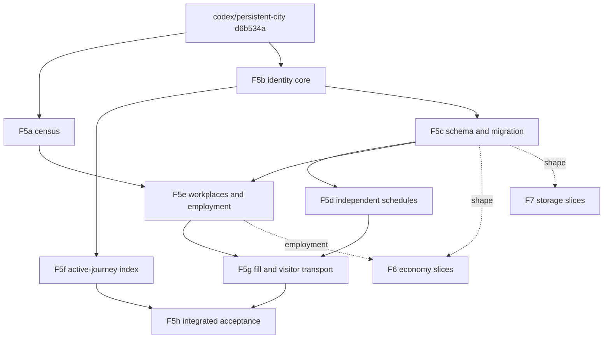

# F5: independent logical population

Planning record, 4 November 2026. Refs [#92](https://github.com/PeterHartwieg/big-ambitions-persistent-city/issues/92). **Docs only; no implementation change.** Base: `origin/codex/persistent-city` at `d6b534ac720ac7c573879a2c9ee981dbcdbbeed5` (writer **25**; E1–E5, the [city vision audit](../reviews/2026-11-03-city-vision-audit.md), F1 #99 and F3 #98 merged). The audit cites `00506ed`; every code claim below was re-read at `d6b534a` and cites that head. Persistent City is not live or released: a slice is **implemented** when it merges after review and **verified by rig** when its automated rig proof passes. Proposed types, fields, limits, formats and effort are designs, not existing APIs or measured results.

Peter approved F5 #92, F6 #93 and F7 #94 on 4 November 2026, 21:23 JST ("I like all changes, let's make it happen.") after a player-facing summary: F5 is a fuller city of real logical residents and visitors linked by households and workplaces, while visible bodies stay capped. This plan owns the **identity model** that the parallel [F6 economy plan](f6-economy.md) and [F7 save-snapshot plan](f7-save-snapshots.md) build on (their files are written on sibling branches; the links resolve once they merge). Section 3's *Contracts for F6 and F7* is the binding hand-off.

Fixed rules carried forward: Core stays pure C# / netstandard2.1 and Unity/game calls stay in Runtime; RLO stays behind Compatibility and is **not changed**; own state stays in the versioned `persistentcity:state_v1` key; stable IDs are reused and never renumbered; native inventory, orders, receipts and hourly/daily settlement keep sale authority; nothing is written to rival finances; the detached food shadow never books sales; a city without a saved food scope gains no economic effects. This plan creates **no second citizen simulator**: there is one scheduler, one event queue and one person record type.

## 1. Acceptance mapping

The seven acceptance items of #92, verbatim, are the plan's contract.

| # | Acceptance item (verbatim) | How the plan meets it |
| --- | --- | --- |
| A1 | Define resident/visitor/household/workplace identity and ownership contracts, including demand units. | Section 3 *Identity and ownership* defines `Person` (kind Resident/Visitor), `Household`, `Workplace`, `Employment`, wallet and demand-unit ownership; *Contracts for F6 and F7* maps them to B1–B6. Implemented as pure Core types and validators in **F5b**; persisted in **F5c**. Offline: ownership-validator tests (one wallet per person, one owner per meal intent, at most one active employment, no household wallet). Rig check **R4** reads the live ownership manifest. |
| A2 | Select a defensible population/capacity interpretation of the game world; neither 957 nor the 50,000 codec ceiling is automatically the target. | Section 3 *World capacity interpretation*: residents from exposed residential interiors (existing bands), workplaces from native interior area instead of the constant sixteen, visitors derived from the gap between workplace/attraction demand and resident supply. The target is **computed per city** from that census and reported, never a constant. **F5a** implements the read-only census and publishes the reference-city numbers; **F5e** uses the workplace capacity; **F5g** fills toward the derived target. Rig check **R4** compares census diagnostics with independent native reads. |
| A3 | Give independent people independent schedules, resources and transport opportunities without requiring native bodies. | Section 3 *Independent schedules, resources and transport*: every person runs its own routine in the existing `CitySimulator`, owns its wallet, and gets walking/subway access from its home or a visitor portal; no body is needed. **F5d** (schedules), **F5e** (employment), **F5g** (visitor arrivals/portals). Offline: per-person schedule independence, no anchor reads after the policy start day. Rig check **R3** follows two formerly anchored persons through one day. |
| A4 | Design migration preserving current consumer IDs or explicit stable mappings, balances, histories, receipts and outstanding journeys. | Section 3 *Migration from represented consumers* and section 5: every consumer ID becomes a `PersonId` **verbatim** (one-to-one, no renumbering), so receipt keys and intent IDs are unchanged; budgets, histories, memory, receipts, excursions and journeys copy exactly; legacy behaviour continues until a next-day policy start. **F5c**. Offline: exact predecessor equality, migrated-vs-unmigrated replay equality. Rig checks **R1**, **R2**, **R9**. |
| A5 | Prevent duplicate wages, wallets, consumption or native employment when integration is added. | Section 3 *Guards against duplication*: structural uniqueness (one budget per person, one owner per intent, one active employment, `NativeEmployment = None` invariant), validated on read, write and before every economic commit; F6 must attach wages to the `Employment` record, never to a second wallet. **F5b** validators, **F5c** codec checks, **F5e** employment guard. Rig checks **R4** and **R6**. |
| A6 | Verify conservation and determinism through interrupted migration/reload and different event budgets. | Section 3 *Conservation and determinism*: the F1 harness (`tools/accounting-backlog-regression`) gains a persons variant comparing the same logical day across 30/60/120 FPS, 16–128 citizen-event budgets and skip, with reload at every migration/legacy-to-independent step. **F5c**/**F5d** offline; rig checks **R2** (interrupted migration) and **R7** (event budgets/frame caps). |
| A7 | Measure state, throughput and frame costs at the declared population and presentation loads. | Section 6: bytes/records/retained memory, events per game hour, backlog and mod-work p95/max at the reference city's derived population and at 1,914 / 10,000 / 50,000 / 100,000-person stress sizes, with bodies at the default 48/24 caps. Every slice records its own numbers in `docs/perf/<slice>.md`; **F5h** is the integrated measurement. Rig check **R8**. |

Out of scope for this plan, owned elsewhere: wage amounts, attendance-linked pay, household money flows, service spending and rival availability (F6 #93); compact wire storage, background snapshots and save-pause bounds (F7 #94); one movement authority across detail levels and camera-outcome equivalence (F2 #89); the integrated 60 FPS gate definition (F4 #91); RLO decoupling (F8 #95); the portable acceptance entry point (F9 #96).

## 2. Current state at `d6b534a`

### Population, homes and work

- Population is created by `Population.CreateFromHousing` (`Core/Population.cs:64`, via `CreatePopulation` L68) inside `Task.Run` (`Runtime/PersistentCityMod.cs:537-543`) after `GamePlaces.Read()` on the main thread (L527). The first `min(target, 400)` residents are RLO donors with IDs `c<index>` (`Population.cs:87-95`; `Compatibility/RloIdentityAdapter.cs:258,292`); the rest get `pc:<sequence>` (`Core/ResidentLifecycle.cs:88`, `Population.cs:124,131`; `CityState.NextResidentSequence` starts at 1, `Core/Model.cs:284`). `pc:` residents copy one of the 400 donor appearance seeds (`ResidentLifecycle.cs:89,108`).
- Housing: `GamePlaces` reads `BuildingSizeData.squareMeters` per rentable/buyable interior (`Runtime/GamePlaces.cs:31-32,55-59`), treating one residential interior as one household (comment L53-54). `HousingPolicy.Capacity` bands are 0/1/2/4/5/7 occupants (`Core/HousingPolicy.cs:17-22`); the target is the integer floor of 90% of total capacity (L29); more than 50,000 refuses (`MaximumResidents`, L7, L31-32). The reference figures (335 interiors, 1,064 capacity, target **957**) are evidence in `README.md:113`, not a code constant.
- Work: every established business, school and retail address gets `BusinessAllocation = 16` (`GamePlaces.cs:15-16,68,92-97`), explicitly "simulation policy, not native staffing or customer capacity". Parks use `ParkAllocation = 64` (`Runtime/OutdoorPlaces.cs:22`). `GamePlaces` reads **no** native employee, workstation or capacity field; the only staffing-like reads are the food-supply reflections `availableProducers`/`pointOfSales`/`GetMaxCustomerCapacityThisHour` (`Runtime/FoodSupplyReader.cs:36-38`), limited to player-owned full-service shops.
- `CitizenState` (`Model.cs:209-245`) has `Identity`, `HomeId`, `DayPlaceId` (work or study), `ShopId`, `LeisureId`, `Car`, `Journey`, `RecentVisits`, `Traits` and employment bookkeeping; there is **no** household, visitor or employment record. Work windows follow persona templates (`Core/DailyRoutine.cs:148-153`: 08:30, Parent 07:45, NightOwl 12:00, 480 minutes, ±15-minute shift L338, three-day weekend L132). Employment changes are daily seeded draws at home (`ResidentLifecycle.cs:43-65`; `CityBalance.DailyJobLossChance = 0.001`, `DailyJobFindingChance = 0.10`, L8-9).
- Cars: at most one logical car per car-owning resident, ID `<residentId>:car` (`Core/TransportComposition.cs:89-101`); the traffic kernel keys vehicles by resident ID and refuses a second record (`Core/TrafficJourneys.cs:147-148`, `Core/TrafficKernel.cs:107-120`).
- Physical bodies: caps 48 pedestrians / 24 cars / 120 m (`Runtime/PrototypeSettings.cs:169-171`). `PhysicalPopulation` re-selects every 0.25 s by scanning **all** `State.Citizens` and sorting nearby candidates (`Runtime/PhysicalPopulation.cs:186-222`); leases make visible motion authoritative (`Core/PhysicalJourneys.cs:60-148`). This is roadmap hotspot #1 (historical p95 0.64 ms / max 21.7 ms).
- No `Visitor`, `Tourist`, `Household` grouping or `HouseholdId` exists in Core, Runtime, Compatibility or Persistence.

### Represented consumers

- `CityBalance.ConsumerRepresentationFactor = 2` (`Core/CityBalance.cs:7`) is applied only when a new city first gets food state (`PersistentCityMod.cs:600-601`); a saved city keeps its own factor, validated 1–3 (`Core/FoodRepresentation.cs:91-92`, `Persistence/SaveCodec.cs:888`).
- `FoodRepresentation.ConsumerId(anchor, slot)` is the anchor ID for slot 0 and `consumer:<escaped anchor>:<slot>` otherwise (`FoodRepresentation.cs:30-31`). `MealExcursion` is "One abstract walking meal visit. Never a citizen, body, car or traffic owner." (L44). The roster is `FoodCommerceState.Residents`, a `List<ResidentMeal>` of exactly `Citizens.Count × factor` (`Core/FoodCommerce.cs:106-125`; `SaveCodec.cs:889,966-968`).
- Each consumer owns its `ResidentMeal`, `RepresentedTraits` (null for slot 0), seeded tastes, `ResidentBudget`, `MealExcursion`, B1 `ConsumerMemory`, current-day outcomes, held decision and D2 external-food state (`FoodCommerce.cs:56-105,237-257`; `Core/FoodFinances.cs:70-75`). It shares the anchor's `FoodRoutineStop` (keyed by `AnchorId`, `FoodRepresentation.cs:34,67`), employment status (income source re-derived from the anchor each day, `Core/HouseholdFinance.cs:69-70,106-113`) and broad routine. Only slot 0 has a physical meal visit, recent visits and native walking-pace retiming (`FoodCommerce.cs:562`; `Core/RivalFood.cs:206-211`; `Core/TravelTiming.cs:222-225`).
- Wallets are **per consumer**: `HouseholdFinance.Create(..., meal.ResidentId)` seeds every draw by consumer ID (`HouseholdFinance.cs:41-60`), with an explicit "Individual budget unit, not an inferred family … No native job or family pooling inferred" (L7-10, L37). The doc at `FoodCommerce.cs:166-167` ("sharing one resident wallet") predates per-consumer budgets; F5b corrects that comment.
- Receipts are keyed by meal intent, `food:<escaped consumerId>:<kind>:<day>` (`Core/MealRhythm.cs:16-18`; `Persistence/FoodSaleReceipts.cs:15-18`).
- Anchoring is load-bearing in food decisions (`FoodCommerce.cs:276-568`, `FoodWeightedCommerce.cs:75-461`), finances (`FoodFinances.cs:100`), B1 memory and B2 regulars (`FoodMemoryCommerce.cs:42-143`, `RegularsProjection.cs:48-55`), D2 rival outflow (`RivalFood.cs:206-228`), C4 research rows (`MarketResearchEngine.cs:29-60`, `Represented` flag; no runtime snapshot producer exists), the inspector (`CitySimulator.cs:60-68`, `ResidentInsight.cs:139`), panels (`FoodMarketHistory.cs:103-128`, `Runtime/FoodEconomyPanel.cs:95-146`) and save scheduling (`CitySimulator.cs:201-207`). `Population.AppendResidents` can add citizens after food initialization without re-enrolling meal records (inference from `Population.cs:114-132` and `FoodRepresentation.cs:89-116`); F5 closes that gap.

### Boundaries and invariants that F5 must preserve

| Invariant | Current source | F5 obligation |
| --- | --- | --- |
| Native sale authority, whole-business ownership at hourly boundaries | `Runtime/NativeFoodOwnership.cs:225-309` (`Suppress`, `HourlyCustomers`, `CustomerSale`, `AfterNativeTick`); `Core/FoodAuthority.cs:44-55` (`Boundary` waits an observed hour) | Persons buy only through the existing checkout path; F5 adds no customer generation and no second sales path. |
| Duplicate-sale protection | `FoodSaleReceipts.cs:41-60` (`AlreadyPaid`, `Begin`, `Confirm`; pending/conflict never retried); `FoodCommerce.cs:298-318` | Intent IDs and receipt keys keep their exact strings across migration; no receipt is rewritten, re-keyed or replayed. |
| Exact money | `Core/FoodMoney.cs` (`Money`, checked 64-bit units, `TotalUnits` as `BigInteger`); `HouseholdFinance.CashConserved` (L99-104), checked at `SaveCodec.cs:1250` | Every budget migrates bit-exactly; per-person conservation and city-wide `BigInteger` totals are equal before and after migration. |
| F1 accounting boundary | `Core/AccountingClock.cs:6-81` (one native minute per epoch, `MaximumLagMinutes = 1`, `PopulationFrameBudget`); `CitySimulator.cs:172-217`; `Runtime/NativeCityClock.cs:34-129`; lost epoch stops with `persistentcity:accounting-stop_v1` (`Runtime/AccountingRecovery.cs:35-44`) | All new person events run inside the same epoch drain; `HistoricalClockMisses` (`FoodCommerce.cs:331-335`) must stay zero at the declared load in every harness arm. |
| F3 bounded units | `Core/FoodFinances.cs:76-107` (32 postings/unit, `BudgetQueue` heap ordered by ordinal ID); `Runtime/MultimodalRoutes.cs:288-295,382-390` (16 path admissions/frame); `CitySimulator.cs:315-320` (no inline escape) | New per-person work (postings, routine preparation, portal routes, census, migration publication) is split into bounded units with cursors; no new unbounded synchronous path. The single pending-route clock barrier (`CitySimulator.cs:21-23,319-320`) is kept. |
| Strict saves | `SaveCodec.Read` (L127-163: future schema preserved, 13–24 → exact 24 → 25); `SaveStore.cs:45-47`, `SaveSession.cs:89-97` (refused payloads preserved) | F5c adds one strict version with a frozen exact-25 predecessor; refusal keeps the original text. |
| RLO contract | `RloIdentityAdapter.MatchesPopulation` (L31-47), periodic check (`PersistentCityMod.cs:242-252`) | Source identities are untouched; new persons derive appearance from the existing donor catalogue as `pc:` residents do. |

## 3. Design

### Identity and ownership

One record type, **`Person`**, replaces "citizen plus K-1 represented consumers". At the wire and model level this is the existing `CitizenState` extended with a kind and relationships, not a parallel class hierarchy, so the scheduler, traffic, physical leases and inspector keep one population list.

| Entity | Identity | Owns | Relationships and rules |
| --- | --- | --- | --- |
| **Person** | `PersonId`: the existing opaque ordinal string. Residents keep `c<n>` / `pc:<n>`; migrated consumers keep `consumer:<anchor>:<slot>` **verbatim**; new visitors get `pv:<n>` from a new `NextVisitorSequence`. IDs are never reused after a person leaves. | One `ResidentBudget` wallet; one meal roster record (`ResidentMeal`, slot 0); traits, tastes, B1 memory; at most one logical car (residents only); its journey and visits. | `Kind ∈ {Resident, Visitor}`. A resident has exactly one `HouseholdId`. A visitor has no household and no home; it has a `VisitorStay`. At most one active `Employment`. |
| **Household** | `HouseholdId` `h:<homePlaceId>`, deterministic from the residential interior (one interior = one household, matching `GamePlaces.cs:53-54`). | **No wallet, no money.** | Members are the residents whose `HouseholdId` matches; `Count ≤ HousingPolicy.Capacity(area)`. Membership is stored once, on the person. |
| **Workplace** | The existing `Place.Id` of kind `Work` or `Study`, backed by a native registration/building at census time. | Capacity (section *World capacity*); no money. | Employment links reference it; a workplace removed from the catalogue ends its employments at the next safe home event (existing rule for vanished places). |
| **Employment** | `(PersonId, WorkplaceId, StartDay)`; at most one active per person. | Schedule template code and shift draw; `NativeEmployment = None` (fixed in F5). | Formalizes today's `DayPlaceId`. Study enrolment uses the same record with `Kind = Study`, which can never carry a wage. |
| **VisitorStay** | Part of the visitor's person record. | Origin portal ID, stay pattern (`Commuter`: recurring weekdays; `DayVisit`: bounded days), first day, optional last day. | A commuter visitor may hold one Employment. A day visitor never does. |
| **Demand unit** | A meal intent, `IntentId = food:<escaped PersonId>:<kind>:<day>` (unchanged formula). | Exactly one owning person. | Held purchase, receipt, outcome, memory update and outflow settlement all name that one person. Future F6 purchase intents for other goods follow the same rule: one person, one intent ID, one wallet. |

Rules, validated in Core (F5b) and in every codec read/write (F5c):

1. **Person ↔ wallet is a bijection.** Exactly one `ResidentBudget` per person when finances are on, zero otherwise; no budget exists without a person; no household, workplace or visitor stay can hold money.
2. **Person ↔ meal roster is a bijection.** `FoodCommerceState.Residents.Count == Persons.Count` and every record has `Slot = 0` and `AnchorId == ResidentId` after migration. The representation factor becomes a fixed literal 1 in the new schema (read-only legacy field for predecessors).
3. **Every demand unit has exactly one owner**, and that owner exists. No intent is copied into another person on migration, reload, household change or visitor departure.
4. **Ordering and draws are deterministic**: lists are sorted by ordinal `PersonId`; draws use `Hash(seed, PersonId, purpose, day)` as today; no draw depends on cadence, camera, body state or enumeration order.
5. **No native object references** in persisted state: places by saved place ID, portals by saved portal ID, never Unity objects or registration instances.

### World capacity interpretation

The population is computed from the loaded world, then reported; it is not a constant.

1. **Residents = housing supply.** Keep the existing reviewed policy: occupant bands from native `BuildingSizeData.squareMeters` and a 90% fill of total beds. That policy is already the defensible part of the model: it is based on the interiors the player can actually rent or buy, it bounds villas, and it produced the reference 957 from 1,064 beds. F5 adds households on top (one per occupied interior) instead of changing the fill.
2. **Workplaces = native interior area, not sixteen.** Replace `BusinessAllocation = 16` for `Work`/`Study` places with a band policy over the same native `BuildingSizeData.squareMeters` used for homes, read by `GamePlaces` for every business building (the field is already read for homes; reading it for businesses adds no new native member). Proposed provisional bands, to be calibrated by F5a's census: < 40 m² → 2, < 75 → 4, < 150 → 6, < 300 → 10, < 600 → 16, ≥ 600 → 24; schools use the same bands ×2 for students. F5a also inspects (read-only, ILSpy) whether a native per-business employee/workstation count is readable without side effects; if one is verified, it may replace the area band for businesses where it is known. **No native staffing member is assumed by this plan**; until verified, the area policy is the only input. Shop and leisure customer allocations keep their current values (they are attraction weights, not people).
3. **Visitors = the gap the housing cannot supply.** Big Ambitions exposes far fewer enterable homes than its streets imply, so the city must import people. Two flows, both derived from the census and bounded:
   - **Commuter visitors**: `max(0, round(WorkFill × WorkplaceCapacity) − ResidentWorkers)`, where `WorkFill = 0.8` (provisional) and `ResidentWorkers` counts residents of working persona with a workplace. They arrive weekday mornings at a portal and leave after work.
   - **Day visitors**: `round(LeisureVisitorShare × ResidentCount)` per day with `LeisureVisitorShare = 0.15` (provisional), weighted toward weekends and leisure/outdoor places (parks, pier, theatre/cinema, beach volumes already in the catalogue).
   - **Portals** are existing subway stations discovered by `RouteObjectDiscovery.Stations` (`Runtime/RouteObjectDiscovery.cs:66`), whose station source IDs are already tied to the reviewed game build (`README.md:124`). Road-edge portals for driving visitors are **not** part of this plan's default (see Q1).
4. **Consistency checks, not a count target.** F5a reports, per city: beds, residents, households, workplace capacity, resident workers, commuter visitors, day visitors, students vs study capacity, and the implied trips and meals per day. Acceptance is internal consistency (jobs filled ≤ capacity, households ≤ beds, visitors ≥ 0 and bounded, meal intents per person unchanged) rather than reaching any number. 957 stays the reference resident count; 50,000 stays only a codec ceiling.
5. **Declared population for measurement.** The F5a census on the reference rig city declares the measured load. Planning estimate, to be replaced by F5a's actual census: about 957 residents + 700–1,500 commuter visitors + 100–250 day visitors, i.e. **1,900–2,700 persons**, close to today's 1,914 consumers. The budget envelope for design and measurement is **≤ 5,000 persons** for the reference city; 10,000 is the stress size; 50,000 and 100,000 are scale/refusal probes.
6. **Hard bounds.** `Residents ≤ 50,000` (existing). `Persons ≤ 150,000` (equal to today's meal-roster cap `MaxCitizens × 3`, `SaveCodec.cs:344-346`, so every existing per-consumer B–E allocation still applies one-for-one). Visitors per city ≤ `Persons − Residents`. Commuter and day visitor counts are clamped to `min(derived, 2 × Residents, 100,000)`; a census above the bound refuses initialization with a diagnostic, never truncates silently.

### Independent schedules, resources and transport

- **One scheduler.** Every person is an ordinary entry in `CitySimulator`'s event queue. Residents keep their routine. Migrated former consumers and new visitors get routines from the same `DailyRoutine` planner, parameterized by kind: a visitor's day starts at its portal at the stay start and ends at the portal at the stay end, with home stays replaced by off-map time. No `MealExcursion` is created for new persons; the representation excursion path stays only to finish legacy excursions (below).
- **Own schedule inputs.** Shift draws, meal rhythm, shop/leisure choices and quiet hours are drawn per `PersonId`. Household members share their home location but not their schedule; F5 adds no shared household activities (no family outings).
- **Resources.** The person's wallet funds its own meals as today. Income source per person comes from its own employment (`ExternalEmployment` when it has a work Employment, `ExternalPension` for retirees, `ExternalSupport` otherwise), replacing the anchor lookup in `HouseholdFinance.cs:106-113`. Amount rules stay as today until F6.
- **Transport opportunities without bodies.** Residents keep walking/subway/car through the existing multimodal planner and traffic kernel. Visitors walk and ride the subway from their portal through the same planner, with portal-to-destination quotes reused across visitors through the existing bounded walking-quote cache idea (shared geometry/timing whose endpoints match, never shared choices or queue positions). Visitors own no car in F5 (Q1). All route requests go through F3 admission; commute preparation keeps its 8–14-hour lead and previous-duration reuse, so a visitor's recurring commute costs one search per changed route, not one per day.
- **Physical bodies are presentation only.** `PhysicalPopulation` selects from all persons (residents and visitors) whose journey is visible; caps, leases and release rules are unchanged. Identity, wallet, employment and demand never depend on whether a body exists. F5f replaces the all-persons 0.25 s scan with a maintained **active-journey candidate index** (persons currently travelling, queueing or outdoors, updated on phase change), so selection cost scales with active journeys, not with population. F5 does **not** change lease authority or movement rules; that is F2 #89.

### Migration from represented consumers

Migration runs once when a valid writer-25 city is read by the F5c binary. It is pure Core, detached, deterministic and interruptible: nothing is published until the migrated graph passes validation and the next coordinated save writes it; a crash, refusal or stop before that leaves the original writer-25 text unchanged and the next load repeats the identical migration.

1. **Slot 0 consumers** are already the residents: same ID, same `ResidentMeal`, same budget. They get `Kind = Resident`, `HouseholdId = h:<HomeId>` and an `Employment` copied from `DayPlaceId` (Study for students). Residents sharing a `HomeId` become one household; existing over-band legacy homes keep their members (no eviction) and are flagged.
2. **Slot k > 0 consumers** become persons with their **ID unchanged** (`consumer:<anchor>:<k>`), `Kind = Visitor`, `VisitorStay = Commuter` with a portal chosen by `Hash(seed, PersonId, "portal")` among stations ordered by ID. They never had homes, bodies or cars, and the housing bands are already 90% full, so they become the city's first commuter population instead of being squeezed into homes (Q4). Their wallet, traits (`RepresentedTraits` move to `Traits`), tastes, B1 memory, today's outcomes, held decision, D2 state and receipts move with them unchanged. Their identity (name, age, persona, appearance donor) is **derived**, not stored: `IdentityPolicy v1` draws from the existing donor catalogue by `Hash(seed, PersonId, …)`, exactly like `pc:` remixing, so migration adds no name strings and the derivation is stable forever under that policy version.
3. **Legacy mode until a next-day policy start.** Migration sets `IndependentPolicyStartsDay = floor(Minute / 1440) + 1` (E5d's `NamePolicyStartsDay` pattern). Until then, migrated persons keep the represented behaviour: they read their former anchor's routine stop (kept as `LegacyAnchorId`), and an in-flight `MealExcursion`, held purchase, uncertain receipt or rival settlement finishes under its captured terms. A migrated person switches to its own schedule at its first safe home-or-portal event on or after the start day **and** only once it has no unresolved excursion/receipt; until then it stays in legacy mode (bounded by the existing "outstanding returns must not accumulate" rule). `LegacyAnchorId` is cleared at the switch and is never used for identity.
4. **Employment for migrated visitors** starts empty; until one is assigned, a commuter visitor without work follows the visit-only pattern (shop, leisure and meals between portal arrival and departure). Its income basis keeps the last posted day's amounts (no rewrite of posted days); from the policy start day the person's own employment, assigned by the ordinary job-finding draw against remaining workplace capacity, decides income. This changes future income only, at a declared boundary, exactly like E5d's next-day policy changes.
5. **Nothing is inferred or replayed.** No historical purchase, visit, wage or memory is reconstructed; no budget is re-seeded; no ID is regenerated; the anchor's recent visits are not copied to the new person.
6. **Exactness checks before publish**: identical set of consumer IDs and person IDs; every budget field bit-equal; `CashConserved` per person; city-wide `Money.TotalUnits` of every ledger column equal; every receipt key resolvable to exactly one person; outstanding excursions/journeys/holds count-equal; D3a outflow ledger reconciliation (`SaveCodec.cs:1016-1021`) unchanged. Any mismatch refuses migration and preserves the source.

Factor-1 cities migrate with zero visitors; factor-3 cities migrate two visitors per resident. Cities without food state migrate residents/households/employment only.

### Guards against duplication

| Duplicate to prevent | Structural guard | Checked where |
| --- | --- | --- |
| Duplicate wallet | Bijection rule 1; `ResidentBudget` keyed by `PersonId`; codec refuses a second budget, an orphan budget or a household/visitor-stay money field. | F5b validator, F5c read/write, every commit that creates a person. |
| Duplicate consumption | Rule 3; `IntentId` derives from the owning `PersonId`; `FoodSaleReceipts.Begin` already refuses a non-missing status; migration copies, never forks, a held purchase. | Existing receipt path plus F5c migration equality and a test that a migrated person cannot start an intent its former anchor already owns. |
| Duplicate wage (for F6) | At most one active `Employment` per person; F6 must post wages **from the Employment record into the person's single wallet**, once per worked/posted day keyed by `(PersonId, day)`; no wage on Study records; visitors' wages enter the same wallet type. F5 stores no wage fields. | F5b validator; F6 implementation must use the key. |
| Duplicate native employment | `NativeEmployment` is a fixed `None` in F5's shape; any other value is refused on read until a later reviewed contract defines it. No F5 code calls native hiring or staff APIs. Source guard: a test asserts Runtime person code references no native employee/hiring member. | F5c codec, F5e source test, rig check R4 reads native staff lists unchanged. |
| Duplicate person (second simulator) | One `Citizens` list; meal roster bijection; `MealExcursion` creation refused for persons after their switch; the legacy excursion path accepts only legacy-mode persons. | F5c validator, F5d tests. |
| Duplicate car / traffic record | Existing kernel refusal (`TrafficKernel.cs:110`); visitors own no car. | Existing tests plus F5d visitor-car refusal test. |

### Conservation and determinism

Extend the F1 harness (`tools/accounting-backlog-regression`, `AccountingScenario.Run(residents, fps, eventBudget, milliseconds, reload, stallFrames, skip, coordinated)`) with a persons dimension. Each F5 slice that changes behaviour proves, offline:

- **Migration equality**: a writer-25 city replayed for N days without migration and the same city migrated at day 0 produce identical orders, receipts, wallets and outflow until `IndependentPolicyStartsDay` (legacy mode is behaviour-preserving). Full `SaveCodec.Write` strings are compared after projecting the new fields away.
- **Interrupted migration**: stop after migration but before save, reload the original, migrate again → identical migrated state; stop at every unit boundary of the bounded publication → identical; a failed validation leaves the source text byte-equal.
- **Event budgets and cadence**: the same logical day at (30 FPS, 32 citizen events, 4 ms), (60, 16, 2), (120, 128, 2) and hidden skip, with and without reload at the policy start day, produces identical final saves and order lists; `HistoricalClockMisses == 0` and `MaxLag ≤ 1` in each arm.
- **Conservation**: per-person `CashConserved`; city-wide `BigInteger` totals of opening + income = balances + essentials + home food + prepared food + external food + held, before/after migration, across the switch day and at every reload checkpoint; person count, household membership and employment count change only through logged lifecycle events.
- **Ordering independence**: shuffled input enumeration, catalogue order and camera/body state produce identical state.

### Contracts for F6 and F7

This is the identity/ownership contract F6 #93 and F7 #94 should rely on, mapped to the shared baseline.

| Baseline | Verdict | Final contract |
| --- | --- | --- |
| **B1** one logical Person per independent consumer, stable `PersonId`, consumer IDs preserved or mapped one-to-one | **Confirmed, sharpened** | `PersonId` is the existing opaque ordinal string. Migration maps every consumer ID to the identical `PersonId` (identity mapping, no table). Formats: `c<n>`, `pc:<n>`, legacy `consumer:<escaped anchor>:<slot>`, new `pv:<n>`. Consumers must treat the string as opaque and never parse an anchor from it. IDs are never reused. |
| **B2** kind Resident/Visitor; residents in exactly one Household with a home; visitors with origin/stay window, no home | **Confirmed, amended** | Visitors have `VisitorStay {OriginPortalId, Pattern ∈ {Commuter, DayVisit}, FirstDay, LastDay?}`. A **Commuter** stay recurs on weekdays and has no last day unless the person leaves; a **DayVisit** stay is bounded. Commuter visitors may hold one Employment. `HouseholdId = h:<homePlaceId>`. |
| **B3** employment Person → Workplace with its own schedule; at most one wage source; no duplicate wallets or native employment | **Confirmed** | `Employment {PersonId, WorkplaceId (Place.Id of kind Work/Study), Kind ∈ {Work, Study}, StartDay, ScheduleCode, ShiftDraw, NativeEmployment = None}`, at most one active per person. F5 assigns, ends and validates it; **F6 owns wages and attendance linkage** and must key any wage posting by `(PersonId, day)` into the person's wallet. Study never carries a wage. |
| **B4** money in exactly one owner per unit (person or household wallet, decided by F5); every demand unit has exactly one owning Person | **Decided: person wallet** | Money lives only in `ResidentBudget`, one per person. Households, workplaces and visitor stays hold no money. Any F6 household-level flow (shared rent, transfers) must be explicit exact transfers between member wallets with both sides recorded and `CashConserved` preserved, never a pooled household balance. Every demand unit (meal intent today, F6 purchase intents later) is keyed by one `PersonId`. |
| **B5** bodies are a capped presentation resource selected from logical people | **Confirmed** | Selection reads the F5f active-journey index of persons; caps stay 48/24/120 m. No identity, money, employment or demand fact depends on a body. F2 owns movement authority. |
| **B6** mod-owned, deterministic, no native object references; RLO stays an identity/appearance source behind Compatibility, unchanged | **Confirmed, extended** | Lists are ordinal-by-`PersonId`; draws are `Hash(seed, PersonId, purpose, day)`. Visitor and migrated-consumer identities are **derived** from `(seed, PersonId, IdentityPolicyVersion)` and the existing donor catalogue, not stored; F7 must not persist or compact them as data and must keep the policy version. RLO source identities and `MatchesPopulation` are unchanged. |

#### Differences from the shared baseline

- **B2**: visitors are not only short stays; commuter visitors recur and can be employed. Reason: the game exposes too few enterable homes for its workplaces, and the existing represented consumers (who have wallets and daily meals but no homes) map naturally onto commuters.
- **B4**: the choice is made: person wallets only, no household wallet. Reason: the existing ledger is already per consumer and exact; a household wallet would need a lossy merge of existing balances at migration.
- **B6**: derived visitor identity is an explicit part of the contract. Reason: it keeps migration from adding about 100 name/age/appearance characters per migrated person and keeps F7's compact store from inventing identity fields.

For **F7** specifically: persisted F5 facts are the person kind, the saved `HomeId` from which `HouseholdId` is derived, `VisitorStay`, `Employment`, `NextVisitorSequence`, `IndependentPolicyStartsDay` and the legacy flag/`LegacyAnchorId` while present. F7 may intern `PersonId` strings to dense indices in its wire format only with an exact one-to-one table that round-trips the strings and keeps ordinal order; it must snapshot person, wallet, employment and receipt state at the same epoch as native finances. For **F6** specifically: income source selection is per person after the policy start day; F6 may change amounts and attendance rules but not the ownership rules above.

## 4. Slice breakdown

Effort is focused engineer-days including offline proof and review fixes, excluding rig infrastructure and scheduling. Each row is one PR from updated `codex/persistent-city` once its named prerequisites land; nothing stacks on an unmerged pile. Each slice records `docs/checks/<slice>.md`, `docs/perf/<slice>.md` and one index line each, and lists its numbered rig checks from section 7. Behaviour-changing slices need a `rig_test` session (Codex Sol, high) with before → red / after → green proof attached to the PR before merge/upload; offline success is not native proof.

| Slice / scope | Effort | Offline/headless tests | Perf measurement | Schema | Dependencies / branching |
| --- | --- | --- | --- | --- | --- |
| **F5a — world census (read-only).** Runtime reads business `BuildingSizeData.squareMeters` beside the existing home read and station IDs from `RouteObjectDiscovery.Stations`; pure Core `PopulationCensus` computes beds, households, workplace capacity (area bands), resident workers, commuter/day-visitor counts and implied trips/meals; console diagnostic `pc population census`. Read-only ILSpy inspection of any native per-business staff/workstation count, recorded as verified or absent. No behaviour, no save, no change to `BusinessAllocation` yet. | 2 | Census arithmetic on fixed fixtures (empty, homes only, no stations, over-bound refusal, ordering permutations); band edges; consistency rules (jobs filled ≤ capacity, households ≤ beds); source guard that the reader calls no native mutator. Publishes the reference-city census from a captured rig place list. | Census build time and allocation at the reference place count and 20,000 places; runs once per load off the frame; zero frame work. | None | **Slice 1.** Independent of every other plan; can merge first. |
| **F5b — identity and ownership core (inactive).** Pure Core `PersonKind`, `VisitorStay`, `Employment`, derived `HouseholdId`, `IdentityPolicy v1` (derived visitor identity), ownership validator (rules 1–5, duplication guards), per-person income-source selection function. Fix the stale `FoodCommerce.cs:166-167` comment. Not wired to the simulator or codec. | 3 | Validator red cases for each duplicate (second budget, orphan budget, intent with two owners, two active employments, wage-bearing Study, `NativeEmployment ≠ None`, household money); derived-identity golden vectors stable across platforms and orders; `PersonId` formats and ordinal ordering. | Validator cost at 1,914 / 10,000 / 100,000 persons (one pass, no per-person allocation); derived identity cost per lookup. | None | Sibling of F5a over the base. |
| **F5c — schema and migration (behaviour-preserving).** Freeze an exact writer-25 predecessor (`PopulationSchema25*`), add the next-free schema with person kind/stay/employment/legacy fields and the factor-1 roster rule, migration 25 → new (section 3), strict reader/refusal, bounded migration publication with a cursor, `IndependentPolicyStartsDay`. Migrated persons stay in legacy mode, so city behaviour is unchanged. Inspector shows kind/household/workplace words. | 5–7 | Exact predecessor bytes and both counters; bit-exact budgets, `BigInteger` ledger totals, receipt key set, outstanding excursions/holds/receipts; migration-vs-no-migration replay equality through the legacy period at 30/60/120 FPS, skip and reload (F1 harness persons arm); interrupted migration at every publication unit; future/unknown/duplicate/over-bound refusal preserving source text; factor 1/2/3 and no-food cities. | Bytes/records/retained memory/read/write/migration latency on the E5d matrix (957/5,000/50,000 × K2/K3, CF32, CF64) against section 5's budgets; ordinary-play gate; save timing separate. | **Yes — one next-free version** | After F5b. Must merge **before** F6/F7 schema slices (section 5). |
| **F5d — independent schedules.** At `IndependentPolicyStartsDay`, persons switch at their first safe home/portal event with no unresolved excursion/receipt; visitor portal arrival/departure routines in `DailyRoutine`; per-person routine stops, meal rhythm and income source; the legacy excursion path accepts only legacy persons; anchor reads removed from food/finance paths after the switch; food enrolment for persons created later (closes the `AppendResidents` gap). | 4–6 | Switch timing with in-flight excursion, uncertain receipt, rival settlement and held decision; no anchor read after the switch (spy); per-person schedule independence across seeds; cadence/budget/skip/reload equality (F1 harness); conservation across the switch day; unreachable portal waits/retries without success; no visitor car or traffic record. | Events per game hour and peak due-queue length at reference / 10,000; planning admissions and route backlog (`road-ceiling-regression` throughput variant); posting units (`bounded-bulk-regression` at 1,914/10,000/100,000 persons); mod-work p95/max. | None (uses F5c shape) | After F5c. Sibling of F5e/F5f. |
| **F5e — workplace capacity and employment.** Replace `BusinessAllocation = 16` for Work/Study with F5a's area bands (or a verified native count); `Employment` records assigned/ended by the existing daily draws per person; commuter visitors compete for remaining capacity; Study carries no wage; native-employment source guard. | 3–4 | Capacity never exceeded under churn/reload; one active employment; loss/find rates per person unchanged in distribution; deterministic resident/visitor fill order; vanished places; no native staff API referenced (source test). | Job-finding shortlist cost (two probes) at 10,000 persons; capacity bookkeeping allocation; gate. | None (uses F5c shape) | After F5a + F5c. Sibling of F5d; composes with F5d for income selection. |
| **F5f — active-journey candidate index.** Maintain the set of persons travelling/queueing/outdoors on phase change; `PhysicalPopulation` selection iterates that set instead of all citizens; visitors eligible; caps, leases and `SelectionCandidate.ByPriority` order unchanged. Takes the selection-scan part of parked hotspot #1; spatial indexing and movement authority stay with F2. | 2–3 | Index equals a full scan after every event, reload, pool release and skip (shadow comparison); identical selected set and order vs the old scan at matched states; no identity/economy effect. | Selection p95/max and allocation at 1,914 / 10,000 / 50,000 persons with 0/100/1,000 active journeys; before/after vs the full scan. | None | After F5b (kind field); can land before F5c using residents. Independent of F6/F7. |
| **F5g — population fill and visitor transport.** Create commuter/day visitors toward the F5a census at day boundaries in bounded units (≤ 64 persons/unit), enrol their food/budget records, portal routes via the shared quote cache, day-visitor stays and departures; no person is retired while it owns an unresolved intent or journey; departures end stays, not identities. | 3–4 | Fill converges to the census without overshoot; deterministic creation order and IDs (`pv:<n>`); departure with an outstanding receipt/hold blocked; wallet created exactly once; a catalogue change moves the target only at the next day. | Creation unit cost, portal quote cache hits/misses, route admissions at the declared load, full-day throughput at 10,000 persons. | None | After F5d + F5e. |
| **F5h — integrated acceptance and measurement.** Declared-load and stress runs of F5a–F5g together; final perf report; inspector/panel wording for persons, households, workplaces and visitors (words, no new statistics). | 2 | Full F1-harness matrix at the declared load and 10,000 persons; multi-day conservation; migration from the reference writer-25 fixture through the switch and seven days. | Section 6 matrix complete; mod-work p95/max; whole-frame tracked separately. | None | After F5d–F5g. |

Parallelism: F5a ∥ F5b first; F5f can follow F5b at once; F5c after F5b; then F5d ∥ F5e; F5g after both; F5h last. F6's wage/household slices wait for F5c (shape) and F5e (employment records). F7's storage slices wait for F5c (shape); F7 measurement work without a schema can start on the base immediately.

## 5. Save schema and migration impact

Writer 25 (`Core/Model.cs:256`, `SaveCodec.cs:127-163`) is the predecessor. **Only F5c needs a schema**; F5a, F5b and F5d–F5h reuse its shape. F5c freezes the complete F5 shape (kind, stay, employment, legacy fields, sequences, policy start day) in one version so later F5 slices never bump it.

**Shape.** Per person, a fixed versioned tuple rather than nested objects:

- Resident addition: kind code plus employment tuple (`WorkplaceId` as an index into the existing ordinal-sorted saved `Places` table, kind, start day, schedule code), ≤ **64 ASCII characters** including field overhead. `HouseholdId` is derived from the saved `HomeId`; nothing is stored for it.
- Visitor (including migrated consumers): a compact `CitizenState` with identity omitted (derived), kind, `VisitorStay` (portal index, pattern, first/last day), employment tuple, legacy flag and `LegacyAnchorId` while present, and phase/activity/place/destination; ≤ **256 ASCII characters** when off-map or idle. An active journey charges the existing route/leg rows exactly as a resident's does. Visitors keep **no** `RecentVisits` list (their visits are in the existing meal outcomes, memory and receipts), so the 64-visit allowance is not multiplied.
- Root: `NextVisitorSequence`, `IndependentPolicyStartsDay`, census policy version and `IdentityPolicyVersion`, ≤ 256 characters. Stations are referenced by index into a saved ordinal station table (≤ 256 entries × ≤ 128 characters).
- Records: each person tuple charges **one** embedded record (B0's fixed-tuple counting rule); there is no new variable-length per-person list.

**Migration shape (A2/E5d style).** Valid `13–24 → exact 24 → 25 → new`. The writer-25 source passes its own shape, capability, count, identity and money checks first; migration builds a detached graph; validation (section 3 *exactness checks*) and both size counters pass before `Read` returns success; publication happens only at the next coordinated native/own save. Refused and preserved: future versions, unknown/duplicate/missing fields, wrong tuple arity/alphabet, unknown kind/pattern/`NativeEmployment` codes, bad indices, duplicate `PersonId`, orphan budgets, intents without owners and over-bound counts. The store keeps the original text and reference (`SaveStore.cs:45-47`, `SaveSession.cs:89-97`); refusal never releases managed businesses to overlapping native sales. Old binaries refuse the new version as future; downgrade is unsupported.

**Byte and record budget against the codec caps** (268,435,456 characters, 4,000,000 records; bases measured in [`docs/perf/e5d-name-identity-save.md`](../perf/e5d-name-identity-save.md)). These are arithmetic ceilings, to be replaced by F5c measurements:

| Composition (writer-25 base) | Persons after migration | Added characters (≤) | Result against the cap |
| --- | --- | ---: | --- |
| 957×2, 17,751,674 B | 957 residents + 957 visitors | 306,240 | ≈ 18.06 M, 6.7% |
| 5,000×2, 30,319,583 B | 10,000 | 1,600,000 | ≈ 31.9 M, 11.9% |
| 50,000×2, 162,346,836 B | 100,000 | 16,000,000 | ≈ 178.3 M, 66.4%; +100,000 records |
| 50,000×3, 196,758,738 B | 150,000 | 28,800,000 | ≈ 225.6 M, **84.0%** (inside the 85% target) |
| CF32 budgeted, 223,716,156 B | 150,000 | 28,800,000 | ≈ 252.5 M, 94.1%: **below the hard cap, above the 85% target** |
| CF64 budgeted, 262,116,156 B | 150,000 | 28,800,000 | ≈ 290.9 M: **exceeds the hard cap → refused, source preserved** |

Records: one per person tuple adds 150,000, so CF32 2,119,712 + 150,000 ≈ 2.27 M and CF64 3,719,712 + 150,000 ≈ 3.87 M both stay below 4,000,000. The CF64 character overflow is a known refusal composition (a synthetic 50,000-resident, factor-3, 64-visit, full-history city that no rig fixture or player save has produced). F5c records it as a refusal case and does **not** lower the 64-visit acceptance or the factor-3 limit for old saves. Restoring CF64 and the CF32 85% target at 150,000 persons is **F7's** compact-storage scope. Retained memory budget: ≤ 1 KiB managed memory per migrated visitor (≈ +98 MiB at 100,000 visitors over E5d's 421.4 MiB for 50,000×3), measured, not assumed.

**Bounds and refusal above bounds.** Persons ≤ 150,000; residents ≤ 50,000; visitors ≤ 100,000; stations ≤ 256; one active employment per person. A census above these bounds refuses initialization; a payload above them refuses reading. Nothing is truncated.

**Order relative to F6 and F7.** Schema numbers are allocated in merge order at implementation time. Required order: **F5c first**, because F6 and F7 key their state by `PersonId` and `Employment`. F6's wage/household-flow fields take the next free version after F5c; F7's compact wire takes the next free version after F5c (before or after F6, whichever is ready). The three changes should **not** be combined into one version: each has its own owner, migration and refusal fixtures, and F5c must land behaviour-preserving before F6 changes money flows. A combined bump is acceptable only if two shapes freeze in the same PR under one owner, which this plan does not recommend. F7 may later re-encode F5's tuples (for example dense person indices) under its own version with an exact mapping; F5c deliberately stays a simple strict format and is **not** a serializer rewrite.

## 6. Performance

Gates (roadmap, Peter 30 October): **mod-work p95 < 5 ms**; flag every single mod-work spike **≥ 30 ms** with count, condition and component; whole-frame timing and stalls are tracked separately and never substituted for mod-work. Every F5 slice re-measures. New code adds **no per-frame reflection, no per-frame population scans and no per-frame allocations**; per-person work runs in bounded event units under the F1 `PopulationFrameBudget` (`Core/AccountingClock.cs:65-81`) and F3 admission.

| Cost centre | Reference (≈ 1,914–2,700 persons) | Stress sizes | Expectation and how it is measured |
| --- | --- | --- | --- |
| Budget postings (F3 units) | Same count as today's 1,914 consumers after migration | 10,000 / 100,000 persons via `tools/bounded-bulk-regression` and the audit `StepBudget` fixture (`docs/reviews/assets/2026-11-03-city-vision-audit/`) | Postings are per wallet and wallets map one-for-one, so F3's p95 0.0208/0.0229/0.0111 ms at 1,914/10,000/100,000 should hold; F5d re-measures with per-person income selection. |
| Citizen events | Former consumers gain full routines: roughly 2× today's resident activity events at K=2 | 10,000 / 50,000 persons in the F1 harness | `HistoricalClockMisses == 0`, lag ≤ 1 minute, no unreported demand loss at 30/60/120 FPS. 50,000 and 100,000 are throughput probes: if they cannot keep pace, the result is recorded as a refusal envelope, never hidden by slowing the calendar. |
| Route planning | Visitor commutes reuse previous durations and shared portal quotes | 10,000 persons, `road-ceiling-regression` peak-planning variant | Admissions stay ≤ 16 paths/frame; report planning backlog drain time; native `NavMesh.CalculatePath` tails flagged individually. |
| Physical selection | Scan set doubles if unchanged | 1,914 / 10,000 / 50,000 persons with 0–1,000 active journeys | F5f makes cost proportional to active journeys; before/after against the old scan. Historical hotspot #1 p95 0.64 ms / max 21.7 ms is the comparison point. |
| Census, migration, fill | Load time / day boundary only | 20,000 places; 100,000-person migration | Census off the frame; migration publication and fill in bounded units; startup/migration/reload latency reported separately from gameplay windows. |
| Saved state | +306 K characters on 957×2 | Section 5 table | Bytes, both record counters, retained memory, offline read/write time. In-game save pauses are not part of ordinary-play windows. |

Declared presentation load: default caps 48 pedestrians / 24 cars / 120 m, measured on a dense street with a moving camera. Bodies stay capped, so the larger population must not raise body counts.

Parked hotspots: F5 **takes on only the candidate-selection scan of physical population (hotspot #1)**, via F5f, because F5 enlarges the scanned set. Spatial indexes, body acquisition and movement authority stay with F2 #89. Closure refresh and optional-stop refresh stay parked. **Save serialization stays parked here and is owned by F7 #94**; F5c adds compact tuples but no serializer redesign.

## 7. In-game checks for the batched rig

Every check below is executed by the headless agent rig, repository [PeterHartwieg/big-ambitions-agent-rig](https://github.com/PeterHartwieg/big-ambitions-agent-rig) (owned by the Coding Projects bot, read-only for this plan; capabilities read at `25aecb0f7fe7b130a8a290df8e613abfebf35501`). The existing capabilities named below are built and offline-tested but **unverified in game**, so **RIG-LIVE** is an infrastructure prerequisite of every check, not evidence. Fixtures are built in game by the rig in named disposable FT cities; the rig supports only the installed game build. The rig records autosave, disables it in the isolated profile, verifies it before every measured window (including after reload) and restores it during cleanup; explicit saves stay outside measured windows. PC diagnostics read through FT `console` — `pc population census`; `pc population manifest` (sorted person/kind/household/employment/wallet/intent/receipt facts with counts, exact `BigInteger` ledger totals and a hash); `pc population person <id>`; `pc state hash` (hash of the saved key text) — are implementation work in the owning slices, not existing capabilities.

1. **R1 — Migration of a pre-F5 city (F5c).** The rig loads `pc-schema-25-ref@1` (reference city, factor 2, with an in-flight meal excursion, a held purchase and an uncertain receipt) with the pre-F5 build and records the manifest, then loads the same fixture with the F5c build. Asserts: every former consumer ID present exactly once as a `PersonId`; 957 residents + 957 visitors; all budgets and `BigInteger` ledger totals equal; receipt key set equal; excursion/hold/receipt counts equal; native money and `shop_state` unchanged; save/reload gives the same manifest hash. **rig-automated (existing capability: fixture library `--fixture`, RIG-MODSET, `rig flow run`, FT `state`/`save`/`load`/`console`, `shop_state`; pending rig capability: RIG-PCFIX, RIG-LIVE).**
2. **R2 — Interrupted migration and source preservation (F5c).** The rig loads the writer-25 fixture with the F5c build, waits for the PC log line that migration finished in memory, hard-stops the player before any save, relaunches, and reads `pc state hash` (must equal the original writer-25 text hash) and the manifest after the repeated migration (must equal R1's). A second run stops in the middle of the bounded publication. **rig-automated (existing capability: `rig flow run`, FT `console`/`load`; pending rig capability: RIG-ABORT, RIG-PCFIX, RIG-LIVE).**
3. **R3 — Independent schedules (F5d).** From R1's migrated save, the rig advances past `IndependentPolicyStartsDay` and follows one former anchor and its former slot-1 consumer through a working day: `pc population person` at each phase change, `camera follow` and `capture` while either is visible. Asserts different departure times and places, the visitor arriving and leaving through its portal station, zero anchor reads (PC counter), and identical identity/wallet facts with and without an attached body. **rig-automated (existing capability: FT `time`/`console`, RIG-VIEW `camera`/`screen_pos`/`capture`; pending rig capability: RIG-LIVE).**
4. **R4 — Households, workplaces and no native employment (F5a/F5e).** In a fresh FT city with one `shop_fixture` business with real staff, the rig reads `pc population census` and compares business areas, station count and home interiors with independent native reads (`shop_state.location` square metres and read-only `console` building reads), then asserts household sizes ≤ band capacity, workplace occupancy ≤ capacity, visitors with a portal and no home, one active employment per person, and the fixture shop's native staff list unchanged over three days. **rig-automated (existing capability: `shop_fixture`, `shop_state`, FT `time`/`console`; pending rig capability: RIG-LIVE).**
5. **R5 — Bodies stay capped and presentation-only (F5f).** At the declared load, the rig moves the camera through a dense street and a quiet district with `camera look_at`, sampling `screen_pos list` and PC body counters. Asserts pedestrians ≤ 48, cars ≤ 24, visitors among bodies, no identity or wallet change on acquire/release, and zero index-vs-scan shadow mismatches (PC diagnostic). **rig-automated (existing capability: RIG-VIEW `camera`/`screen_pos`/`capture`, FT `console`; pending rig capability: RIG-LIVE).**
6. **R6 — Native sale authority and duplicate protection with persons (F5c/F5d).** With a managed `shop_fixture` food shop, the rig records `shop_log` purchases and PC receipts across an accounting hour, a midnight settlement, and a save/reload taken while a visitor's checkout is pending. Asserts one native order per paid intent, one owner per intent, no duplicate or replayed sale, exact wallet debits, and native daily revenue equal to PC confirmed receipts. **rig-automated (existing capability: `shop_fixture`, `shop_log`, `shop_state`, FT `save`/`load`/`time`/`console`; pending rig capability: RIG-LIVE).**
7. **R7 — Different event budgets and frame caps (F5d/F5h).** The same checkpoint runs one logical day per arm: PC event-budget override at its minimum and maximum (developer config) and frame caps 30/60/120. Asserts identical end-of-day manifest hashes, `HistoricalClockMisses == 0` and lag ≤ 1 minute in every arm. **rig-automated (existing capability: `rig flow run`, FT `time`/`console`; pending rig capability: RIG-PCCONFIG, RIG-FRAMECAP, RIG-LIVE).**
8. **R8 — Performance at declared and stress loads (F5h; each slice runs its subset).** Interleaved baseline (pre-F5 build) and F5 windows at idle, morning commute, lunch and evening, with stationary and moving camera and the Ctrl+F8 panel closed/open, on the reference fixture and the rig-built 10,000-person stress city. Records mod-work p50/p95/max, components (events, postings, planning admissions, selection), allocations, lag and whole-frame metrics separately; asserts p95 < 5 ms and flags every ≥ 30 ms spike. **rig-automated (existing capability: `rig flow run` autosave guard, RIG-MODSET, FT `state`/`time`/`console`/`shoot`, RIG-VIEW `camera`; pending rig capability: RIG-PCFIX (stress fixture), RIG-LIVE).**
9. **R9 — Future-version refusal and recovery (F5c).** The rig saves the migrated city with the F5c build and loads it with the pre-F5 build, which must refuse it as future, leave `pc state hash` unchanged and keep managed businesses safe under the existing refusal path; it then reloads with the F5c build and asserts the manifest equals the saved one. **rig-automated (existing capability: RIG-MODSET, fixture library, FT `save`/`load`/`console`; pending rig capability: RIG-LIVE).**

### Rig capability requests for Coding Projects

- **RIG-PCFIX** — Produce and seal Persistent City fixtures in game with a pinned **pre-F5** PC build through RIG-MODSET: `pc-schema-25-ref@1` (reference city, factor 2, with an in-flight excursion, a held purchase and an uncertain receipt captured during a scripted meal hour) and `pc-stress-10k@1` (10,000-person stress city made with the pinned build's supported population setting). Extends the fixture library's one-off provenance (`city-50k@1`, `pc-schema-N@1`). Unblocks R1, R2 and R8.
- **RIG-ABORT** — Hard-stop the isolated player inside a flow when a named PC log line appears (or at a step), relaunch in the same flow with the same fixture and mod set, and keep evidence and cleanup. Unblocks R2.
- **RIG-PCCONFIG** — Generalize the E5-7 `metadata_config` staging to reviewed top-level Persistent City developer keys (event-budget override, census report), with byte backup/restore and receipt hashing. Unblocks R7.
- **RIG-FRAMECAP** — Set and verify the isolated profile's frame cap/vsync per flow (30/60/120) and restore it. Unblocks R7.
- **RIG-LIVE** — First live verification of the existing rig-ops, flows, fixture library, RIG-MODSET and RIG-VIEW on the PC. Unblocks R1–R9.

No check is deferred to Peter, a playtest, an unlocked console or a by-hand visual check; a check the rig cannot yet run waits on its named capability.

## 8. Dependencies on the other plans

| Plan | F5 needs | F5 provides | Assumed contract |
| --- | --- | --- | --- |
| **F1 #88** (merged) | Minute-epoch drain, `PopulationFrameBudget`, lost-epoch stop, cadence harness. | A persons dimension in the harness; more events under the same budget. | All person events drain before the epoch closes; zero `HistoricalClockMisses` at the declared load. |
| **F2 #89** | Nothing to start; F5f must not change lease authority. | An active-journey index F2 can reuse for spatial presentation. | F2 owns movement authority and camera-outcome equivalence; F5 guarantees only that identity and ownership never depend on bodies. |
| **F3 #90** (merged) | 32-posting units, path admission, no inline escape. | Bounded census, migration and fill units. | Per-person work never bypasses admission or units. |
| **F4 #91** | The integrated gate definition. | Declared population, body caps and stress fixtures as gate inputs. | F5 reports mod-work and whole-frame separately until F4 replaces the headline gate. |
| **F5 #92** (this plan) | — | The identity model in section 3. | — |
| **F6 #93** | Nothing to start; F6's wage and household-flow decisions do not block F5. | `Person`, `Employment`, person wallets and per-person income-source selection (F5c/F5d/F5e). | Section 3 *Contracts*: wages keyed `(PersonId, day)` into the single wallet; household flows as exact member-wallet transfers; F6 schema after F5c. |
| **F7 #94** | Compact storage to restore CF64 and the CF32 85% target at 150,000 persons. | The frozen F5c shape, the derived-identity rule and person/employment/receipt epoch facts. | F7 re-encodes F5 tuples with an exact one-to-one mapping; F7 schema after F5c; same-epoch snapshots only. |
| **F8 #95** | None. | No new RLO dependency beyond donor appearance for derived identities. | RLO unchanged. |
| **F9 #96** | Optional portable acceptance entry point. | Census/manifest diagnostics and the F1-harness persons arm. | — |

## 9. Questions for Peter

Player-facing only; none blocks the plan. Slices implement the recommended default unless Peter chooses otherwise.

1. **Should commuting visitors drive?** Default: **no, they come by subway and walk** (busier pavements, unchanged car traffic). Other option: some visitors drive in, which adds road congestion and edge-of-city virtual parking, plus a traffic and performance cost (an extra road-portal slice).
2. **How crowded should homes be?** Default: **keep today's home sizes and 90% fill**; the city grows through visitors. Other option: more people per apartment, giving more residents and households but tighter homes.
3. **What happens to today's extra customers in existing cities?** Default: **they become commuting visitors** with the same money and memories. Other option: move as many as fit into spare beds as residents first; fewer visitors, but homes fill up.
4. **How many weekend day visitors?** Default: **about 15% of the resident count per day, mostly at weekends around parks and leisure**. Other option: more, making weekends busier for shops near leisure spots, or none, for a residents-and-commuters city.
5. **Should visitors be clickable in the inspector?** Default: **yes, shown as "visiting from <station>" with their workplace or plans**. Other option: residents only, with visitors as unnamed street presence.

## 10. Risks and refusals

| Risk | How it fails safe |
| --- | --- |
| Migration mismatch (money, receipt, excursion) | Validation refuses before publication; the writer-25 text is preserved; the city stays refused rather than partly migrated. |
| Doubled routines exceed the event budget at stress sizes | F1 backpressure holds native time; lag and pacing are visible; sizes that cannot keep pace become a documented refusal envelope; demand is never dropped to catch up. |
| Census changes after a map or game update | Census runs at load; a changed station/building set moves targets only at the next day; missing stations leave visitors at zero rather than inventing portals. |
| Workplace area bands give implausible staffing | Bands are provisional policy with evidence strings; a verified native staff count can replace them; capacity never creates native staff. |
| Legacy mode lingers (unresolved excursion/receipt) | Existing isolation and reporting rules apply; the person stays in legacy mode until resolved; no forced switch or write-off. |
| CF64 composition exceeds the character cap | Refused and preserved; recorded as a known refusal; F7 owns the fix. |
| Selection index drift | Shadow comparison in tests and a rig diagnostic; on mismatch the runtime falls back to the full scan and logs once. |

The plan refuses to: replay or infer historical purchases, visits, wages or memories; renumber, re-seed or regenerate any existing identity or wallet; create native employees or hire through native APIs; write rival finances or native accounts; pool money into household wallets; give visitors cars or traffic records in this scope; let camera or body state decide who exists or what they own; migrate from stale or background snapshots; build a second scheduler or grow `MealExcursion` into a parallel citizen model; change RLO; or lower existing caps (64 visits, factor ≤ 3 for old saves, 50,000 residents) to make a composition fit.

## Verification boundary of this planning change

Read AGENTS, README, CHECKS, roadmap, design, the implementation plan, the steps B–E, E5 and F1 plans, issue #92, the 3 November audit, the F1/F3 checks and perf records, `docs/population-schema25.md`, `docs/perf/e5d-name-identity-save.md` and the Core/Runtime/Persistence/Compatibility members cited above at `d6b534a`, plus the agent-rig README and its rig-ops, flows, fixtures and modset documents read-only through the GitHub API. No game assemblies were inspected for this revision; the only native members cited are those the cited source already reads. No game, rig, lease, build, `dotnet test`/`dotnet run`, ModsLocal or test-installation access. The deliverable is this one file; all implementation, sizes, timings and rig outcomes above remain future work.
