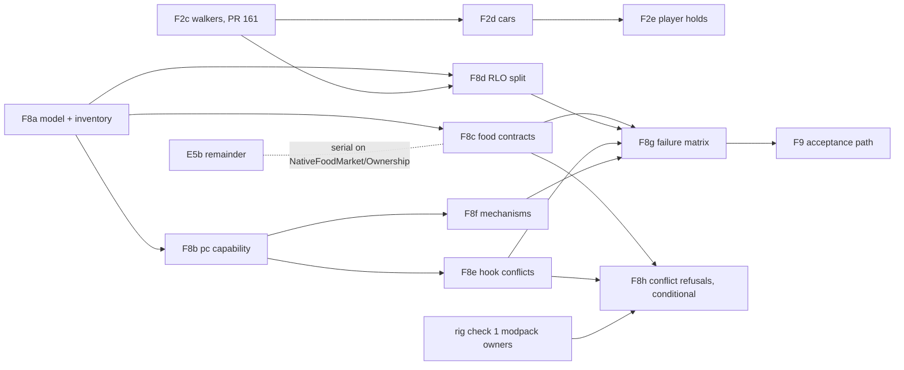

# F8: capability boundaries for dependencies and native patches

Planning record, 9 November 2026. Refs [#95](https://github.com/PeterHartwieg/big-ambitions-persistent-city/issues/95). **Docs only; no implementation change.** Base: `origin/codex/persistent-city` at `c2fc1b0` (F5h #163; current writer **34** = `CityState.CompactSchema`, `Core/Model.cs:339-340`, from F7d #158). The audit cites `00506ed`; every code reference below was re-read at `c2fc1b0` and cites that head. The audit's and the issue's line links point at `00506ed` and are stale; for example the periodic RLO check is now `Runtime/PersistentCityMod.cs:271-281`, not `:253-263`. Owner decisions of 6 November 2026 apply ([delivery rules](../decisions/2026-11-06-delivery-rules.md), [no-migration re-scope](../decisions/2026-11-06-no-migration-rescope.md), [design defaults](../decisions/2026-11-06-design-defaults.md)): no save migration, no switch-over days, batched in-game checks that do not gate merge. Proposed types, members, commands and limits are designs, not existing APIs or measured results.

## Goal

**What the player gets.** When the game updates or a companion mod is missing or changed, Persistent City switches off only the part that depends on it and says which part and why. The city never loses or renames people, never books a sale twice, never charges money through a path it could not check, and never quietly changes how much residents spend. If a part the city cannot run without is broken, the city does not start, says so in its own words, and leaves the saved city untouched for when the problem is fixed.

**Contract in one sentence.** Every native hook, reflected native member and companion-mod contract belongs to exactly one named capability that is detected before use, verified against exact signatures and conflicting patches, degraded or refused as a unit with a stated failure scope, and reported through one read-only surface; no capability's failure writes saved state, books or charges money, or creates identities.

## 1. Requirements

Items A1–A7 are the issue #95 acceptance list (the plan's contract). A8–A14 are the audit's [F8 section](../reviews/2026-11-03-city-vision-audit.md#f8-dependencies-and-native-patches-need-capability-boundaries). A15–A17 are the task's additions.

| # | Requirement | Where it is met |
| --- | --- | --- |
| A1 | Map required versus optional capabilities, native signatures, active/inactive state, fallback and failure scope (#95). | Section 2 inventory tables; section 3 D1/D2 capability table; encoded by F8a, reported by F8b. |
| A2 | Document viable alternatives for RLO coupling, including replacement appearance feasibility and stable identity migration (#95). | Section 2 *RLO coupling*; section 3 D6 (alternatives A–D, the chosen boundary, and why no migration is planned). |
| A3 | Keep RLO access behind Compatibility; do not modify RLO or silently regenerate identities (#95). | D6 and F8d: all RLO reads stay in `Compatibility/`; F8d adds a classification there and changes no identity rule; tests assert identity hash equality through degraded windows. |
| A4 | Define reusable transaction-capability contracts and native proof requirements for each materially different mechanism (#95). | D5 mechanism table; F8f encodes it; rig checks 9–10. |
| A5 | Inventory Harmony hooks and semantic conflicts, including actual active behaviour under supported modpacks (#95). | Section 2 hook table (11 owners, 27 methods); D4 conflict classes; F8a source inventory test; F8e conflict report; rig check 1 records the owners actually present under the full modpack. |
| A6 | Test unsupported contracts and partial feature failures without duplicate sales or misleading compatibility claims (#95). | F8c/F8d/F8e stub and stand-in tests; F8g failure matrix (receipt sets, money, golden hash); rig checks 2–8. |
| A7 | Publish a design choice backed by evidence before removing dependencies or replacing native paths (#95). | D6: no dependency is removed and no native path is replaced in F8; the evidence-gated alternative C is recorded with the proofs it would need. |
| A8 | Make the logical population independently authoritative in the long term; assess RLO as optional only after a replacement appearance path and identity-retaining migration are proven (audit). | D6: after activation, the saved donor catalogue is authoritative (F8d); optional RLO stays alternative C, gated on rig proof. |
| A9 | Retain native transaction adapters and cautious refusals (audit). | D3: F8c only strengthens checks and moves one late failure earlier; every existing refusal stays. |
| A10 | Express business support through capabilities: direct stock, equipment, recipes, service, checkout, lifecycle (audit, #95). | D5 and F8f. |
| A11 | Loaded-catalogue metadata cannot establish transaction support; each materially different mechanism needs native evidence (audit). | D5 rule M3; F8f test that an E5e metadata registration grants no mechanism. |
| A12 | Inventory hooks by owned behaviour, native contract, conflicting behaviour and fallback (audit). | Section 2 hook table columns. |
| A13 | A capability must report whether it is active; an inactive optimization or fail-closed adapter cannot establish behavioural compatibility (audit). | D1 states and D7: "Active" means installed and verified; the report never says "compatible"; "verified by rig" appears only with a rig result link. |
| A14 | Physical movement and inspector input have substantial native surfaces (audit). | Section 2 rows H7–H11; D4 classes them presentation-only; F8e reports conflicts; no F8 slice edits those files (section 6). |
| A15 | Plan the diagnostics surface: a `pc` status/capabilities command (task). | D7, F8b (`pc capability status`, `pc capability show <id>`), F8e (`pc capability hooks`), F8f (`pc capability business <place>`). |
| A16 | Tests with test doubles (task). | Section 4 tests column; D8 test strategy. |
| A17 | Rig checks for a game-update / absent-dependency scenario (task). | Section 7 checks 2–8. |

Out of scope, owned elsewhere: the integrated frame and throughput gate (F4 #91, sibling plan in flight), the portable acceptance entry point and supported game-assembly fingerprints (F9 #96, sibling plan in flight), dynamic native product integration (E5b remainder, sibling plan in flight), movement authority (F2 #89), whole-frame stalls (#128).

## 2. Current state at the base

### Harmony hooks owned by Persistent City

Eleven owner IDs patch 27 native methods. "Check" says what is verified before patching; "Fallback" is what happens when the check or install fails.

| # | Owner ID (file) | Native targets | Owned behaviour | Check before patch | Fallback / failure scope |
| --- | --- | --- | --- | --- | --- |
| H1 | `persistentcity.food-authority` (`Runtime/NativeFoodOwnership.cs:32-69`) | `GameManager.RunMainGameTick` postfix; prefixes at `Priority.First` on `RetailBusinessSimulator.ProcessAllCustomersFromThisHour`, `.ProcessCustomer`, `CustomerEntriesHelper.GetEntriesByAddress`, `.UpdateCustomerEntriesForPlayerBusiness`, `BuildingRegistration.Reset` | Suppresses native customers for PC-owned shops; accounting boundary | Resolved **by name only, no parameter list** (`:57`, `:68`); no foreign-patch check | Install throws, `UnpatchAll` (`:66`); `Initialize` catches and stops the whole mod (`Runtime/PersistentCityMod.cs:205-206`, `:245`). `Install` also runs from the loader's `OnLoadAsync` (`:27`) with no catch there. A renamed target, `ProcessCustomer` included (`:58`), stops the mod here, before any checkout. Required. |
| H2 | `persistentcity.food-routines` (`Runtime/NativeFoodMarket.cs:25`, `:46`) | `CitizenData.IsPriceAcceptable(string, float)` prefix at `Priority.First` (`:138-139`); reflected invoke of `RetailBusinessSimulator.ProcessCustomer` (`:47`, `:526`) | Resident price check; native checkout | `IsPriceAcceptable` by exact parameters; `ProcessCustomer` **by name, no null check** (`:47`) | Constructor failure disposes and throws (`:140`). A missing `ProcessCustomer` already stops the mod at H1's install. A **changed `ProcessCustomer` parameter list** (name still resolves) surfaces only at the first checkout, after `beginReceipt` (`:524-526`), so as an uncertain receipt rather than a clean refusal. |
| H3 | `hart.persistentcity.cityclock.v1` (`Runtime/NativeCityClock.cs:13`, `:55-92`) | Two `RunMainGameTick` prefixes (`Priority.First + 1`, `Priority.Last`); optional `DrivenRides.Ride.CapTick(ref float)` prefix+postfix (`:76-86`) | Calendar factor; accounting hold; Driven Rides coordination | Exact parameters; owner-ID collision check (`:62`); Driven Rides static/void check (`:80-81`) | Rethrows (`:91`); `TryStart` does not catch, so `UpdateCity` stops the mod (`:418`). A **changed Driven Rides contract stops the whole city**, although Driven Rides is optional. |
| H4 | `hart.persistentcity.clockobserver.v1` (`Runtime/NativeTravelPace.cs:15`, `:25-46`) | `RunMainGameTick(float)` postfix | Observes the final tick argument | Exact parameters; owner collision | Returns false; `TryStart` stops (`Runtime/PersistentCityMod.cs:568`). Required. |
| H5 | `persistentcity.research-billing` (`Runtime/ResearchBilling.cs:18-53`) | `MarketingHelper.RunDaily()` postfix | Bills research orders | `ResearchBillingContract.Check` (`:113-141`): 20+ exact members, serialization, foreign patch | Research off with a status line, city runs (`:34-53`). A foreign prefix/transpiler/finalizer found later detaches billing (`:80-83`). Optional. |
| H6 | `persistentcity.research-dialog` (`Runtime/ResearchAgencyDialog.cs:45-79`) | `MarketingAgencyDialog.CampaignSettings()` postfix (`:253`) | Adds the research button | `ResearchDialogContract.Check`, foreign patch (`:297-305`) | Research ordering off; native entry unchanged. Optional. |
| H7 | `hart.persistentcity.physicalvehicles.v1` (`Runtime/PhysicalTrafficHooks.cs:14-91`) | `GameSpeedController.ChangeTimeScale`, `DrivingAI.VehicleCrashHandler`, `DensityManager.AddVehicle` (transpiler), `TrafficManager.FixedUpdate` (prefix, postfix, transpiler, finalizer), `DrivingAI.HasReachedOrPassedWaypoint`, `.WaypointRequested`, `AiCarRescueCheck.DoUpdate`, `TrafficDespawner.OnTriggerEnter` | Visible resident cars | Exact parameters; field types; transpiler shape counts (`:58`, `:68`) | Rolled back, `Ready = false` (`:76-82`); bodies off, background city runs (`Runtime/PersistentCityMod.cs:349-357`). |
| H8 | `hart.persistentcity.physicalintersections.v1` (`Runtime/PhysicalIntersections.cs:16`, `:56-93`) | `IntersectionManager.SetActiveIntersection`, `.UpdateIntersections` | Signal coverage for visible cars | Field shapes, live list validation | `LastError`; vehicles not `Ready` (`Runtime/PhysicalVehicles.cs:138`); bodies off. |
| H9 | `hart.persistentcity.ambientpedestrians.v1` (`Runtime/AmbientPedestrians.cs:17`, `:72-115`) | `PedestrianSpawner.SetActivePedestrians`, `Pedestrian.OnEndCycle`, `.ChangeState` | Replaces ordinary pedestrians | Exact members; RLO reservations ready (`:76`) | Throws; physical population off (`Runtime/PhysicalPopulation.cs:119-120`). |
| H10 | `hart.persistentcity.stationarycrowds.v1` (`Runtime/StationaryCrowds.cs:17-55`) | `StationaryAiSpawner.Spawn(Vector3)` prefix | Hides anonymous standers | Return and field types (`:29-30`) | Unpatched, crowds left native (`:47-53`). |
| H11 | `persistentcity.resident-inspector-input` (`Runtime/ResidentInspector.cs:46`, `:63-108`) | `MouseController.Run`, `PedestrianCam.UpdateInput(float)`, `GraphicRaycaster.Raycast` | Click, scroll and UI guards | Exact members, field types | Each guard degrades separately with a warning (`:82`, `:96`, `:108`). |

`RunMainGameTick` carries patches from three PC owners (H1, H3, H4) and, on the rig, the rig's own `Priority.First` run-until limiter (comment at `Runtime/NativeCityClock.cs:68-69`). A foreign prefix there is therefore normal, not a conflict.

Read-only Harmony use: `NativeInteriorGuard` reads patch owners on `BuildingManager.EnterBuilding`/`ExitFromBuilding` to detect third-party interior mods without patching (`Runtime/NativeInteriorGuard.cs:20-41`).

### Reflected native members outside hooks

| Site | Members | Check today |
| --- | --- | --- |
| `Runtime/NativeFoodOwnership.cs:35-36` | `BusinessSimulator.buildingRegistration`, `.currentHour` | `AccessTools.Field` into a non-nullable `FieldInfo`, no null or type check. |
| `Runtime/FoodSupplyReader.cs:37-39` | `RetailBusinessSimulator.availableProducers`, `.pointOfSales`, `.GetMaxCustomerCapacityThisHour` | Null-forgiving `!`, no type check. A missing member fails at first read. |
| `Runtime/NativeFoodMarket.cs:146-167` | Authored `tags` field on business types | Field type and bounds checked; unknown means no bags, so not supported. |
| `Runtime/ResearchDiagnostics.cs:30-60` | `TextMessage` constructor, `Contact.SendMessage`, contact and registration fields | Exact contract check; `ContractPassed` feeds research availability. |
| `Runtime/NativeCampaignReader.cs:48-63` | Allowlisted campaign fields | Missing or retyped field is skipped; campaign input reads as unknown (neutral). |
| `Runtime/LoadedCatalogueLifecycleMembers.cs:13-41` | 19 lifecycle signatures (E5a) | Exact signatures; discovered, **never patched or invoked**. |
| `Runtime/TrafficRoadNetwork.cs:17`, `Runtime/RoadRoutes.cs:303`, `Runtime/OutdoorPlaces.cs:33`, `Runtime/NativeGameSpeed.cs:11` | `Waypoint.associatedIntersection`, `LocationHappinessTrigger.balanceConfig`, `GameSpeedController.currentGameSpeed` | Nullable `FieldInfo?`; callers handle null. |

### Companion mods

| Mod (assembly) | Bound by | Absent | Present but changed |
| --- | --- | --- | --- |
| RLO (`RealLifeOverhaul`) | `RloIdentityAdapter`: CityApi contract 1 or the reviewed 0.40.4/0.41.1/0.45.0 reflection fallback (`Compatibility/RloIdentityAdapter.cs:52-60`, `:97-120`; `Compatibility/RloBridge.cs:15-60`) | `MissingDependency`; the city waits with a status line (`Runtime/PersistentCityMod.cs:569-576`) | `Incompatible`: city stops (`:574`). See *RLO coupling* below. |
| Street Food (`FoodTrucks`, the same mod as "Food Trucks"; [E6 plan](e6-carts-food-trucks.md)) | `StreetFoodBridge.Open`: `VendorApi` contract 1, public members only (`Compatibility/StreetFoodBridge.cs:8-13`, `:35-96`); looked up in `ComposeFoodMarkets` (`Runtime/PersistentCityMod.cs:139-141`) | `VendorCoordinator` with no API: every vehicle scope unserviceable, shops untouched, `Reason` set (`Core/VendorStands.cs:201-231`) | Binding refused with a reason; same as absent. Saved vehicle rows, receipts and identities survive and requalify when Street Food returns ([E6d checks](../checks/e6d.md), item 5). |
| Driven Rides (`DrivenRides.Ride`) | Type lookup in `NativeCityClock.Start` (`Runtime/NativeCityClock.cs:76-86`) | Not coordinated; `CoordinatesDrivenRides = false` | City stops (row H3). |
| Third-party interior mods | `ThirdPartyInteriorGuard` by assembly patterns and Harmony owners (`Runtime/NativeInteriorGuard.cs:13-17`) | Guard allows F0 | F0 interior view stays off. |
| Metadata providers (other mods using `FoodProductMetadataApi` v1) | `Runtime/FoodProductMetadataApi.cs:7-20` | Default policy | Provider refused; metadata grants no sale permission. |

### Saved-state guards already in place

- **Executable capability header.** `SaveCodec.RequireExecutableCapabilities` refuses a payload whose `PopulationCapabilities` code/revision is not `B`/1 before any graph is built (`Persistence/PopulationWire18.cs:22-50`, `Core/ShopMemory.cs:8-18`), at load (`Persistence/SaveStore.cs:26-29`) and before food authority is taken (`Runtime/NativeFoodOwnership.cs:99`).
- **Refused older city.** A development-schema payload gives a food-authority stand-down: no authority, no key written, native customers return (`Runtime/NativeFoodOwnership.cs:86-95`).
- **Stop keeps keys.** `Fail` sets `failed` and detaches (`Runtime/PopulationLifecycle.cs:7-13`); every refusal path in `TryStart`/`CompleteInitialization` says the payload is retained (`Runtime/PersistentCityMod.cs:583-584`, `:670-676`).
- **E5b dynamic-execution refusal.** A shop with a product outside the historical set reports `DynamicIntegrationRefusal` and is not owned (`Runtime/NativeFoodMarket.cs:205-216`); `SupportedBusiness` requires `FullServiceBusinessSimulator`, no entrance fee and the paper-bag tag (`:185-200`).
- **Per-shop contract refusal.** A checkout contract mismatch marks the registration refused until a later accounting-hour refresh (`Runtime/NativeFoodMarket.cs:40-45`, `:540-544`).

### Patterns to reuse

- **Derived availability (C5f).** `MarketResearchActivation` takes five booleans (attached, dialog contract, billing contract, delivery contract, ledger) and derives `Available` and the first failed `Refusal` (`Core/MarketResearchSettings.cs:7-27`); Runtime reads them at call time (`Runtime/PersistentCityMod.cs:830-833`); `pcresearch status` prints each (`Runtime/ResearchDiagnostics.cs:193-200`).
- **Exact contract class.** `ResearchBillingContract.Check` returns the first changed member as text (`Runtime/ResearchBilling.cs:110-156`).
- **Foreign-patch check.** `ForeignPatch` walks prefixes, transpilers and finalizers of other owners (`Runtime/ResearchBilling.cs:145-152`). Measured by `ResearchChargeTests.ForeignPatchCheckCost` against the pinned Harmony 2.4.2: p95 **0.011 ms**, max 0.021 ms, 1,960 B per call ([C5d perf](../perf/c5d.md)).
- **Versioned public contracts with no fallback** for companion mods (`RloBridge`, `StreetFoodBridge`), bound in tests through stand-in APIs (`Compatibility/RloBridge.cs:70-75`; [E6b checks](../checks/e6b.md)).
- **Optional failure that keeps the background city.** `physicalFailed` (`Runtime/PersistentCityMod.cs:349-357`, `:517-530`).

### RLO coupling (read-only analysis)

Where Persistent City depends on RLO at this base:

| Use | Where | Effect when RLO is not Ready or differs |
| --- | --- | --- |
| Donor catalogue at city creation | `TryStart` (`Runtime/PersistentCityMod.cs:569-576`); copied into `SourceIdentities` (`Core/Population.cs:79-85`) | No city is created; missing RLO waits, incompatible RLO stops. |
| Match at activation | `Runtime/PersistentCityMod.cs:675-676`, `RloReadResult.MatchesPopulation` (`Compatibility/RloIdentityAdapter.cs:31-47`) | Stop, payload retained. |
| **Periodic check every 30 s** | `Runtime/PersistentCityMod.cs:271-281` | `MatchesPopulation` is false for **any** non-Ready status (`Compatibility/RloIdentityAdapter.cs:33`), so switching RLO's Flare off, a refresh, or a Going Public session stops a running city. |
| Save capture | `Runtime/PersistentCityMod.cs:773-775` | Save refused; runtime stops. |
| Physical reservations | `Compatibility/RloPhysicalReservations.cs:31`, `:124-161`; `Runtime/AmbientPedestrians.cs:74-76` | Ready and Off are complete answers: Off clears the lists and reserves nobody, so bodies continue. NotYet and Refreshing reserve everyone, so no bodies until a complete answer. Shared, Failed or a broken answer stops the guard, which then reserves everyone for good. |
| Road speed overrides | `Runtime/MultimodalRoutes.cs:75-82`; `Compatibility/RloRoadSpeedOverrides.cs:103-114` | A non-Ready answer is refused, not read as "no slowdowns". Its downstream effect on route preparation is not traced at this base; F8d records it. |

What does **not** need live RLO after creation: new residents are remixed from the saved donor catalogue with `pc:<sequence>` IDs (`Core/ResidentLifecycle.cs:100-110`), and bodies are dressed by the game's own appearance setter seeded with the saved `AppearanceSeed` (`Runtime/PhysicalPedestrians.cs:91-104`). The `PopulationKey` is a digest over the donor catalogue and city seed ([RLO contract](../rlo-contract.md), mapping section).

## 3. Decisions

### D1: one capability model with four states

Every hook owner, reflected contract and companion-mod contract maps to one capability ID. Each capability has: **requirement** (`Required`, `Optional`, or `RequiredWhenPresent` for a companion mod whose contract must hold if it is loaded), **state** (`NotChecked`, `Active`, `Off` with reason, `Absent`), **failure scope** (the features it disables, as a fixed list) and **fallback** (what native or PC behaviour runs instead). Transitions: `NotChecked → Active | Off | Absent` at detection; `Active → Off` on a later verification failure (as billing does today). `Off` is sticky for the session; it returns to `Active` only through the capability's declared re-check point (city load, or a companion mod's next revision, as Street Food requalifies today). The model lives in Core (`Core/NativeCapabilities.cs`) so tests run without game assemblies. Reason: C5f's derived availability already works this way for one feature; generalising it gives one vocabulary and one report.

### D2: capability table

| Capability | Requirement | Native contract | Failure scope | Fallback |
| --- | --- | --- | --- | --- |
| `food.authority` | Required | H1 targets | Whole city | Not started; native customers serve every shop; payload and manifest unchanged. |
| `food.checkout.shop` | Optional per shop | H2, `FoodSupplyReader` members | PC ownership of building shops | Shops stay native-owned with a scope reason. |
| `food.dynamic` | Optional, Off | E5a lifecycle members (never installed) | Shops with products outside the historical set | `DynamicIntegrationRefusal`; the E5b remainder plan owns turning it on. |
| `vendor.streetfood` | Optional | `VendorApi` contract 1 | Vehicle scopes | Street Food keeps its own customers. |
| `clock.observe`, `clock.city` | Required | H4, H3 | Whole city | Not started. |
| `clock.drivenrides` | RequiredWhenPresent | `DrivenRides.Ride.CapTick(ref float)` | Whole city when present and changed | Not started, with a status naming Driven Rides. Reason: an uncoordinated ride multiplier would run the calendar off the declared pace (F1 boundary). |
| `rlo.donor` | Required at creation and activation | RLO CityApi 1 / reviewed fallback | Whole city | Not started (unchanged); mid-session see D6. |
| `rlo.reservations`, `rlo.roadspeeds` | Required for bodies / for road timing | CityApi reads | Physical population / route preparation | Bodies off; roads as F8d records. |
| `research.dialog`, `research.billing`, `research.delivery` | Optional | H5, H6, message contract | Market research | Research hidden; orders kept. |
| `physical.vehicles`, `physical.pedestrians` | Optional | H7–H10 | Visible bodies | Native traffic and pedestrians; background city unchanged. |
| `inspector.click`, `.scroll`, `.uiblock` | Optional | H11 | Each guard | Inspector usable without it. |
| `interior.view` | Optional, default off | F0, interior guard | Interior view | Off. |

### D3: verify before any effect

A capability is checked completely (exact parameter lists, return and field types, transpiler shapes) before its first patch, ownership request or native write. F8c applies this to the three weakest sites: H1's name-only lookups, H2's unchecked `ProcessCustomer` and `FoodSupplyReader`'s unchecked fields. The checkout contract moves from first checkout to market construction, so a changed checkout member refuses ownership instead of creating an uncertain receipt. Existing refusals stay unchanged.

### D4: conflict classes for foreign patches

For each PC target, a foreign owner is classed by patch kind: **observer** (foreign postfix), **may-skip** (foreign prefix that can return false), **rewrites** (foreign transpiler) and **swallows** (foreign finalizer). Other PC owners on the same method (H1/H3/H4 on `RunMainGameTick`) are not foreign. Policy: research hooks keep today's refusal on may-skip/rewrites/swallows. Economy hooks (H1 customer targets, H2) refuse `food.checkout.shop` on may-skip/rewrites/swallows **only after** rig check 1 has recorded the owners actually present under the full modpack (conditional slice F8h); until then F8e reports them. Presentation hooks (H7–H11) only report: after F2d, bodies follow logic and cannot change outcomes ([F2 plan](f2-movement.md) section 3). Reason: refusing blindly could switch off a supported modpack; reporting first gives the evidence.

### D5: transaction mechanisms as capabilities

A mechanism is a materially different way money and stock move. Each needs its own native proof.

| Mechanism | Native evidence it needs | State at base |
| --- | --- | --- |
| `shop.fullservice-bag.v1`: `FullServiceBusinessSimulator`, no entrance fee, paper-bag tag, historical products, one native order per line (`Runtime/NativeFoodMarket.cs:185-200`, `:470-535`) | Direct stock and bag decrement, one completed order, receipt before effect, native daily settlement | Implemented; rig pending ([A5 checks](../checks/a5-integrated-acceptance.md)). |
| `vehicle.streetfood-api.v1`: Street Food `Sell` through contract 1 | Units before/after, cents, sequence; lease and handback | Implemented; rig pending ([E6d checks](../checks/e6d.md)). |
| `shop.dynamic-catalogue`: loaded-catalogue products (equipment, recipes, lifecycle) | Mutation notifications, holder reconciliation, held execution ([E5b checks](../checks/e5b-complete-menu.md), refusal boundary) | Off (refused). |
| `research.agency-bill.v1`: `ChangeMoneySafe` after `RunDaily` | One transaction per order, before the financial summary | Implemented; rig pending ([C5d checks](../checks/c5d.md)). |

Rules: **M1** a business is served only under exactly one mechanism or reports one unsupported reason; **M2** a mechanism's proof state uses the status words and links its evidence; **M3** product metadata (E5c/E5e) never grants a mechanism. Service and staffing stay inside each mechanism's checkout checks.

### D6: RLO boundary

Alternatives:

- **A. Keep today's coupling.** Simple, but a Flare toggle or refresh stops a running city (section 2).
- **B. Saved catalogue authoritative after activation (chosen, F8d).** RLO stays required to create and to activate a city, and the activation match stays strict. After activation, `rlo.donor` distinguishes: Ready and matching (continue); Ready and different (stop, as today); `Off`, `NotYet`, `Refreshing` (transient: continue on the saved catalogue, saves allowed). Bodies follow the existing reservations unchanged: under `Off` bodies continue with no RLO reservations; under `NotYet`/`Refreshing` everyone is reserved, so bodies pause; `Shared`, `Failed`, `Incompatible` (stop, as today). No identity is created, renamed or regenerated during a transient window; residents keep coming only from the saved catalogue. Reason: the identities are already in Persistent City's save; stopping adds no safety for a transient state, and the activation match still catches a different RLO world at the next load.
- **C. RLO as an optional provider for new cities (not planned).** Replacement appearance is feasible in principle because bodies are already dressed by the game's own appearance setter from a seed (`Runtime/PhysicalPedestrians.cs:91-104`). Unproven: name and persona quality from a PC donor generator, the rendered look of PC seeds, and how RLO's social features treat residents with no RLO citizen. Identity migration is not needed and not allowed before release: a city would keep the provider it was created with, and a provider change would be refused with a distinct status. This needs rig evidence first; it is recorded here and not sliced.
- **D. Remove RLO.** Rejected: it discards the reviewed donor contract with no proven replacement.

All RLO access stays in `Compatibility/`. F8 plans no change to RLO, no RLO release and no claim about RLO behaviour beyond the existing contract docs.

### D7: one read-only diagnostics surface

`pc capability status` prints one line per capability: ID, requirement, state, reason, failure scope and the Unity `Application.version` string for context. `pc capability show <id>` adds the native members checked and the fallback. `pc capability hooks` (F8e) lists each PC target with foreign owners and their class. `pc capability business <place>` (F8f) shows the mechanism or unsupported reason. At activation one Player.log line lists every capability not `Active` (F8d). Commands run only on request, read existing status members and write nothing. They route through the existing two- and three-argument `pc` router (`Runtime/VendorDiagnostics.cs:23-24`, `:64-68`) via `RunCensusCommand` (`Runtime/PopulationCensusDiagnostics.cs:81-89`), so no new console registration is needed. Wording: states are `active`, `off`, `absent`; the report never prints "compatible", and "verified by rig" appears only next to a rig result link.

### D8: test strategy

The test project references Core, Persistence and Compatibility only (`tests/PersistentCity.Tests.csproj:54-56`). Therefore: the model, mechanisms and report are Core and unit-tested; RLO and Street Food classification is tested through the existing stand-in APIs; Runtime contract classes are tested in a stub-compiled harness `tools/capability-contracts/` (the pattern of `tools/event-observation-regression/Stubs.cs`), with the pinned Harmony 2.4.2 loaded as `ForeignPatchCheckCost` already does (`tests/ResearchChargeTests.cs:807-812`). A source inventory test (as F2b's `tests/PresentationBoundaryTests.cs`) fails when a Runtime file adds a Harmony owner or `.Patch(` target that the inventory does not declare.

## 4. Slice breakdown

Every slice writes `docs/checks/<slice>.md` and `docs/perf/<slice>.md`, runs the build and `dotnet test tests/PersistentCity.Tests.csproj`, and adds a test that the current-writer golden hash is unchanged. No slice bumps the schema.

| Slice | Scope | Owns (files) | Tests | Perf | Schema | Depends on |
| --- | --- | --- | --- | --- | --- | --- |
| **F8a — capability model and hook inventory** | D1 and D2 in Core: capability IDs, requirements, states, failure scopes, fallbacks, transition rules, report builder; static inventory of the 11 owners and 27 targets (section 2). Not wired to Runtime. | `Core/NativeCapabilities.cs` (new), `tests/NativeCapabilityTests.cs` (new), `tests/HookInventorySourceTests.cs` (new) | Transitions; `Off` is sticky until the declared re-check; a required `Off` yields a start refusal distinct from corruption and from the older-schema status; an optional `Off` disables only its listed scope; deterministic report; the source test fails on an undeclared owner or target (red with one injected test-only owner). | Registry update and report cost (µs, allocation). | None | Starts now. |
| **F8b — `pc capability status|show`** | D7 surface: `Runtime/CapabilityDiagnostics.cs` (new `PopulationRuntime` partial) builds a registry snapshot on request from existing members (`ResearchBilling.Status`, `ResearchAgencyDialog.Status`, `ResearchMessages.Status`, `NativeTravelPace.LastError`, `NativeCityClock.CoordinatesDrivenRides`, vendor `Coordinator.Reason`, `physicalFailed`, `PhysicalVehicles.LastError`, `AmbientPedestrians.LastError`, interior guard verdict, RLO last status); one routing branch. | `Runtime/CapabilityDiagnostics.cs` (new), the `RunCensusCommand` branch in `Runtime/PopulationCensusDiagnostics.cs` (`:81-89`), `tests/CapabilityReportTests.cs` (new) | Report from doubles for every capability state; source test: the new file calls no mutating member and is not reached from `Update`. | Command cost on a 957×2 fixture snapshot; zero per-frame work (source test). | None | F8a. |
| **F8c — food-economy contracts verified before effect** | D3 for H1, H2 and `FoodSupplyReader`: a `NativeFoodContract` class (ResearchBillingContract style) with exact signatures for the six H1 targets, `IsPriceAcceptable`, `ProcessCustomer` and the three supply members; checked before `Install` patches and before the market requests ownership; a failed checkout contract refuses `food.checkout.shop` with a scope reason. **Shops already owned in the save:** the market is still constructed (it is needed to confirm paid and uncertain receipts), but in checkout-off mode: it installs no `IsPriceAcceptable` prefix, `CanServe` is false for every shop, and each owned registration is observed ineligible (`NativeFoodOwnership.Observe(reg, false)`, `Runtime/NativeFoodOwnership.cs:194`). That clears `Desired`; the current owned hour stays protected and the next drained accounting boundary hands the shop back and persists the row, through the existing release path that runs without a market (`ReleaseAfterAccountingFailure` and `releaseWithoutMarket`, `:174-192`, `:284`, `:315`). Checkout-off construction does not throw, so `CompleteInitialization` (`Runtime/PersistentCityMod.cs:710-711`) is unchanged. Test build only: a declared fault point (a compile-time `PC_FAULT_POINTS` symbol, absent from release builds) that makes `NativeFoodContract` expect one named member under another name or signature (checks 5–6), and makes `ResearchBillingContract.Check` report one named member as changed (check 7). Foreign owners on these targets are recorded for F8e. | `Runtime/NativeFoodContract.cs` (new), the `Install` region of `Runtime/NativeFoodOwnership.cs` (`:52-69`), the static-member and constructor regions of `Runtime/NativeFoodMarket.cs` (`:46-47`, `:133-141`), the release and `Observe` region of `Runtime/NativeFoodOwnership.cs` (`:171-205`), `Runtime/FoodSupplyReader.cs` (`:37-39`), the two `BusinessSimulator` fields (`Runtime/NativeFoodOwnership.cs:35-36`), the fault-point symbol in `tools/build.py` (test-build flag only), one `#if PC_FAULT_POINTS` line in `ResearchBillingContract.Check` (`Runtime/ResearchBilling.cs:113-141`), `tools/capability-contracts/` (new) | Stub harness, **required-contract refusal** (`food.authority`): each H1 member missing, renamed, re-typed or with another parameter list gives a named refusal before any patch; then no PC Harmony owner is installed, no receipt key is written, and the authority manifest and every saved key are byte-identical. **Checkout-off** (`food.checkout.shop` refused, H1 verified): the verified food-authority hooks stay installed (they keep suppressing native customers through each owned hour) and only the food-routines `IsPriceAcceptable` prefix is omitted; a checkout contract failure at construction requests no new ownership and creates no uncertain receipt (red on today's code: uncertain receipt). For a save with an owned shop, including a reload in the middle of an owned hour with one paid and one uncertain receipt: the owned hour stays suppressed; no new receipt is begun; the paid receipt is confirmed and the uncertain one stays uncertain and is never re-sold. Two authority changes are permitted and asserted, both persisted: the withdrawal request (`Desired` false with its requested hour, persisted by `Observe` at `Runtime/NativeFoodOwnership.cs:204`), which survives a reload, and the handback at the next drained accounting boundary, after which native customers serve the shop. The population payload and receipt evidence are unchanged throughout; the authority manifest changes only by those two transitions. | One-time check cost at `Initialize` (expected < 1 ms); checkout path unchanged (same per-sale cost as [F6j](../perf/f6j.md)). | None | F8a. Serial with any E5b-remainder slice that edits `NativeFoodMarket.cs` or `NativeFoodOwnership.cs`. |
| **F8d — RLO capability split** | D6 alternative B: a classification member on `RloReadResult` (match / different / transient / unsupported). Today `RloReadStatus` has only Ready, MissingDependency, Incompatible and NotReady (`Compatibility/RloIdentityAdapter.cs:17`); the CityApi path maps every non-Ready, non-Failed status, `Shared` included, to NotReady (`:278-279`), and the reflection fallback reports Going Public (`:230`) and Flare not running (`:234`) as NotReady too. F8d therefore adds a reason class to `RloReadResult`, set at every NotReady and Incompatible construction site on both paths, so `Off`/`NotYet`/`Refreshing` (continue) are told apart from `Shared` (stop); the periodic, activation and save call sites use it; transient keeps the city running and saving on the saved catalogue; `rlo.reservations` and `rlo.roadspeeds` states reported; records the downstream effect of a refused road-speed capture; adds the activation Player.log capability line (D7). | `Compatibility/RloIdentityAdapter.cs` (`RloReadResult`, `:19-48`), the three call sites in `Runtime/PersistentCityMod.cs` (`:271-281`, `:675-676`, `:773-775`) and one log line after activation (`:729-731`), `tests/RloCompatibilityTests.cs`, `tests/RloBridgeTests.cs` | Stand-in CityApi: every bridge status maps to its reason class; Ready+match continues; Ready+different stops with payload kept; Off/NotYet/Refreshing continue and a save in that window equals a Ready save of the same state byte for byte; Shared/Failed/Incompatible stop; reservations reserve nobody under Off and everyone under NotYet/Refreshing; identity hash and resident count unchanged across a transient window; reload with matching RLO continues, with different RLO refuses; reflection-fallback arm (stand-in reviewed contract): Going Public gives the stop class, Flare not running gives the transient class; red on today's code for the transient cases. | No extra RLO read; the 30 s cadence is unchanged; classification cost per read. | None | F8a; after F2c merges (shared `PersistentCityMod.cs`). |
| **F8e — hook conflict report** | D4 report: `Runtime/HookConflicts.cs` (new) lists foreign owners per PC target and their class, once at activation and on `pc capability hooks`. Uses Harmony's all-patched-methods listing if the pinned 2.4.2 has it (the slice confirms against the package), else `GetPatchInfo` on the F8a inventory targets. Report only. | `Runtime/HookConflicts.cs` (new), one branch in `Runtime/CapabilityDiagnostics.cs`, an arm in `tools/capability-contracts/` | Real Harmony 2.4.2 on stand-in methods: PC owner plus foreign prefix/postfix/transpiler/finalizer classed correctly; H1/H3/H4 on one method are not foreign; a method with no patch info reports none. | Scan cost at activation: estimate 27 × 0.011 ms ≈ 0.3 ms from the C5d measurement; measured in the slice, outside gameplay windows. | None | F8a, F8b. |
| **F8f — transaction mechanisms** | D5 in Core: mechanism IDs, required native evidence, proof state with evidence link, rules M1–M3; `pc capability business <place>` maps a place to its mechanism through the existing `ScopeStatus` (`Runtime/NativeFoodMarket.cs:200-206`). No change to `Supported`. | `Core/TransactionMechanisms.cs` (new), `tests/TransactionMechanismTests.cs` (new), one branch in `Runtime/CapabilityDiagnostics.cs` | Every scoped business maps to one mechanism or one unsupported reason (M1); a proof state of "verified by rig" without a result link is refused (M2); an E5e metadata registration changes no mechanism (M3); the E5b refusal text maps to `shop.dynamic-catalogue` Off. | None at runtime beyond the on-request command. | None | F8b. |
| **F8g — failure matrix evidence** | Offline matrix over a Core city fixture (the F6a/F2a 957-resident shape): arms with each optional capability Off or Absent, each required one refused, Street Food absent then returned, RLO transient. Docs and tool arms only. | `tools/capability-matrix/` (new), `docs/checks/f8g.md`, `docs/perf/f8g.md` | Receipt sets have no duplicate intent; money, wallets and receipts equal between "optional X off" and "X never present" where X has no economic role; shop scopes byte-identical when vehicles are absent; a refused required arm leaves the payload byte-identical; golden hash unchanged; every A1–A17 row has a passing check. | Whole-matrix cost; no mod-work. | None | F8c, F8d, F8e, F8f. |
| **F8h — conflict refusals (conditional)** | D4 policy for economy hooks: may-skip/rewrites/swallows on H1 customer targets or H2 refuse `food.checkout.shop` (shops stay native), like `ResearchBillingContract.ForeignPatch`. Runs only if rig check 1 shows the supported modpack has no such owner, or names the owners to accept. | Policy table in `Runtime/HookConflicts.cs`, the check call in `Runtime/NativeFoodContract.cs`, an arm in `tools/capability-contracts/` | Foreign prefix on `ProcessCustomer` refuses shop ownership with the owner named; a foreign postfix does not; no receipt is written after refusal. | Same scan; once per city load. | None | F8c, F8e, rig check 1 result. |

## 5. File ownership and schema

**Schema.** Current writer 34. No F8 slice bumps the schema or changes the save shape: capability state, conflict reports and mechanism labels live in Runtime memory and diagnostics only. F8d's transient continuation writes the same payload a Ready save writes. Each slice adds a current-writer golden-hash-unchanged test. F8 therefore never holds the single schema-slice slot and can run alongside whichever schema slice is in flight.

**Parallel with the F2 movement chain (F2c → F2d → F2e).** The chain owns `Core/PhysicalJourneys.cs` and `Runtime/PhysicalPopulation.cs`; F2c (PR #161, in review) also edits `Runtime/PersistentCityMod.cs`, `Runtime/VendorDiagnostics.cs`, `Runtime/PrototypeSettings.cs` and `Runtime/PhysicalPedestrians.cs`; F2d owns `Runtime/PhysicalTrafficHooks.cs` and `Runtime/PhysicalVehicles.cs`.

- **Can run in parallel with the chain now:** F8a (new Core and test files), F8b (new file plus `PopulationCensusDiagnostics.cs`, which no F2 slice edits), F8c (food files, no F2 overlap), F8e (new file; reads hook targets by name and edits no hook file), F8f (new Core file plus F8b's file), F8g (new tool), F8h (F8 files only).
- **Must wait:** F8d edits `Runtime/PersistentCityMod.cs`, so it starts after F2c merges and keeps its hunks to the four listed regions; if F2d or F2e later edit that file, they rebase on F8d or vice versa, never concurrently.
- **No F8 slice edits** `PhysicalTrafficHooks.cs`, `PhysicalIntersections.cs`, `PhysicalVehicles.cs`, `PhysicalPopulation.cs`, `AmbientPedestrians.cs`, `StationaryCrowds.cs` or `ResidentInspector.cs`. Physical and inspector hooks are reported by F8e only.

**Inside F8.** `Runtime/CapabilityDiagnostics.cs` is created by F8b and then edited by F8e and F8f, one at a time. `Runtime/HookConflicts.cs` is F8e then F8h. `Runtime/NativeFoodContract.cs` is F8c then F8h. `tools/capability-contracts/` is F8c, then F8e and F8h arms.

**Sibling plans.** The E5b-remainder plan (in flight) owns dynamic integration in `NativeFoodMarket.cs`, `NativeFoodOwnership.cs` and the loaded-catalogue readers; F8c and those slices are serial on the two shared files, in either order, and E5b adds its mechanism row to `Core/TransactionMechanisms.cs` after F8f. The F4 and F9 plans (in flight) consume F8b's report to record active capabilities with every result; F8 needs nothing from them.

## 6. Performance

Gate: mod-work p95 < 5 ms; flag every mod-work sample ≥ 30 ms; whole-frame timing reported separately (#128 stays its own investigation). F8 adds no per-frame work.

| Slice | Expected cost | Measure in `docs/perf/<slice>.md` |
| --- | --- | --- |
| F8a | Microseconds per registry update; not wired | Update and report p50/p95/max, allocation |
| F8b | On request only | Command time and allocation on a 957×2 snapshot |
| F8c | One-time contract check at `Initialize`; checkout unchanged | Check time; checkout p95 before/after on the F6j fixture |
| F8d | No extra RLO read; classification per 30 s read | Classification time; RLO `elapsedMs` already logged per read (`Runtime/PersistentCityMod.cs:739-747`) |
| F8e | ≈ 0.3 ms once per load (estimate from 0.011 ms p95 per method) | Scan time at activation, outside timing windows |
| F8f, F8h | On request / once per load | As F8b and F8e |
| F8g | Tool only | Matrix wall time |

Cheap win to take in F8c: `FoodSupplyReader`'s three members are already static; F8c only adds the one-time check, so per-read cost does not change.

## 7. In-game checks for the batched rig

Fixture for all checks: a disposable FT city on the owned rig with Persistent City, RLO and Street Food, one owned food shop and one Street Food cart owned by PC, built and aged at head. Autosave is off in the isolated test profile, checked before every measured window (also after reload) and restored at cleanup. Capability state is read with `pc capability status` through FT `console`. Red means the base build; green means the build after the named slice. Every check is rig-automated.

1. **Capability report and modpack hook owners (F8b, F8e).** Setup: full modpack DLL set. Steps: load the fixture, run `pc capability status` and `pc capability hooks`. Expected: every required capability `active`; optional ones `active` or `off` with a reason; the hook list names every foreign owner on the 27 targets with its class; the result file is kept as F8h's input. **Existing capability:** RIG-MODSET full set, FT `console`/`load`.
2. **Street Food absent, then returned (F8b).** Steps: save; load without `FoodTrucks`; run 2 game hours; save; restore Street Food and load; run to the next crew opening. Expected: `vendor.streetfood absent` with Street Food's missing-API reason; shop money and receipts equal a run with no cart; vehicle rows, receipts and identities unchanged by the absent window; after return, `active` and the cart requalifies. **Existing:** RIG-MODSET, FT `save`/`load`/`time`; **pending:** RIG-PCSAVE `money`/`receipts`.
3. **Driven Rides absent (F8b).** Steps: load without Driven Rides. Expected: `clock.drivenrides absent`, city runs, calendar factor as configured. **Existing:** RIG-MODSET, FT `console`.
4. **RLO absent at load (F8b).** Steps: load without RLO. Expected: no city starts; the status says RLO is required; raw PC payload hash unchanged; native customers serve the shop; no PC receipt key is written. **Existing:** RIG-MODSET build selection and raw PC payload hash/refusal-status readback.
5. **Game update: changed required member (F8c).** Steps: select a PC fault variant whose `NativeFoodContract` expects one H1 target under another name; load. Expected red: the base build has no such check (record behaviour). Green: city refuses to start with `food.authority off: <member> changed`; payload hash unchanged; no PC Harmony owner present in `pc capability hooks`; native customers serve the shop. **Existing:** RIG-MODSET build selection and payload hash readback; **pending:** RIG-FAULT selection of F8c's `PC_FAULT_POINTS` test build.
6. **Game update: changed checkout member (F8c).** Steps: fault variant with `ProcessCustomer` expected under another signature; load and run to lunch. Expected red: first checkout leaves an uncertain receipt. Green: the fixture's already owned shop keeps the loaded hour protected, gets a scope reason, begins no new PC receipt, and is handed back at the next drained accounting boundary, after which native customers serve it; the city runs. **Existing:** RIG-MODSET, FT `time`; **pending:** RIG-FAULT selection of F8c's test build, RIG-PCSAVE `receipts`.
7. **Game update: changed optional research contract (F8b, F8c).** Steps: select F8c's test build with the research-billing fault point; load; run past one nightly marketing bill. Expected: research `off` with the member named, no research charge, native campaigns unchanged, the city runs. A vehicle-hook arm is not planned here: the hook file is F2d-owned (section 5), and the existing bodies-off fallback is covered by the F2 plan's bodies-off checks. **Existing:** RIG-MODSET, FT `time`; **pending:** RIG-FAULT selection of F8c's test build, RIG-PCSAVE.
8. **RLO Flare switched off mid-session (F8d).** Steps: run 1 game hour; switch RLO's Social Media option off; run 1 hour; save; switch it on; run 1 hour; save; reload. Expected red: the city stops at the next periodic check. Green: `rlo.donor off (transient)`; city runs; bodies continue with no RLO reservations (Off is a complete answer); the in-window save succeeds; resident IDs, names and count unchanged across the window (RIG-PCSAVE `ids`); reload continues. **Pending capability:** RIG-RLOTOGGLE, set RLO's Social Media option in the isolated profile mid-session and restore it at cleanup; RIG-PCSAVE. **Existing:** FT `save`/`load`.
9. **Mechanism report (F8f).** Steps: `pc capability business <shop>` and `<cart place>`. Expected: `shop.fullservice-bag.v1` and `vehicle.streetfood-api.v1`; a shop with a non-historical product reports `shop.dynamic-catalogue off`. **Existing:** FT `console`, RIG-SHOPEDIT `shop_edit` for the third shop.
10. **Foreign prefix on checkout (F8h, conditional).** Steps: a rig-owned test Harmony owner adds a prefix on `RetailBusinessSimulator.ProcessCustomer` in the disposable profile; load. Expected: `food.checkout.shop off: foreign prefix by <owner>`; shops native; zero PC receipts; removing the test owner and reloading restores ownership at the next accounting boundary. **Pending capability:** RIG-FOREIGNPATCH, install and remove a named test Harmony patch in the disposable profile.
11. **Performance (F8b, F8d, F8e).** Steps: in a clean RIG-PERF-UNION window at default caps, run `pc capability status` once per game minute for 30 game minutes; record the activation scan from the load log. Expected: mod-work p95 < 5 ms; every ≥ 30 ms sample listed with its component; whole-frame metrics reported separately; activation scan time recorded. **Existing:** RIG-PERF-UNION `perf_window`, FT `console`.

### Rig capability requests (PeterHartwieg/big-ambitions-agent-rig)

- **RIG-RLOTOGGLE**: switch RLO's Social Media option off/on in the isolated profile during a session and restore it at cleanup. Check 8.
- **RIG-FOREIGNPATCH**: install a rig-owned test Harmony patch of a given kind on a named method, and remove it. Check 10.
- **RIG-FAULT** (pending; also requested by the [F7 plan](f7-save-snapshots.md) section 7): select F8c's `PC_FAULT_POINTS` test build with a named `NativeFoodContract` or `ResearchBillingContract` fault point and restore the normal build afterwards. Checks 5–7.
- **RIG-PCSAVE** (pending; requested by the F7 plan): PC payload and receipt projections. Checks 2 and 6–8.

## 8. Open questions

These are player-facing. The plan proceeds on each default.

1. **RLO's social media is switched off or refreshing while you play. Should the city keep running?** Recommended default: yes. Everyone keeps their name and life and saving works. With social media off, people on the street carry on; while RLO is refreshing, they pause until it answers. A city whose RLO citizens really changed still stops.
2. **A part of Persistent City is off because the game or a mod changed. How are you told?** Recommended default: one short notice when the city starts, naming what is off and why; the details are in the `pc capability status` console line.
3. **Another mod changes the same shop sales code Persistent City relies on. What happens?** Recommended default: Persistent City leaves those shops to the game and says which mod is involved; the rest of the city keeps running.

All other choices are technical and recorded in section 3.

## 9. Risks and refusals

Risks:

- **Over-refusal.** A strict signature or foreign-patch rule could switch off a supported modpack. D4 reports first and refuses only after rig check 1 (F8h).
- **Report drift.** A new hook added without an inventory row would be invisible. The F8a source test fails on it.
- **Transient RLO window.** If RLO returns with a different catalogue, the next periodic check stops the city as today, and the next load refuses; no identity is changed in between.
- **Shared files.** F8c with the E5b remainder and F8d with F2c are serial; section 5 orders them.

Refusals. F8 will not:

- migrate saves, bump the schema or add switch-over days;
- create, rename or regenerate identities, or substitute a synthetic donor source;
- modify RLO, plan an RLO release or make claims about RLO behaviour;
- book, retry or charge money through an unverified path, or write rival finances;
- let product metadata grant transaction support;
- print "compatible" or "verified by rig" without a rig result;
- edit the F2-owned physical hook files.

## Verification boundary of this planning change

This change adds one plan file. It runs no build, test, game or rig. Code references were read at `c2fc1b0`.
