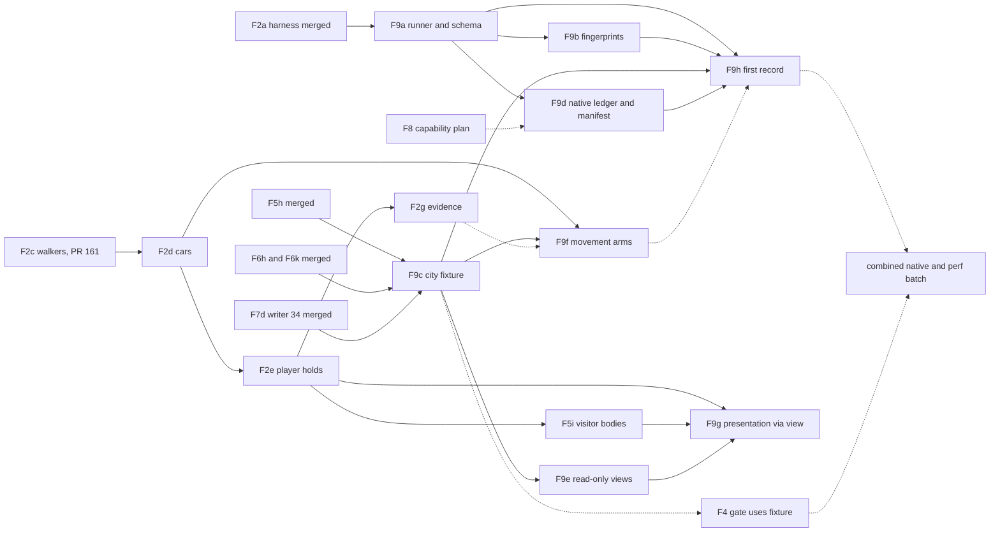

# F9: one portable integrated city acceptance path

Planning record, 9 November 2026. Refs [#96](https://github.com/PeterHartwieg/big-ambitions-persistent-city/issues/96). **Docs only; no implementation change.** Base: `codex/persistent-city`, verified at `c2fc1b0` (F5h #163 merged; current writer **34** = `CityState.CompactSchema` from F7d #158). The audit cited `00506ed`; every code reference below was re-read at `c2fc1b0` and cites that head. Owner rules that apply: [delivery rules](../decisions/2026-11-06-delivery-rules.md) (batched in-game checks that do not gate merge, `tools/*-regression` not run before release), [no migration](../decisions/2026-11-06-no-migration-rescope.md), [design defaults](../decisions/2026-11-06-design-defaults.md) and the [price weight 1.2 decision](../decisions/2026-11-08-price-weight.md). Proposed files, commands, fields, limits and run times are designs or estimates, not existing APIs or measured results.

Sibling plans written in parallel and referenced by intent only: F4 experience/perf gate (#91), F8 capability contracts (#95) and the E5b remainder, each as its own file under `docs/plans/`. This plan does not read or edit them.

## 1. Requirements

**What the player gets.** Nothing visible. Peter gets one command that says whether the whole city still works together (people, money, saves, movement, research and food trucks), on any of his machines, with the same answer for the same code. Each answer says exactly which code, game files, fixture and settings it came from, and keeps "works in the simulation", "works against the real game", "fast enough" and "fun to play" apart.

| # | Requirement (issue #96 acceptance, audit F9, task scope) | Where it is met |
| --- | --- | --- |
| R1 | One documented portable offline entry point with explicit SDK/game-assembly inputs and no unrelated machine-specific script dependency (#96). | Decisions 1 and 2; slice **F9a** (`tools/acceptance/run.py`). Paths in section 3.2. |
| R2 | Compile production against the declared supported assembly fingerprints and record actual active capabilities (#96). | Decision 4; slice **F9b** (fingerprints in `tools/build.py`), capability record in Decision 6 (offline) and rig check 3 (native). |
| R3 | A small integrated city fixture used by correctness and performance checks (#96, audit). | Decision 3; slice **F9c** (`city-s`, `city-m`). F4 uses the same fixture (section 3.8). |
| R4 | Exercise frame budgets, timestamped native changes, detail transitions and in-flight reloads while checking identity, conservation and event order (#96). | Decision 3 arms and oracles; **F9c** (budgets, native changes, skips, reloads), **F9f** (body transitions after F2d). Rig checks 5 and 6. |
| R5 | Separate semantic correctness, native compatibility, performance and hands-on gameplay results (#96, audit). | Decision 5 result classes; one summary verdict over the functional classes only. |
| R6 | Timely native evidence for changed native assumptions before dependent systems accumulate (#96, audit). | Decision 7 native-evidence ledger; slice **F9d**. Not a merge gate (merge rule v2). |
| R7 | Record source/artifact/fixture/settings provenance and raw evidence boundaries (#96, audit). | Decision 6; **F9a** writes it, **F9b** adds assembly fingerprints. |
| R8 | Strengthen conceptual ownership/read-only views where needed; splitting partial files alone does not satisfy this (#96, audit). | Decision 8; slices **F9e** and **F9g**. |
| R9 | Integrate population: F5h acceptance (task). | Stage `population` (Decision 2); F9c's `city-m` is the F5h reference city. |
| R10 | Integrate economy: F6h acceptance with `FoodChoicePriceWeight` default 1.2 (task, price-weight decision). | Stage `economy`; the stage refuses a run whose recorded weight is not the compiled default unless the override is declared (Decision 2). |
| R11 | Integrate saves: F7 (task). | Stage `saves`: golden pins, older-schema refusal, reader corpus, save epoch; F9c reload arms. |
| R12 | Integrate movement: F2a equivalence (task). | Stage `movement` consumes the F2 harness output with an expectation file (Decision 2); **F9f** adds body arms to the city scenario after F2d. |
| R13 | C5/E6 integration (task). | F9c's city includes research orders (C5) and a crew-run vehicle scope (E6) in the same city as the population and economy. Rig check 7. |
| R14 | Deterministic seeds, fixtures and machine-independent paths on PC, Mac and the Linux box (task). | Decisions 1, 3 and 6; cross-machine digest comparison in **F9h**. |
| R15 | A result schema and a single summary verdict (task). | Decision 5 (`persistentcity-acceptance-1`). |
| R16 | Relation to `tools/*-regression`, `docs/checks/*-results.json` and the combined native/perf batch (task). | Sections 3.9 and 3.10; rig checks section 7. |
| R17 | Do not duplicate F4's perf gate; state the interface (task). | Section 3.8. |

## 2. Current state at `c2fc1b0`

### 2.1 Entry points and machine dependence

- **Build.** `tools/build.py` requires `--game-managed` (`:15`), checks that 27 named assemblies exist (`:19-24`), finds `dotnet` on `PATH` with a Windows `%LOCALAPPDATA%` fallback (`:28-33`), pins Harmony by SHA-256 (`:47`), compiles with `-deterministic+` (`:61`) and prints the DLL SHA-256 (`:80`). It hashes no game assembly and has no notion of a supported game build. It already runs on the PC and the Mac (the [F5h checks](../checks/f5h.md) build on the Mac against `<dll-import-shim>/Big Ambitions_Data/Managed`).
- **Unit tests.** `tests/PersistentCity.Tests.csproj` targets `net10.0` and references only Core, Persistence and Compatibility plus linked harness sources (for example `tools/economy-interventions/*.cs`, `tools/movement-equivalence/*.cs`, `tools/accounting-backlog-regression/AccountingScenario.cs`, `tools/market-research-regression/ResearchFixture.cs`). Runtime files it links compile against test doubles such as `tests/VendorPhysicalRuntimeDouble.cs` (it declares `namespace UnityEngine`). So the unit suite needs no game assembly. It has 209 `.cs` files; the last full run reported **4,094 passed** in 5 min 49 s on the Mac ([F5h](../checks/f5h.md#validation-run)).
- **The audit's central runner.** `tools/run-d3a-checks.py` still hardcodes `%LOCALAPPDATA%` dotnet (`:13`), `C:\Users\Peter\Coding_Projects\.agent-logs\wait-other-dotnet.ps1` (`:16-17`) and the Steam `Managed` path (`:20`), and runs every `tools/*-regression` project. The audit's `#L14-L24` range is stale by one line. Under the delivery rules these suites are not run before release.
- **Wider tooling.** Of the 152 tracked Python files under `tools/` (`git ls-files tools | grep -c '\.py$'`), 56 match `LOCALAPPDATA`, `C:\\`, `C:/Users` or `Program Files` (`grep -l` over that list; a wider pattern gives 57), and 30 files under `tools/` call `wait-other-dotnet` (grep at this base). There are 60 `tools/*-regression` directories.

### 2.2 Integrated acceptance that exists, and its gaps

| Area | What exists (inspected) | Gap for F9 |
| --- | --- | --- |
| Population (F5h) | `tests/F5hIntegratedAcceptanceTests.cs`: the reference city `Shape` (`:50`, 957 residents, two portals, three player food shops, seed 2026), seven days with save/reload at each boundary (`:220`), fill convergence (`:241`), older-schema refusal (`:285`), golden pins (`:329-339`, seeds 5150/9217, `a3b70408…`/`cb39d793…`), F1 matrix across 30/60/120 FPS, budgets, skip and reload (`:616-618`). | No movement bodies, no rival-limit interventions, no research, no vehicle scopes. |
| Economy (F6h) | `tools/economy-interventions` (`Program.cs:8` usage; `EconomyRun.cs:29` takes the price weight from `new FoodChoiceSettings()`), `acceptance.py` (household thresholds at `:16-20`, derived from the 8 Nov reruns at weight 1; `report` always fills `unmeasuredCriteria` with native, perf and superseded items (`:285-286`), and `main` exits 1 when `failedCriteria` or `unmeasuredCriteria` is non-empty (`:300`), so today it exits 1 on every complete sweep), evidence JSON under `tools/economy-interventions/evidence/`. Fast checks in `tests/F6hIntegratedTests.cs`, which pins 1.2 (`:27`). Default 1.2 in `Core/FoodChoiceSettings.cs:15` and `:44`, and in `config/persistent-city.json:41`. Full matrix about 5 s per six-week run, 86 runs ([F6h perf](../perf/f6h.md)). | Separate fixture from F5h's city; no research, vehicles or bodies; the full-matrix rerun at 1.2 has not been recorded (the #160 numbers are at weight 1; [F6k](../checks/f6k.md)). |
| Saves (F7) | `tests/F7dCompactWriterTests.cs:30-31` golden pins; `tests/ReaderCorpusTests.cs`, `tests/SaveEpochTests.cs`; refusal status `SaveReadStatus.DevelopmentSchema` (`Persistence/SaveCodec.cs:16`, `:187`) with the "start a new city" message (`Persistence/PersonWire26.cs:18`). | Spread over test classes; no single stage. |
| Movement (F2a) | `tools/movement-equivalence` (`README.md`; JSON `persistentcity-f2a-movement-1`, `baseline.json`), 21 arms, 229 s; body arms are expected red until F2c/F2d ([F2a](../checks/f2a.md)). Fixture is the older F1/F6a 957 × 2-consumer shape. | Exit code reflects self-checks only; no machine-readable "expected red" list. Lease API it drives is being removed by F2c (PR #161, in review) and F2d. |
| C5 research | `tests/Research*Tests.cs` on `ResearchFixture` (for example `tests/ResearchDeliveryTests.cs:44`), commands `pcresearch status|orders|report` (`Runtime/ResearchDiagnostics.cs`). | Not exercised in a populated, reloading city. |
| E6 vehicles | `tests/StreetFoodVendorTests.cs` on `StreetFoodDoubles`, `tests/VendorSaveTests.cs`, `tests/VendorBodyTests.cs`; commands `pc vendor status|sales` (`Runtime/VendorDiagnostics.cs`). | Same as C5. |
| Native batch | [6 Nov results](../checks/rig-2026-11-06-results.md): of 310 checks, 6 passed (5 partially), 1 failed, 303 not run; native rental was refused, so the "city plus one player business" fixture was blocked. | No machine-readable link from a slice's checks to the batch result. |

### 2.3 Results files and provenance

`docs/checks/` holds 42 JSON files, each with its own shape (for example `f1-accounting-backlog-results.json` keys `codeCommit`, `gameReferenceDllSha256`; `pc-f3-bounded-bulk-work-results.json` keys `sourceCommit`, `offlineOnly`, `groups`; `f6a-command-matrix-results.json` keys `head`, `host`, `commands`). Some record the source commit and DLL hash; none records the game-assembly set, the effective settings or the fixture hash in a common form.

### 2.4 Ownership and mutable state

- `CitySimulator` spans **16** files and 4,922 lines; `FoodCommerce` spans **11** and 3,117 (grep for `partial class` at this base; the audit's 11/2,800 and 9/2,100 are older).
- `CityState` is still the public mutable model (`Core/Model.cs:328-368`; the audit's `:254-285` is stale), exposed as `CitySimulator.State` (`Core/CitySimulator.cs:54`).
- Runtime reads `simulation.State` 64 times in 8 files: `PhysicalPopulation.cs` 34, `PersistentCityMod.cs` 22, `FoodEconomyPanel.cs` 3, and one each in `AccountingRecovery.cs`, `AccountingStatus.cs`, `ResearchDiagnostics.cs`, `SaveCostStatus.cs`, `VendorDiagnostics.cs`. Other handle names reach the same property: `current.State` (`PopulationCensusDiagnostics.cs:141`, `:153`, `:155`; `PersistentCityMod.cs:146`), `simulation!.State` (`FoodEconomyPanel.cs:133`) and `city.State` (`StreetFoodVendorMarket.cs:53-58`). A text count of the literal is therefore only a lower bound, so F9e counts by receiver type. Diagnostics thus hold the same mutable graph the simulator writes.
- Existing boundary tests to follow: `tests/PresentationBoundaryTests.cs` (F2b allowed-member list), `tests/AccountingObservationBoundaryTests.cs`, `tests/TrafficBoundaryTests.cs`.
- `PopulationCapabilities` (`Core/ShopMemory.cs:8-18`) is a saved code/revision pair, not a report of active native capabilities.

### 2.5 Invariants every F9 slice keeps

- No product behaviour change, except F9e/F9g, which change only how read-only callers reach state. No new saved field, no schema bump, no migration; the current writer's golden pins hold.
- Native sale authority, exact money, the F1 accounting boundary, F3 bounded units and the F7b save epoch are unchanged. F9 never books, replays or reconstructs a sale.
- Core stays netstandard2.1 without Unity; RLO stays behind Compatibility.
- Implementers do not use the game, the rig, ModsLocal or the bridge. Rig steps are handed to the batch (section 7).
- The `tools/*-regression` suites are not run before release; F9 does not bring them back.

## 3. Decisions

### Decision 1: one Python stdlib runner that wraps existing checks

`tools/acceptance/run.py`, Python 3 standard library only, the same on PC (`python`), Mac and Linux (`python3`). It runs named stages in one process, in the foreground, one `dotnet` process at a time, and writes one result file. Stages wrap existing tests and harnesses; they do not copy their logic. Alternatives rejected: a .NET console runner (cannot run the build step that produces its own inputs, and `acceptance.py` is Python already), and extending `run-d3a-checks.py` (its job is the historical regression suites).

Profiles:

| Profile | Stages | Needs game assemblies | Estimated time |
| --- | --- | --- | --- |
| `quick` | provenance, `population`, `economy-fast`, `saves`, `city-s` (filtered `dotnet test`) | No | under 5 min |
| `full` | provenance, `build`, `unit` (whole suite), `population`, `economy` (full F6h matrix and `acceptance.py`), `saves`, `movement` (F2 harness), `city-s`, `city-m` | `build` stage only | about 25–35 min |
| `rig-manifest` | writes the rig batch manifest (Decision 7) | No | seconds |
| `summarize` | merges a `full` result with rig results and F4's performance record (section 3.8) | No | seconds |

Times are estimates from the records in section 2.2; F9a and F9h measure them.

### Decision 2: stages, commands and expectations

Each stage is one row of `tools/acceptance/stages.json`: id, class (Decision 5), argv with placeholders (`{dotnet}`, `{python}`, `{out}`, `{managed}`), the result files it reads, and its pass rule.

| Stage | Wraps | Pass rule |
| --- | --- | --- |
| `build` | `tools/build.py --game-managed {managed} --provenance {out}/build.json` (F9b) | Exit 0. Records DLL and assembly hashes. Marked `not-run` (not `fail`) when no `--game-managed` is given. |
| `unit` | `dotnet test tests/PersistentCity.Tests.csproj` with a TRX logger into `{out}` | Zero failed. Records passed/failed/skipped counts from the TRX. |
| `population` | filter `F5hIntegratedAcceptanceTests` | Zero failed. |
| `economy-fast` | filter `F6hIntegratedTests\|F6kPriceWeightTests` | Zero failed. |
| `economy` | `dotnet run --project tools/economy-interventions -c Release -- {out}/f6h --integrated`, then `acceptance.py {out}/f6h --output {out}/f6h/acceptance.json`, then the F9a adapter `tools/acceptance/economy_stage.py` | The harness exits 0 and `acceptance.json` exists. The adapter ignores `acceptance.py`'s exit code and applies the rule under *Economy stage adapter* below. The recorded `priceWeight` must equal `new FoodChoiceSettings().FoodChoicePriceWeight` (1.2). A run with `--price-weight` is recorded as a declared deviation and can never give the stage a pass. |
| `saves` | filter `F7dCompactWriterTests\|ReaderCorpusTests\|SaveEpochTests` plus the golden-pin facts | Zero failed. |
| `movement` | `dotnet run --project tools/movement-equivalence -c Release -- --out {out}/movement.json` | Self-checks pass, and each arm's equality matches `tools/acceptance/expectations/movement.json`: an arm listed `expected-red` may differ; any other arm must equal its bodies-off reference. F9a seeds the file from `baseline.json`. A listed arm that turns green is reported, not failed, so F2 slices need no change to this file; F9f empties the list after F2d. |
| `city-s`, `city-m` | filter `F9IntegratedCityTests` with the size trait (F9c) | Zero failed. |

**Economy stage adapter.** `acceptance.py` belongs to F6 and stays unchanged. The adapter reads its JSON output:

- **Fail** on any `failedCriteria` entry other than the household-threshold one (`:271`). The others are functional regressions: conservation, recovery within 14 days, a staffing cut raising served meals, control p10 falling every week, a family with no effect outside the control band. It also fails if `completeInterventionMatrix` is false.
- **Household thresholds.** `HOUSEHOLD_THRESHOLDS` were measured at weight 1. A miss on that criterion alone makes the stage `incomplete`, with the deviation "household thresholds measured at weight 1", never `fail`.
  - F9h runs the full matrix at 1.2 anyway. It records the 1.2 control seed bands with the existing `derive_household_thresholds` (`:99-103`) and hands them to the F6 owner.
  - Adopting them in `acceptance.py` is an F6 calibration change, which the price-weight decision defers until closer to release. F9 does not edit F6's script.
  - Once the F6 owner adopts the bands, the adapter drops this exception.
- **Route the `unmeasuredCriteria`; never fail on them.**
  - "measured native wholesale costs" and "native staffed-throughput calibration" go to the `native` class, as ledger rows proved by rig check 9.
  - "full section 6 perf and 100000-consumer stress" goes to `performance` (F4).
  - "F1 cadence byte identity" and "F2 body-cap flagged differences" are linked to the `population`, `city-*` and `movement` stages.
  - "every gain has a measured cost / no Pareto dominant arm" is recorded as `superseded`, with a link to the price-weight decision.
  - Any entry the adapter does not recognise makes the stage `incomplete`, so a new F6 criterion is never silently dropped.

The `unit` stage already contains the filtered stages; `full` runs it first and reuses its TRX for those filters instead of running them twice.

### Decision 3: one integrated city fixture in two sizes

F9c adds a test-side fixture, `tests/Acceptance/CityFixture.cs`, built on the F5h reference `Shape`, which already shares one business list between saved places and the census:

- **`city-m`** is the F5h declared load: 957 residents, F5g fill toward about 2,556 persisted persons, two portals, three player food shops, seed 2026. It adds one rival with F6b service limits, one E6 crew-run vehicle scope through `StreetFoodDoubles` and C5 research through the existing research ledger, with one order of each product over the run.
- **`city-s`** is the same composition at 128 residents and one player shop, seed 2026, for the default suite (target under 60 s in Debug). The audit asks for a small fixture; `city-s` is it, and `city-m` keeps the declared load.

Both sizes run the same scenario. Arms start from the same checkpoint and are compared with a reference arm:

- **Frame budgets and cadence**: 30/60/120 FPS with the F5h frame shapes (event budget, 2 ms or 4 ms), and a hidden skip.
- **Timestamped native changes**: a minute-stamped `InputSchedule` from `tools/economy-interventions/InterventionInputs.cs` (`InputKind` `ProductPrice` +50%, `Hours`, `Stock` to zero, `MealsPerHour` as the staffing cut, `RivalLanes`, `WorkplaceClosed`). Its `PublishAt` publishes inputs at a drained epoch boundary, and a reload derives the due set from the minute, as F6a already does.
- **In-flight reloads**: save and reload into a new simulator at a fixed list of risky states: between fill units, with a receipt uncertain (the F5h lost-acknowledgement double), with a research order pending billing, with a vendor lease open, with a held meal decision and mid-journey.
- **Detail transitions**: hidden travel and skip in F9c; body acquisition, release and follower arms in F9f, after F2d.

Oracles, checked at every drained hour:

- **Identity**: the person, household, place, vendor-row and research-order ID sets equal the reference, and no ID is reused for a different entity.
- **Conservation**: the F5h `BigInteger` city ledger and `CashConserved` per wallet, extended with research charges and vendor sales.
- **Event order**: one ordered ledger of journey commits and arrivals, meals, native orders, postings, research bills and reports, and vendor sales, each with its minute and sequence. Every arm's ledger equals the reference ledger, and its save bytes at each drained day boundary equal the reference save.
- **Native order list** equal to the reference, with `HistoricalClockMisses` 0 and lag within `AccountingClock.MaximumLagMinutes`.

The scenario compares runs with each other, never with stored hashes of its own saves, so later schema bumps (F2e and others) do not break it. The current-writer golden pins stay with the `saves` stage.

### Decision 4: declared game-assembly fingerprints

F9b adds `tools/acceptance/supported-game.json`: named fingerprint sets, each a SHA-256 per referenced assembly (the 27 in `tools/build.py:19-21`, plus `Newtonsoft.Json.dll`). It holds hashes only, never assemblies. `build.py --provenance <file>` hashes the supplied assemblies and writes the matching set name, or `unknown` with the differing files. An `unknown` set does not stop an ordinary build, so the Mac shim and the Linux box keep working. The acceptance summary reports `native` as incomplete when the set is `unknown`. The first set is recorded read-only from the PC's installed game, the same kind of read-only inspection as earlier ILSpy records. A game update is a new set added by a reviewed change, and it marks every native assumption stale (Decision 7).

### Decision 5: result schema and the single summary verdict

One JSON file per run, schema `persistentcity-acceptance-1`, at `{out}/acceptance.json`:

```text
schema, runId, profile, startedUtc, finishedUtc
provenance: see Decision 6
stages[]: id, class, argv (placeholders, no absolute paths), exit, seconds,
          verdict (pass | fail | expected-red | not-run | incomplete), reason,
          metrics{}, digests{name: sha256}, evidence[]: {path (relative to {out}), sha256, bytes, retained}
classes:
  semantic:    verdict from the semantic stages
  native:      verdict from the build fingerprint stage and merged rig results (rig checks section 7)
  performance: the record F4 supplies (section 3.8); F9 copies its verdict and reference and never computes it
  gameplay:    always "not-assessed"; F9 records no hands-on result
nativeEvidence: the Decision 7 ledger state at this source
summary: verdict (pass | fail | incomplete), required[], failed[], incomplete[], deviations[]
```

`summary.verdict` covers **semantic and native only**: `fail` if any required stage failed; `incomplete` if none failed but a required stage is `not-run` or `incomplete` (for example no game assemblies, or rig results not yet merged); `pass` otherwise. Performance and gameplay are printed next to it and never folded in. A `pass` means the integrated city works offline and against the recorded game build. It is not a release or readiness claim.

### Decision 6: provenance and raw evidence boundaries

`provenance` records:

- **source**: commit, branch name, whether the tree was dirty and the SHA-256 of `git diff HEAD` when it was;
- **host**: OS, architecture, .NET SDK version (`dotnet --version`), Python version. No user name, home path or machine name;
- **game**: whether assemblies were supplied, the fingerprint set name and per-file hashes (F9b). The `Managed` path is recorded only as `<supplied>`;
- **artifact**: the `PersistentCity.dll` SHA-256 from the build;
- **fixtures**: id, size, seed and a SHA-256 of the fixture's creation-time save;
- **settings**: SHA-256 of `config/persistent-city.json`, and the effective values that acceptance depends on (`FoodChoicePriceWeight`, `FoodChoiceHouseholdWeight`, the frame-budget defaults) read from the compiled defaults, plus any declared override;
- **capabilities**: offline, the capability values the fixture sets (for example `PopulationCapabilities` code and revision, vendor bridge status in the double); natively, whatever rig check 3 reads. Until F8 defines capability IDs, the native list is the existing status lines.

Raw evidence (TRX, harness JSON, logs, dumps) stays under `{out}`, which defaults to `build/acceptance/<runId>/` and is not committed. A slice that cites a run puts the run ID, the summary verdict and the SHA-256 of `acceptance.json` in its own checks file. A run kept as reference evidence goes under `tools/acceptance/evidence/`, as F6h keeps its evidence under `tools/economy-interventions/evidence/`. Every evidence entry carries its hash, so a summary can be checked against its raw files.

### Decision 7: native-evidence ledger, a scheduling signal and not a merge gate

`tools/acceptance/native-assumptions.json` lists each native assumption the city relies on. A row holds an ID, one sentence, the record that established it (for example the [F7 save contract](f7-save-snapshots.md#22-native-save-contract-read-only-ilspy-inspection-installed-bigambitionsdll)), the source paths that depend on it (globs), the rig check that proves it, and the head of its last rig evidence. F9d seeds it from existing records: save epoch, `BuyLive` sale authority, hourly settlement, agency billing (C5d), the Street Food bridge contract (E6b) and the subway portals (F5g), among others.

The runner computes `git diff --name-only <lastRigHead>..HEAD` against each row's globs. A row whose paths changed is **stale**, and the number of merges since then is its **debt**. The summary lists stale rows. When any row has debt of 3 or more merges, or the game fingerprint changed, it says "native batch due" and `rig-manifest` puts that row's checks first. Native findings still become fix slices; nothing here blocks a merge (merge rule v2).

F8 owns capability definitions and their active/inactive report. F9 owns only the freshness bookkeeping. Once F8 lands, each row gains F8's capability ID.

### Decision 8: read-only city views for observers

Splitting partial files is not the fix. F9e adds `Core/CityView.cs` with read-only interfaces at two levels:

- **City level.** `ICityView` (minute, persons, places, food scopes, the economic ledger, research and vendor rows), returned by a new `CitySimulator.View`.
- **Entity level.** `IPersonView`, `IPlaceView`, `IFoodScopeView`, `IResearchOrderView`, `IVendorRowView` and ledger views. The existing entity classes implement them with getters only, for example `CitizenState` (`Core/Model.cs:271`) and `Place` (`:35`).
  - Through interface covariance, a `List<CitizenState>` is exposed as `IReadOnlyList<IPersonView>`, so no wrapper or copy is allocated.
  - Nested members return view types or immutable values (strings, numbers, enums, read-only lists of views), never an entity class or a mutable collection.

Diagnostics, the panel, the inspector and the F9 oracles read through `View`. Two tests enforce it:

- **`tests/OwnershipBoundaryTests.cs`**, a source test in the style of `PresentationBoundaryTests`.
  - It finds every `.State` access in `Runtime/*.cs` whose receiver is declared as `CitySimulator`: a field, a parameter, a local, or a `var` copy of one. It does not rely on the literal `simulation.State`.
  - An access whose receiver type it cannot resolve fails the test.
  - Allowed files: `PersistentCityMod.cs` (load/save), `AccountingRecovery.cs`, `StreetFoodVendorMarket.cs` (the E6 market owns vendor-row writes) and, until F9g, `PhysicalPopulation.cs`.
  - Observer files may not cast a view back to an entity class.
- **A reflection test** over `ICityView` and every type reachable from it: no setter, and no member that returns an entity class, a `List<>` or another mutable collection.

**Remaining limit.** A view is a read-only contract, not a copy, so a caller could still cast an `IPersonView` back to `CitizenState`. The source test forbids this in observer files, but other code in the same assembly is not policed. F9 accepts that limit rather than copying state. Writes keep going through the simulator's existing methods.

**Presentation (F9g).** After the F2 chain and F5i, F9g:

- moves the `Runtime/PhysicalPopulation.cs` reads to `View`;
- changes the candidate queries `ActiveJourneyIndex.BodyCandidates` (`Core/PhysicalJourneys.cs:323`) and `PresentationGrid.Query` (`Core/PresentationGrid.cs:115`) to return `IPersonView`;
- changes the read-only route and pose helpers in `PhysicalPopulation.cs` and `PhysicalVehicles.cs` to take `IPersonView`.

Any presentation signature that still needs a `CitizenState` after that (for example one that passes the entity to a simulator write method) is listed by name, as an explicit exception, in `OwnershipBoundaryTests` and in F9g's checks file. F9g claims the boundary is closed only for the paths that test covers, and lists every other path that still exposes mutable state.

### 3.8 Interface with F4

F9 owns functional and integrated acceptance; F4 owns the experience and performance gate (mod-work p95 < 5 ms, every ≥ 30 ms mod-work spike flagged, whole-frame timing separate, #128 stalls a separate investigation).

- **F9 gives F4**: the `city-s`/`city-m` fixture definitions and seeds for offline component timing; the FT-F9 rig fixture recipe and its `f9-city-ready` checkpoint (rig check 2) for native windows; the provenance block (same source, artifact and game set); the result schema's `performance` class slot.
- **F4 gives F9**: one record per measured run in the same schema, class `performance`, with F4's own verdict and a link to its perf record. `summarize` copies it into `classes.performance`.
- **F9 never** times frames, computes p95 or spikes, or folds performance into its verdict. Its stages record tool seconds only, labelled as tool cost.
- **Batch order**: F9's functional rig steps save and reload, so they run outside F4's timing windows. F4's windows run on the same checkpoint with autosave off and checked before every window (also after reload).

### 3.9 Relation to `tools/*-regression` and `docs/checks/*-results.json`

- The 60 regression suites stay historical evidence and are not run before release. The runner calls none of them. Harness sources the unit project already links (`AccountingScenario.cs`, `ResearchFixture.cs`, `EconomyScenario.cs`) keep running through `unit`.
- `run-d3a-checks.py` stays as written; F9 does not make it portable.
- The 42 existing `docs/checks/*.json` files are not rewritten or converted. New slices that use the runner cite their run as in Decision 6.
- The Windows-only `wait-other-dotnet.ps1` is replaced inside the runner by a machine-wide lock file in the OS temp directory (created exclusively, holding the PID and checkout, cleared when the PID is gone) plus a check for running `testhost`/`dotnet test` processes (`tasklist` on Windows, `ps` elsewhere). An optional `PC_DOTNET_WAIT` command can still be set on Peter's PC; the runner works without it.

### 3.10 Cross-machine determinism

Within one machine, arms must be byte-identical (Decision 3). Across PC (x64), Mac (arm64) and the Linux box, the same seeds should give the same digests, but .NET does not promise bit-identical `Math.Pow`/`Math.Exp` across architectures, and the F6 choice weights use powers. F9h therefore records each machine's stage digests and compares them. Equal digests are recorded as cross-machine determinism; a difference is reported as `platform-divergent` with the first differing digest, and does not fail the semantic class. If F9h finds a difference, a later Core slice can decide whether to make the math platform-exact.

## 4. Slice breakdown

Every slice writes `docs/checks/<slice>.md` and `docs/perf/<slice>.md` and runs the build plus `dotnet test tests/PersistentCity.Tests.csproj`. No slice bumps the schema.

| Slice | Scope | Owns (files) | Tests | Perf | Schema | Depends on |
| --- | --- | --- | --- | --- | --- | --- |
| **F9a — portable runner and result schema** | Decisions 1, 2, 5, 6 (without assembly hashes) and section 3.9's lock. Stage catalogue, `quick`/`full`/`summarize` profiles, TRX parsing, movement expectation file seeded from `baseline.json`, provenance without the game block. `tools/acceptance/README.md` documents the inputs. | `tools/acceptance/run.py`, `tools/acceptance/stages.json`, `tools/acceptance/economy_stage.py`, `tools/acceptance/expectations/movement.json`, `tools/acceptance/README.md`, `tools/acceptance/test_run.py` | Python `unittest` with fake stage commands: no absolute path or user name in the result; verdict rules (fail beats incomplete beats pass; performance and gameplay never change it); `not-run` without game assemblies; an expected-red arm passes, an unlisted differing arm fails, a listed arm that turns green is reported; a price-weight override is a deviation; the economy adapter on recorded `acceptance.json` samples (a functionally passing sweep whose only non-empty list is `unmeasuredCriteria` passes with each item routed; a conservation or recovery failure fails; a household-threshold-only miss is `incomplete`; an unknown unmeasured entry is `incomplete`); the lock refuses a second runner and clears a stale one; evidence hashes match the files. One real `quick` run on the implementer's machine. | Runner overhead per stage; `quick` and `full` wall time on one machine. No mod work. | None | None. Parallel with the F2 chain. |
| **F9b — game-assembly fingerprints** | Decision 4. `build.py --provenance`; first declared set recorded read-only from the PC's installed game; runner `build` stage reads it. | `tools/build.py`, `tools/acceptance/supported-game.json`, `tools/acceptance/test_build_fingerprints.py` | Matching set, one changed file reported as `unknown` with its name, missing assembly still refused as today, no path in the output, the DLL hash unchanged by the new flag (deterministic build). | Build time with and without `--provenance`. | None | F9a. Parallel with the F2 chain. |
| **F9c — integrated city fixture and scenario** | Decision 3 without body arms: `city-s` and `city-m`, cadence, timestamped native changes, hidden skip, in-flight reload states, identity/conservation/event-order oracles, C5 and E6 in the same city. | `tests/Acceptance/CityFixture.cs`, `tests/Acceptance/CityScenario.cs`, `tests/Acceptance/CityOracles.cs`, `tests/F9IntegratedCityTests.cs` | Every arm equals the reference (ledger, saves at day boundaries, native orders). Each reload state is reached and asserted. Fault injection fails loudly: duplicate sale, skipped event, a research charge without a report, a vendor sale outside its lease. One research order of each product is billed once and reported the next morning; a vendor scope sells to residents and hands back on release. Older-writer refusal of the scenario city. Current-writer golden pins unchanged. | `city-s` and `city-m` test time; tool cost per simulated day. Labelled tool cost, not mod work. | None | None (F9a only for the stage row). Parallel with the F2 chain. |
| **F9d — native-evidence ledger and rig manifest** | Decision 7: assumption rows seeded from existing records, staleness and debt, `rig-manifest` output for section 7's checks, `summarize` merge of rig results into the `native` class. | `tools/acceptance/native-assumptions.json`, `tools/acceptance/rig_manifest.py`, `tools/acceptance/test_native_ledger.py` | Staleness from a synthetic git history; debt counting; a fingerprint change marks every row stale; the manifest orders stale rows first; a merged rig result with a failed check makes `native` fail; missing rig results make it incomplete. | Seconds; no mod work. | None | F9a. Parallel with the F2 chain. |
| **F9e — read-only city views** | Decision 8 for observers: `ICityView` and `CitySimulator.View`; diagnostics, panel and inspector read through it; the F9c oracles use it; ownership source test. | `Core/CityView.cs` (new), the `State`/`View` property region of `Core/CitySimulator.cs` (`:54`), the entity class declaration lines in `Core/Model.cs` (interface lists and getter-only explicit implementations; no field or wire change), `Core/ResidentInsight.cs`, `Runtime/FoodEconomyPanel.cs`, `Runtime/AccountingStatus.cs`, `Runtime/ResearchDiagnostics.cs`, `Runtime/SaveCostStatus.cs`, `Runtime/VendorDiagnostics.cs`, `Runtime/PopulationCensusDiagnostics.cs`, `tests/OwnershipBoundaryTests.cs` | The type-based source test lists the allowed `.State` users and refuses unresolved receivers (a planted `current.State` read in a diagnostics fixture is caught); panel, inspector and diagnostic outputs are identical before and after on the F5h and F9c cities; no type reachable from `ICityView`, entity views included, exposes a setter, an entity class or a mutable collection (reflection test); current-writer golden pins unchanged; no allocation per read in the panel refresh. | Panel refresh and diagnostic command cost before/after; allocations per refresh. Expected neutral. | None | After F9c (its oracles switch to `View`). Parallel with F2c and F2d. Its `Core/Model.cs` edit must not overlap F2e (which adds two fields there) or a schema slice editing that file: it merges before F2e starts or after F2e merges. |
| **F9f — movement in the integrated city** | Body and follower arms in the F9c scenario, using the F2 harness's driver after F2d: stationary, sweep, away/return, caps, acquisition failure, mid-journey reload with followers bound. `movement` expectation file emptied, since the F2 plan has every F2a arm green after F2d; F2e's E2 replay arm joins the `movement` stage when F2e adds it to the harness. | `tests/Acceptance/CityMovementArms.cs` (new), `tools/acceptance/expectations/movement.json` | The F9c oracles hold in every body arm against bodies-off; visitors get no body until F5i flips `ActiveJourneyIndex.VisitorsReceiveBodies` (`Core/PhysicalJourneys.cs:291`). Links, never edits, `tools/movement-equivalence/` sources. | Test time per arm. | None | After **F2d** (driver API final) and F9c. Waits for the F2 chain. |
| **F9g — presentation reads through the view** | Decision 8, *Presentation*: `PhysicalPopulation.cs` reads move to `View`; candidate queries return `IPersonView`; read-only helpers take `IPersonView`; any remaining entity-typed presentation signature is a named exception. | `Runtime/PhysicalPopulation.cs`, `Runtime/PhysicalVehicles.cs` (helper signatures), the `ActiveJourneyIndex` query region of `Core/PhysicalJourneys.cs` (`:323`), `Core/PresentationGrid.cs` (`Query`, `:115`), `tests/OwnershipBoundaryTests.cs` | Source test with no blanket `PhysicalPopulation.cs` exception, only named signatures; reflection test that `BodyCandidates` and `Query` return view types; selected set and order unchanged on the F2f grid tests; F2 harness and F9f arms unchanged. | `PhysicalPopulation.Update` component time before/after at 48/24 bodies. | None | After **F2e** and **F5i** (both edit `PhysicalPopulation.cs`; F2d and F2f own the other three files) and F9e. Waits for the F2 chain. |
| **F9h — first integrated acceptance record** | Run `full` on the PC, the Mac and the Linux box at one head. Record each summary, the first full F6h matrix at weight 1.2 with its derived household seed bands (handed to the F6 owner), the cross-machine digest comparison (section 3.10), the native-evidence ledger state and the rig manifest for the next combined batch. Keeps one reference run under `tools/acceptance/evidence/`. | `tools/acceptance/evidence/` (new run files), `docs/checks/f9h.md`, `docs/perf/f9h.md` | The run itself: semantic verdict per machine; `native` incomplete until the batch merges its results. | Wall time per stage per machine (tool cost). | None | F9a–F9d. Re-run after F9f for the movement stage. |

## 5. Dependency graph



Dotted edges are interfaces, not merge order: F9d works before F8 and gains F8's IDs later; F4 consumes F9c's fixture; F9h re-runs after F9f.

## 6. File ownership and schema

**Parallel with the F2 chain (F2c → F2d → F2e, owning `Core/PhysicalJourneys.cs` and `Runtime/PhysicalPopulation.cs`).** F9a, F9b, F9c, F9d and F9e can start now and run in parallel with it. None of them edits `Core/PhysicalJourneys.cs`, `Runtime/PhysicalPopulation.cs`, the traffic and physical files in F2d's Owns, `Persistence/SaveCodec.cs` or `tools/movement-equivalence/`. Only F9e touches `Core/Model.cs`, and only the entity declaration lines. F2e also edits that file (two new fields), so F9e merges before F2e starts or after F2e merges. F9c and F9f only link F2 harness sources, as `tests/PersistentCity.Tests.csproj` already does. **F9f must wait for F2d**, because it drives the follower API that F2c/F2d create. **F9g must wait for F2e and F5i**, because it edits `Runtime/PhysicalPopulation.cs`, `Runtime/PhysicalVehicles.cs`, `Core/PhysicalJourneys.cs` and `Core/PresentationGrid.cs`. F5i waits for the rest of the F2 chain, because it also edits `PhysicalPopulation.cs`. The serial order on that file is therefore F2c → F2d → F2e → F5i → F9g.

Other shared files:

- `tools/acceptance/expectations/movement.json` is created by F9a and emptied by F9f. F2 slices do not have to edit it, because a listed arm that turns green is reported rather than failed; the F2 plan stays frozen.
- `tools/build.py` is F9b's only shared tool file. F8's plan may add capability output to Runtime; if it also proposes a `build.py` change, F9b lands first and F8 extends the `--provenance` output.
- F9e's Runtime files are diagnostics. The E5b remainder plan may touch food-market Runtime files. If it lists `Runtime/FoodEconomyPanel.cs`, F9e goes after it or edits only the `State` read lines.
- `Core/CitySimulator.cs` gets one new property in F9e. No F2, F5 or F6 slice in flight lists that file.
- `tests/PersistentCity.Tests.csproj` needs a new line only if F9c links a harness source not already linked; it currently links `EconomyFixture.cs`, `InterventionInputs.cs` and the movement-equivalence sources.

**Schema.** No F9 slice bumps the schema or adds a saved field. The writer stays whatever is current (34 at this base); F2e's planned bump to the next free number does not touch F9. Each code slice keeps the current-writer golden pins green through the `saves` stage, and F9c adds a golden-unchanged fact for its own branch. F9's scenario never pins its own save hashes (Decision 3). Since only one schema slice is in flight at a time and F9 has none, F9 never blocks or waits on the schema queue.

## 7. In-game checks for the next batched rig

All checks run on the headless agent rig (`PeterHartwieg/big-ambitions-agent-rig`) in the combined native/perf batch against the development head, in a named disposable **FT-F9** city (the task's disposable fastest-traveller city) with one player food business, never in Peter's ordinary save. The rig records the autosave setting, turns autosave off in the isolated profile, checks it is off before each measured window (also after reload) and restores it at cleanup. Functional steps that save run outside F4's timing windows. None of these checks is left to Peter, a playtest or a by-hand check. Results are written in the F9 schema (class `native`) and merged by `summarize`; offline results stay separate. The new pending capability **RIG-ACCEPT** is the rig writing its check results as `persistentcity-acceptance-1` stage records with the provenance block. Where a check repeats another slice's check, it runs that check once and records it under both IDs.

1. **Build provenance at the rig head.**
   - Setup: head build installed by RIG-MODSET.
   - Steps: hash the installed game's referenced assemblies read-only and the installed `PersistentCity.dll`.
   - Expected: the fingerprint set is a declared set in `supported-game.json`, and the DLL hash equals F9h's offline build at the same commit. An `unknown` set marks `native` incomplete and every ledger row stale.
   - Rig automation: existing RIG-MODSET (hashed DLL set); pending RIG-ACCEPT.
2. **FT-F9 fixture with a player food business.**
   - Setup: fresh head city.
   - Steps: create the city, rent and fit one food shop with staff, stock and prices through the shop fixture, age to day 3 (fill reaches its targets), save as checkpoint `f9-city-ready`.
   - Expected: PC running at the current writer with no refusal; `pc population manifest` at its targets; the shop owned by PC; `pc food decisions` shows decisions at that shop. This checkpoint is the shared fixture for checks 3–9 and F4's windows.
   - Rig automation: existing `produce_fixture.py`, `shop_fixture`, `shop_state`, FT `save`/`console`. The 6 Nov run refused native rental (`ops_shop_native_rental_refused`), so this needs pending **RIG-SHOPRENT** (a working rental in a head city).
3. **Active capabilities.**
   - Setup: `f9-city-ready`.
   - Steps: read the capability report and every existing status line (`pc population manifest`, `pc vendor status`, `pcresearch status`, the accounting status line).
   - Expected: each capability recorded as active or inactive with its reason; an inactive one is recorded as inactive, never as a pass.
   - Rig automation: existing FT `console`; pending F8's capability report (until then the status lines only) and RIG-ACCEPT.
4. **Seven days with daily save/reload against an uninterrupted copy.**
   - Setup: `f9-city-ready` and a copy.
   - Steps: as F5h check 4, with the player business open.
   - Expected: equal PC state extracts and native order lists; ledger conservation at each daily checkpoint.
   - Rig automation: existing `rig flow run`, FT `time`/`save`/`load`/`console`; pending RIG-PCSAVE, RIG-LEDGER, RIG-LIVE.
5. **Timestamped native changes across cadences.**
   - Setup: `f9-city-ready` at 06:00.
   - Steps: at fixed game minutes, raise the shop's prices by 50%, shorten its hours, set one product's stock to zero and remove one staff member. Run the same day at frame caps 30, 60 and 120, and once with a hidden skip.
   - Expected: identical PC extracts and native order lists across arms; each change takes effect at the same simulated minute; `HistoricalClockMisses` 0; lag ≤ 1 game minute.
   - Rig automation: existing RIG-SHOPEDIT `shop_edit`, RIG-CHECKPOINTS, FT `time`; pending RIG-FRAMECAP, RIG-PCSAVE.
6. **Detail transitions and in-flight reload.**
   - Setup: `f9-city-ready` at 07:30.
   - Steps: teleport beside the shop, away 1 km and back; enter and leave a building interior; skip 2 hours; save with followers mid-leg and reload in a fresh process. Repeat with bodies off.
   - Expected: equal PC extracts and native order lists with and without bodies. Red before F2d is allowed and recorded.
   - Rig automation: existing FT `teleport`/`save`/`load`, RIG-CHECKPOINTS `physical_lease_visible`; pending RIG-PCCONFIG `PhysicalEnabled`, RIG-PCSAVE.
7. **Research and a food truck in the same city.**
   - Setup: `f9-city-ready` with Street Food installed and one crew-run truck opening.
   - Steps: order a neighbourhood snapshot through the agency phone dialog; run past the night's marketing bill to the next morning, with one save/reload while the order is pending; read `pcresearch orders`, `pc vendor status` and `pc vendor sales`.
   - Expected: one charge on that night's marketing bill, the report the next morning, at most one pending order for the business; residents buy at the truck and the opening hands back on release; receipts unique across the reload.
   - Rig automation: existing RIG-MODSET (Street Food present), FT `console`/`save`/`load`; pending RIG-LIVE (agency phone dialog input).
8. **Older-schema city refused and kept.**
   - Setup and steps: F5h check 5 at this head.
   - Expected: the "start a new city" status, payload and other PC keys byte-identical across a native save.
   - Rig automation: as F5h check 5 (pending older-schema FT loader, RIG-PCSAVE).
9. **Price response on the real shop at weight 1.2.**
   - Setup: `f9-city-ready` and a copy; read the loaded `FoodChoicePriceWeight` from the PC config readback.
   - Steps: raise every price by 50% in one copy for two game days; leave the other unchanged.
   - Expected: weight 1.2 loaded; fewer meals in the raised copy, and revenue rising by well under 50%, matching the direction of F6h's offline result. Recorded as native evidence, not a calibration.
   - Rig automation: existing RIG-SHOPEDIT, RIG-WEEKS, FT `console`; pending RIG-LEDGER, RIG-PCCONFIG readback.
10. **Merged summary for the batch.**
    - Setup: F9h's offline `acceptance.json` at the same head, checks 1–9 and F4's performance record.
    - Steps: run `summarize`.
    - Expected: one summary verdict over semantic and native; performance copied from F4 with its own verdict; gameplay `not-assessed`; the native-evidence ledger updated with this head for every row whose check passed.
    - Rig automation: pending RIG-ACCEPT.

## 8. Open questions

None. Every choice in this plan is technical and is recorded in section 3. The product defaults it relies on are already decided: the F2 movement defaults, the E6 and C5 defaults ([design defaults](../decisions/2026-11-06-design-defaults.md)) and `FoodChoicePriceWeight` 1.2 ([decision](../decisions/2026-11-08-price-weight.md)).

## 9. Risks and refusals

- **Duplicate oracles.** F9c reuses F5h's `Shape`, F6a's input stream and the F2 harness sources instead of copying them. If a needed helper is private, F9c makes it `internal` in its own test file, never in product code.
- **Expectation drift.** An expected-red list can hide a regression. The runner reports every listed arm that turns green, and F9f empties the list once F2d makes every arm equal.
- **Run time.** `full` may exceed its estimate on the Linux box. Profiles stay separate, and `quick` stays under 5 min.
- **Cross-machine math.** Handled as a report, not a failure (section 3.10).
- **Refusals.** F9 does not run `tools/*-regression`, does not change product behaviour or the save shape, does not time frames, and does not claim release readiness.

## Verification boundary of this planning change

Docs only: one new file, `docs/plans/f9-city-acceptance.md`. Code was read at `c2fc1b0` with grep and file reads; no build, test, game, rig, ModsLocal or bridge was used. Checks: `git diff --check` and the changed-paths check.
