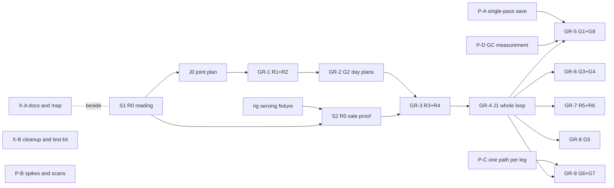

# Next tracks: prove a sale, X, P, G and R

Joint slice plan for the approved work still unimplemented at `86c2e92` (11 November 2026). It follows Peter's [10 November city direction](../decisions/2026-11-10-city-direction.md) and the order on the [roadmap](../roadmap.md). Slices are large on purpose (Peter, t104u): one PR per row, not a swarm. The save schema stays 1; a slice that needs a format change changes it in place ([decision](../decisions/2026-11-09-schema-one.md)). Nothing here plans a release, a Workshop upload or an RLO change.

J0 stays the detailed design for G and R. This file sizes and orders those slices so they can be launched once J0 merges; J0 may split or merge rows without a new owner decision.

## 1. Status at the base

### Merged and recorded

F2, F5, F6, F8 (F8a to F8h), C5, E5b, E6b to E6f, F4a to F4e, F7a to F7d, F7f, F7p, F9a to F9h, X1 to X3, and the two fixes #202 and #205 are merged. The roadmap's Done list carries the PR links.

### Remaining approved work

| Item | Source | True status | Slice here |
| --- | --- | --- | --- |
| Rig serving fixture | roadmap, direction "Not yet proven" | partial: rig #70 and #71 installed, rig 11d and 11e running, no sale recorded | outside this repository (rig repository) |
| F8h-2 first sale and the shop-dependent rig rows | F8 plan section 7, rig reports #209 to #212 | not run: blocked on the serving fixture | batched rig run, no slice |
| F2c review-round coverage | STATUS, 11 November | partial: coverage check running on the PC | fix slice only if a gap is found |
| E6a Street Food vendor API | E6 plan | planned, Street Food repository | outside this repository |
| R0 native customer path | roadmap, direction | planned | S1 (reading), S2 (in-game proof) |
| X4, X7 | roadmap track X | planned | X-A |
| X5, X6, X9 | roadmap track X | planned | X-B |
| P1 | roadmap track P | planned | P-A |
| P2, P5 | roadmap track P | planned | P-B |
| P3 | roadmap track P | planned | P-C |
| P4 | roadmap track P | planned, rig capability | P-D |
| J0 | roadmap, direction | planned, after S1 | J0 |
| R1, R2 | roadmap G and R | planned | GR-1 |
| G2 | roadmap G and R | planned | GR-2 |
| R3, R4 | roadmap G and R | planned | GR-3 |
| J1 | roadmap G and R | planned | GR-4 |
| G1, G8 | roadmap G and R | planned | GR-5 |
| G3, G4 | roadmap G and R | planned | GR-6 |
| R5, R6 | roadmap G and R | planned | GR-7 |
| G5 | roadmap G and R | planned | GR-8 |
| G6, G7 | roadmap G and R | planned | GR-9 |
| F4f gate run record | F4 plan | planned, waits on sealed FT-F4 and FT-F9 fixtures and reserved caps | not launched now |
| F7e | F7 plan | superseded by P1, recorded not worthwhile (#211 check 2) | none |
| Recorded walk-through, final gate, hands-on session, single release | roadmap "Proof and release" | planned | not planned here |

## 2. Order

Prove a sale (S1, S2) starts now beside tracks X and P. X-A, X-B, P-A, P-B and P-C have no dependency on S1 and can launch together, subject to the file conflicts in section 4. Within G and R the order is Peter's: R1 and R2, then G2, R3 and R4, then J1, then G1 and the rest.

## 3. Slices

Every code slice runs the build, `python tools/test-focused.py` and its own new checks; the harness runs the full suite before merge. In-game checks go in the PR description and do not gate merge.

### S1: R0 reading of the game assembly

- **Scope.** Docs only. Read the game assembly in place (no decompiled code in Git): where `CustomerEntriesHelper` generates hourly entries and their orders; which business simulator processes each customer-facing business type (shops, services, gyms, nightclubs, cinemas, theatres, entrance-fee venues); what the native customer count already includes (price, marketing, location); whether a native entry can be bound to one resident and a spending ceiling checked before the sale commits. Measure nothing in game. Output: a table of processing families with the member names that J0 will cite.
- **Schema:** no. **Testing:** offline (reading). **Depends on:** nothing.
- **Owns:** `docs/plans/j0-living-city-and-sales.md` (its "Native customer path" section, started here).
- **Tests:** none; `tools/docs-links` passes.

### S2: R0 sale proof in game

- **Scope.** A diagnostic-only path (behind a `pc` command, no change to ownership rules) that lets one named resident take one native entry at an owned food shop, an owned goods shop and an owned service business, with a refusal on a ceiling below the basket and a reload in between. Uses the families from S1.
- **Schema:** no. **Testing:** rig-needing for the proof; offline tests for the Core side. **Depends on:** S1, the rig serving fixture.
- **Owns:** `Runtime/NativeSaleProbe.cs` (new), `Core/PurchaseProbe.cs` (new), `tests/PurchaseProbeTests.cs` (new).
- **Tests:** a ceiling below the order cost refuses before any native call; a refused or interrupted probe leaves wallet, receipts and native books unchanged; reload mid-probe leaves no half sale.
- **In-game checks:** one each for food, goods and service sale; one refusal; one reload.

### X-A: entry docs and code map (X4, X7)

- **Scope.** Bring `docs/behaviour.md`, `docs/glossary.md` and `docs/save-format.md` up to the code; write `docs/map.md` (tick path, save path, settings, partial classes, three recipes). No behaviour change.
- **Schema:** no. **Testing:** offline. **Depends on:** nothing; best after X-B removes dead code, otherwise X-B updates the map.
- **Owns:** those four files.
- **Tests:** `tools/docs-links`.

### X-B: tree cleanup and test kit (X5, X6, X9)

- **Scope.** Move `tools/*-regression`, their evidence JSON and the refilled `docs/checks/` and `docs/perf/` trees to a history tag; move the tool folders the test project compiles under `tests/`. Delete the E3 feasibility readers (`Runtime/*FeasibilityReader.cs`, `RemainingBatchFeasibilityReaders.cs`), the street proxy (`Core/StreetProxyGeometry.cs`, `Runtime/StreetProxy*.cs`, `Runtime/NativeStreetProxyDiagnostics.cs`), the traffic kernel's physical-control branches and saved field (in-place format change), and legacy representation code with no caller. One test city builder, one fake planner, one golden hash per fixture, measurements behind `PC_PERF_ASSERTS`; drop source-text tests.
- **Schema:** no bump; the removed kernel field is an in-place format change and needs its golden hash updated once. **Testing:** offline. **Depends on:** nothing. Serial with P-A on `Persistence/` and with P-B on `Core/TrafficKernel.cs`.
- **Owns:** the deleted files, `tools/`, `tests/` (kit files and moved folders), `Core/TrafficKernel.cs` (deletions only), `Persistence/CompactWire34.cs` (kernel field only).
- **Tests:** suite count may drop; every deleted test is listed in the PR with the invariant test that still covers it; golden hash for each fixture.
- **Reserved:** whether F0's interior experiment goes with X6. See Q5.

### P-A: single-pass save (P1)

- **Scope.** One writer and one strict reader straight from the snapshot inside the existing save callback; replaces the compact columnar writer path. Capture, validation and encoding timed separately in `SaveCostDiagnostics`. No worker or sidecar.
- **Schema:** no bump; the wire changes in place at 1 and older development cities are refused with "start a new city". **Testing:** offline for round-trip and refusal; rig-needing for the 40 ms p95 target at 3,000 persons. **Depends on:** nothing; serial with X-B on `Persistence/`.
- **Owns:** `Persistence/SaveCodec.cs`, `Persistence/SaveSnapshot.cs`, `Persistence/CompactWire34.cs` (replaced), `Persistence/SaveCostDiagnostics.cs`, `tests/SaveRoundTripTests.cs`.
- **Tests:** round trip at 957 and 3,000 persons; corrupt, truncated and other-schema payloads refused without overwrite; wallets and native receipts from one capture; `CurrentSchemaOnlyTests` unchanged.
- **In-game checks:** save p95 at 3,000 persons with autosave off in the window; reload continuity.

### P-B: known spikes and per-frame scans (P2, P5)

- **Scope.** Move optional-stop scene reads off the event path; smooth the first frames after a speed change; cache the 30-second RLO reflection read and the path-cache clear; index active optional stops; sync car progress only for visible cars.
- **Schema:** no. **Testing:** offline for correctness; rig-needing for the spike numbers. **Depends on:** nothing.
- **Owns:** `Runtime/OptionalStopEnvironment.cs`, `Core/OptionalStopScheduling.cs`, `Runtime/NativeGameSpeed.cs`, `Compatibility/RloRoadSpeedOverrides.cs` (read cache only, no RLO change), `Runtime/PhysicalVehicles.cs`.
- **Tests:** stop index equals a full scan over a seeded day; invisible cars resume at the kernel position; speed change replays identically.
- **In-game checks:** no mod-work spike of 30 ms or more at the three known sites.

### P-C: walkers keep one path per leg (P3)

- **Scope.** One NavMesh path per leg with along-leg tolerance, replacing the half-metre recalculation. Takes the F2c coverage-check result into account.
- **Schema:** no. **Testing:** offline (F2 movement-equivalence harness) and rig-needing (walker cost). **Depends on:** the F2c coverage check.
- **Owns:** `Runtime/PhysicalPedestrians.cs`, `Runtime/PhysicalPopulation.Following.cs`, `Runtime/WalkingRoutes.cs`.
- **Tests:** movement equivalence within the F2 baseline; no identity change on pool reuse; interrupted leg resumes.

### P-D: Mono GC measurement (P4)

- **Scope.** Rig capability request plus a measurement run: GC pauses against heap at 3,000, 10,000 and 20,000 persons. Pool the per-event working copy only if the numbers call for it, as a follow-up row.
- **Schema:** no. **Testing:** rig-needing. **Depends on:** a rig capability in the rig repository.
- **Owns:** nothing in this repository except the measurement command if one is needed (`Runtime/MovementDiagnostics.cs`).

### J0: joint plan

- **Scope.** Docs only, per the roadmap row: day-plan model and executor, purchase contract, need model, household rules, capacity rule for homes without interior area, through-traffic share. Measures the revenue-scale gap and brings options to Peter (Q1).
- **Schema:** none. **Testing:** offline. **Depends on:** S1.
- **Owns:** `docs/plans/j0-living-city-and-sales.md`.

### GR-1: business types and the wallet (R1, R2)

- **Scope.** Every place carries its business type from the loaded catalogue, modded types included; new and closed businesses refresh. Budget and wages move from the food roster to the person; household essentials re-cut so a need is not paid twice. Food becomes one spender.
- **Schema:** no bump; in-place format change for the person wallet. **Testing:** offline; rig-needing for live refresh. **Depends on:** J0.
- **Owns:** `Core/Model.cs` (place type, person wallet), `Core/HouseholdFinance.cs`, `Core/FoodFinances.cs`, `Runtime/GamePlaces.cs`, `Runtime/FoodBusinessCatalogue.cs`, wallet wire in `Persistence/`.
- **Tests:** money conservation across the move; reload keeps wallets; a closed business leaves no dangling reference; unknown types get the neutral default.

### GR-2: day plans (G2)

- **Scope.** A plan per person per day, generated once with seeded draws and saved; one executor replaces the separate scheduling state for commutes, meals, opening waits and optional stops; work windows from workplace hours and a shift type.
- **Schema:** no bump; in-place format change. **Testing:** offline; rig-needing for the recorded walk-through. **Depends on:** GR-1.
- **Owns:** `Core/DailyRoutine.cs` (replaced), `Core/DayPlans.cs` (new), `Core/CitySimulator.cs` (scheduling state), `Core/OptionalStopScheduling.cs`, `Core/MealRhythm.cs`, plan wire in `Persistence/`.
- **Tests:** a reload mid-day continues the saved plan; late arrival, closed venue and missed item; identical replay at two cadences.

### GR-3: needs, impulse and one purchase contract (R3, R4)

- **Scope.** Need model with catalogue categories and a neutral default; impulse while passing; one purchase contract (resident, ceiling, intention in; confirmed result out) with food on the same checkout; adapters per processing family where S1 shows them.
- **Schema:** no bump; in-place format change for needs. **Testing:** offline; rig-needing for non-food sales. **Depends on:** GR-2, S2.
- **Owns:** `Core/Needs.cs` (new), `Core/PurchaseContract.cs` (new), `Runtime/NativeSalePath.cs` (new, grows from S2's probe), `Runtime/NativeFoodMarket.cs` (checkout moves onto the contract), `Core/FoodWeightedCommerce.cs`.
- **Tests:** ceiling refused before commit; a deferred need comes due again; food checkout unchanged by the golden F6h matrix; native counts calibrate only.
- **Reserved:** AGENTS.md ownership wording (Q4).

### GR-4: one whole loop (J1)

- **Scope.** At today's population: a resident earns, plans a non-food visit, travels, buys, pays and reloads. Integration fixes only.
- **Schema:** no. **Testing:** offline (F9c scenario arm) and rig-needing (the loop in game). **Depends on:** GR-3.
- **Owns:** `tests/Acceptance/` arm, `tools/acceptance` stage.

### GR-5: population and visitor table (G1, G8)

- **Scope.** Residents in homes the player cannot rent, with the second capacity rule from J0; size from P-A, P-D and GR-4 evidence. Visitor constants in `Core/PopulationCensus.cs` become a tuning table with named groups that lean toward business types.
- **Schema:** no bump. **Testing:** offline; rig-needing for frame and save at the new size. **Depends on:** GR-4, P-A, P-D.
- **Owns:** `Core/PopulationCensus.cs`, `Core/PopulationFill.cs`, `Core/HousingPolicy.cs`, `Core/CityBalance.cs`.
- **Tests:** every person has a home and a place; a group changes who comes, never what a shop is paid; census reproducible.
- **Reserved:** Q1, Q2.

### GR-6: evenings, weekends, households (G3, G4)

- **Scope.** Nightlife and late shifts, varied days off; one optional shared outing with a cancelling rule. Wallets individual.
- **Schema:** no bump. **Testing:** offline. **Depends on:** GR-4.
- **Owns:** `Core/DayPlans.cs`, `Core/VisitorSchedules.cs`, `Core/Households.cs` (new).
- **Tests:** a member who does not turn up cancels by rule; each pays from their own wallet; visitors get no household.

### GR-7: workplaces and feedback (R5, R6)

- **Scope.** Offices, factories and warehouses staffed on venue hours; inspector words and business panel for non-food visits, purchases and refusals with causes.
- **Schema:** no. **Testing:** offline; rig-needing for panel text. **Depends on:** GR-4.
- **Owns:** `Core/WorkplaceCapacity.cs`, `Runtime/ResidentInspector.cs`, `Runtime/FoodEconomyPanel.cs`, `Runtime/Localization/`.
- **Tests:** offline: workers arrive before opening and leave after closing, and no workplace holds more than its capacity; a closed venue staffs nobody; native production and wages are unchanged by the golden fixture; every refused non-food visit and purchase records one cause, and the panel model lists it. Batched rig check: inspector and panel text for a visit, a purchase and a refusal.

### GR-8: through-traffic cars (G5)

- **Scope.** Anonymous cars edge to edge in the traffic kernel; inspector says "Passing through the city"; share is a setting with a low default.
- **Schema:** no (not saved, regenerated). **Testing:** offline; rig-needing for queues. **Depends on:** GR-4.
- **Owns:** `Core/TrafficKernel.cs` (entries), `Core/ThroughTraffic.cs` (new).
- **Tests:** offline: through-cars enter and leave only at map edges and count toward road capacity like resident cars; they never park, carry no passenger and get no person ID; the share setting at 0 leaves the kernel identical to today; reload regenerates them without touching saved state. Batched rig check: queues at the default share and the inspector line.
- **Reserved:** Q3.

### GR-9: bodies and own cars (G6, G7)

- **Scope.** Fades, wider appearance and wardrobe, higher walker cap; the mod's own kinematic cars replace borrowed native cars and their IL hooks.
- **Schema:** no. **Testing:** rig-needing. **Depends on:** P-C, GR-4.
- **Owns:** `Runtime/PhysicalPopulation*.cs`, `Runtime/PhysicalVehicles.cs`, `Runtime/PhysicalTrafficHooks.cs`.
- **Tests:** offline: a journey gives the same legs, times and arrival with own cars as with borrowed cars over a seeded day; person and car IDs survive pool reuse, reload and camera movement; appearance is reproducible from the person ID. Batched rig checks: walkers fade in and out without popping; parked cars stay where their owner left them across reload; no native car is borrowed and no IL hook is installed.

## 4. File conflicts

- `Persistence/`: P-A, X-B (kernel field), then GR-1, GR-2, GR-3 in that order. One `Persistence/` slice at a time.
- `Core/TrafficKernel.cs`: X-B, then GR-8.
- `Core/OptionalStopScheduling.cs`: P-B, then GR-2.
- `Runtime/PhysicalVehicles.cs`: P-B, then GR-9.

## 5. Reserved questions for Peter

None blocks the slices above; each has a default the plan uses until answered.

- **Q1. If visitors are not enough to keep your shops' income at the game's normal level, what should give?** Options: lower income, one visit counts as several customers, or higher spend per visit. Default: none until J0 and GR-5 bring numbers.
- **Q2. Should players see and change the visitor table?** Default: hidden balance settings only.
- **Q3. How much of the traffic should be cars just passing through?** Default: a low share, about 10 percent.
- **Q4. Once one sale path works for every shop, should the mod take over customers at every player business automatically?** Default: yes, after S2 and GR-4 are proven in game; AGENTS.md wording changes in that PR.
- **Q5. The old interior-view experiment is off by default. Delete it?** Default: keep it until X-B, delete unless a plan still needs it.
- **Q6. Performance caps for present, foreground and priority work (F4f).** Reserved; F4f stays unlaunched until answered.

FoodChoicePriceWeight (1.2), FoodChoiceHouseholdWeight, the F6h criterion and the F6i and F6j rules are not changed by any slice here.
