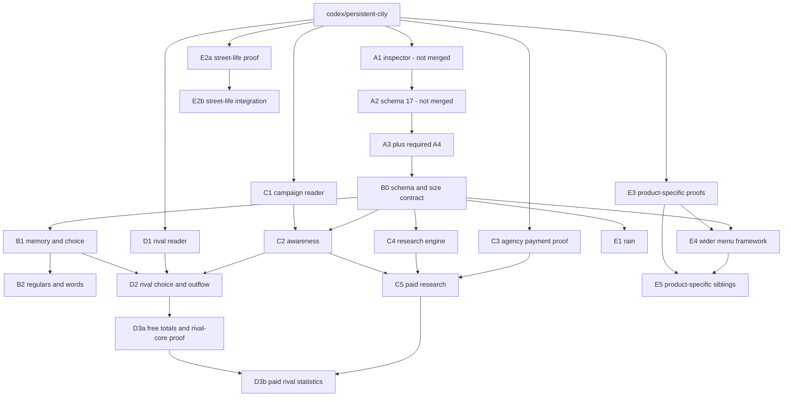

# Steps B–E: memory, marketing, rivals and the wider street

Planning record, 31 October 2026. Documentation only. Inspected development head: `73129e0fc93772e4d1460a71aea7d174186454e1` (`origin/codex/persistent-city`). Step A is **not merged**: A1 / PR #4 was read at `ee9486b17db082aff1f764251568fb4670ffca2a`; A2 / PR #5 at `41c870f64f8d5495285026daa99029ea4033bb95`, using `git show`, without checking either branch out. The [Step A plan](step-a-inspector-traits-choice.md), including its A2 status note, is on those branches; its link becomes available on integration. A3 is in flight: its plan, rather than unfinished implementation, is the interface assumed below. All new names, formats, defaults, sizes and effort estimates below are **proposals**, not existing APIs, measured savings or product approvals.

## Scope and decisions carried forward

[Peter's roadmap](../roadmap.md) governs product decisions 1–8, order **A → B → C → D → E**, standing performance practice and the single release after the complete roadmap. Its later decisions supersede the phase order, obsolete schema numbers, inspect-mode suggestion and rival scope question in the [27 October review](../reviews/2026-10-27-realism-gameplay-roadmap.md). README and CHECKS describe evidence for particular candidates; older opt-in, menu and schema statements in design/food documents are historical, not new requirements.

- **B:** loyalty-driven memory, curious exploration and regulars; stockout, closure and queue disappointment lower return probability according to traits. About four remembered shops **per consumer**, including represented slots, not four per physical anchor.
- **C:** campaign awareness and targeting, plus paid market research **through marketing agencies**. Awareness admits a possibility; it never guarantees consideration, a journey or a sale. Individuals remain described in words. New city-wide market distributions and catchment estimates belong behind paid research.
- **D:** rival food businesses become genuine alternatives with an explicit resident-money outflow. Rival registrations, stock, finances, prices, demand, campaigns and special-rival defenses receive **no native writes**.
- **E:** weather, street life, verified wider menus and products after the core loop. No employees/payroll integration, households, general detour planner, nutrition system, rival AI or economy rewrite.

Keep Core pure C# / netstandard2.1, native and Unity access in Runtime, and all RLO access behind Compatibility. Never substitute identities or generate demand to rescue a business. Existing whole-business ownership changes only at safe native accounting boundaries; unsupported businesses remain native-owned. The detached food shadow stays hypothetical and cannot book sales. A city without its saved food scope gains no economics from traits, inspection, research previews or weather.

Implementation PRs land through ordinary review and proof gates on the development line, with no interim Workshop release. Nothing here authorizes an ordinary-save deployment. This planning session runs no build, tests, game or rig tooling and changes no config.

## Verified seams and gaps

Paths are repository-relative. “Verified” means present in the inspected source, **not** fresh native proof. Cross-project field names quoted by the older review remain leads until independently checked against the then-targeted game assemblies and a disposable native fixture.

| Area | Source-backed seam | Gap / implementation constraint |
| --- | --- | --- |
| Stable consumers and traits | `Core/Model.cs`: `CityState.Seed`, `CitizenState.Identity`, assignments, visits. A2 `Core/ResidentTraits.cs`: ten version-1 bands; `ResidentTrait.LoyaltyCuriosity` runs curious 0 → loyal 4. `Core/FoodRepresentation.cs`: `FoodRepresentation.ConsumerId`, fixed factor 1–3, distinct slot wallets and `MealExcursion`. | A2 generates loyalty but deliberately omits its words and behavior. No saved shop-memory collection exists. Do not regenerate traits from visits, wealth, bodies or campaign targets. |
| Step A choice contract | A2 `Core/FoodToday.cs`: `FoodChoicePolicy` bounds: eight shops, four offers/shop, four contexts/meal and one city-wide route-bearing decision. `FoodDecisionState`, `FoodDecisionShop`, quote states/cursor, `ResidentMeal.LastContextKey` / `ContextAttempts`. A3 plan: weighted all-shop shortlist, then feasibility and probabilistic choice. | A2's type named `FoodChoicePolicy` currently supplies constants, not A3's finished algorithm. B–E extend A3's captured inputs and common live-choice seam, including existing-stop and represented decisions; do not implement another chooser or increase routes. Reconfirm A3/A4 continuation behavior before branching. |
| Actual experience | `Core/FoodCommerce.cs`: `Step`, `Finish`, `ConfirmPurchase`; `Core/FoodStops.cs`: `ObserveStop`, `DecideAtStop`. A2 `Core/FoodToday.cs`: `MealOutcomes`, `MealReasonCode`, `MealOutcomeRecord`, `ResidentFoodToday`. | A2 current-day outcomes replace by meal identity; they are not an experience history. Nonpurchase outcomes do not retain a shop. Capture the selected/visited business **before** reset; do not reconstruct disappointment from `Today` or count every rejected candidate as a bad visit. |
| Regulars and inspection | A1 `Core/ResidentInsight.cs`: pure `ResidentInsight.Capture`; `Runtime/ResidentInspector.cs`: hover/click popup; `Runtime/NativeMap.cs`: `TryFocus`, existing `cityMap.FocusOnBuilding` guarded by `CityMap.CanOpenMap`. A2 adds trait words and recorded meals. | Add words such as “usually returns here” only once B behavior exists. Keep stable selection and pool-generation checks; no customer percentages or numbered personality scores in the popup. |
| Observed business feedback | `Core/FoodMarketHistory.cs`: `FoodShopDay`, `RecordChoices`, `RecordPurchase`, fourteen-day observed shop history. `Runtime/FoodEconomyPanel.cs`: `BuildEconomyText`, three-second open-panel refresh, native account display. | Offer counts include repeat decisions, not unique prospects. No unique-regular index or paid report entitlement exists. Own observed sales/accounts can remain free; a free trait/catchment dashboard cannot be added here. |
| Native campaigns and agencies | `Runtime/NativeFoodAccounts.cs` reads `financialSummaries` / `businessIncomeStatements`, including `MarketingExpenses`. No campaign, agency ordering or research adapter exists in Core/Runtime. | The older review's `marketingCampaigns[]`, `marketingTypeName`, `enabled`, `promotion.trafficIndex/marketing/total` are **unverified leads**, not an API contract. `MarketingExpenses` proves an expense, not who a campaign reached. Agency identification, supported campaign types/targets, order UI, fee debit and durable payment evidence all need discovery. Never call a provider/demand helper just to inspect it. |
| Rival identity and advertised offer | `Runtime/FoodBusinessCatalogue.cs`: `ReadSelected` copies an existing `controller.buildingRegistration`; `BusinessIdentity` includes address, creation day, type and player/rival owner. Reads `businessOwnerRivalId`, `retailPrices`, `cachedAvailableProducts`, `scheduleDays`, temporary closure and `satisfaction.customerService`. Offers initially have unknown units. | These reads are not restricted to players, but the live market is. Same-day same-owner/type/address replacement is not fully generation-proof; establish a native discriminator or refuse ambiguous replacement. A name/address alone cannot transfer loyalty. No special-rival-defense reader exists. It is unnecessary for D and stays out. |
| Player supply and native authority | `Runtime/NativeFoodMarket.cs`: `Supported`, `DiscoverShops`, `ReadLocal`, live `Buy`, scoped `ResidentPrice`. `Runtime/NativeFoodOwnership.cs`: `HourlyCustomers`, `CustomerSale`, acquisition/handoff guards. `Runtime/FoodSupplyReader.cs`: `ReadMenu`, native producer/counter inspection on `FullServiceBusinessSimulator`. | `Supported` requires a player business, a fully reviewed menu of at most four, bags and no entrance fee. `FoodSupplyReader` explicitly returns **unknown rival supply**. Do not bypass those refusals, create rival simulators or enroll rivals in `FoodScope`/authority. |
| Money and settlement | `Core/FoodMoney.cs`: exact overflow-checked integer `Money`; `Core/HouseholdFinance.cs`: `SpendingLimit`, `HoldPurchase`, `ConfirmPurchase`, `CashConserved`. `Persistence/FoodSaleReceipts.cs` and `FoodCommerce.Step` handle uncertain native checkout. | `PreparedFoodSpent` currently means the existing purchase path; no distinct rival-outflow account exists. Add an exact outside account and transactional state, not fake native receipts/revenue. `docs/food-demand.md` identifies `GameManager.ChangeMoneySafe` in native daily settlement; that does **not** verify a safe agency-purchase API. |
| Weather | `Runtime/OptionalStopEnvironment.cs`: `Raining => RainHelper.isRaining`. `Core/OptionalStops.cs`: rain prevents/ends optional stops. `Core/DwellPlanner.cs`: `QueueAtOpening`, dry lead 2–10 minutes, rain lead up to 5 and fewer queuers. `Runtime/PhysicalPopulation.cs` already reads rain. | Rain is a verified boolean read. No season/temperature/forecast contract is established. Food decisions and optional outing initiation have no captured weather input. Do not cancel work, committed travel or paid purchases when rain starts. |
| Street life already exists | `Core/OptionalStopScheduling.cs`: breaks on work visits, window shopping, park-edge resting, paired chats, arrival-based performer audiences, persisted continuation and chance transfer. `Runtime/OptionalStopEnvironment.cs`: geometry/availability. `Runtime/StationaryCrowds.cs` suppresses anonymous standers while keeping performers/homeless. | The older proposal to “add breaks/chats” is partly implemented already. Work assignments are not native employee contracts. Nightclub frontage is checked for `ChatOutsideVenue`; arbitrary bars need separate evidence. Expand/validate existing stops rather than spawn another population or duplicate queues. |
| Products | `Core/FoodProducts.cs`: only croissant, burger, hot dog and provisional meal fits. `Runtime/FoodSupplyReader.cs`: one stock unit/product, verified producer resources, shared bags/counters, rejects converted/shared resources. Native checkout revalidates live stock/price/staff. | Catalogue-reader allowance of sixteen selected product IDs is not sale support. Coffee, salad, ice cream, soda and water are **candidates from the review**, not verified product IDs, recipes or eligible menu items. Each must pass producer/equipment/bag/order/settlement proof before activation. |
| Configuration | `Runtime/PrototypeSettings.cs`; `PopulationRuntime.Initialize` in `Runtime/PersistentCityMod.cs` loads `<ModRootPath>/persistent-city.json`. `tools/build.py` copies the flat source template `config/persistent-city.json` to `build/PersistentCity/persistent-city.json`; README and `docs/stationary-citizens.md` document this installation path. | Add flat top-level keys to the existing settings type and template. No loader/path migration, second config file, nested sections or precedence/fallback loader is needed. Follow Step A's clamp-and-log-once convention. |
| Persistence and RLO | `Persistence/SaveCodec.cs`: strict schema contracts, `CheckShape`, `ValidateFood`, money migration, character/record caps; `SaveStore`, `SaveSession` preserve refused payloads. `Compatibility/RloIdentityAdapter.cs`, `RloBridge.cs`, reservations/speed adapters and [RLO contract](../rlo-contract.md). | A2 owns population schema 17; shadow schema is separate. RLO identity/read readiness does not provide marketing, rival checkout or research writes. Contract mismatch refuses; never modify RLO or recreate a donor. |

## Common implementation contract

### Work, choice and replay

Extend A3 with proposed pure, bounded input contributions: memory affinity, awareness/source, alternative kind, weather sample and product attributes. Capture them at the **existing logical decision context** before weights are drawn. Store the policy/config revision and the inputs necessary to resume; do not read mutable campaigns/rain again halfway through a resumed context. Changing cache warmth, UI state, frame budget or catalogue order must not change a captured shortlist/draw. A genuine new context still consumes A3's four-context allowance; a campaign update or memory lookup cannot reset it.

Admission order through B retains A3's weighted metadata shortlist. From C2 onward: enumerate bounded awareness-source samples → deduplicate/capture eligibility and source → weighted eight-shop shortlist → existing complete feasibility checks → weighted offer/outside choice. C2 defines this candidate interface before D uses it. B's memory can influence shortlist weights and final choice, with bounded positive multipliers. It cannot force its four remembered shops into extra slots. D's rivals share those **same eight slots**, never eight more. C/E add no route-based targeting or explanations. Every supported shop has positive distant admission probability through the bounded discovery source; sampled aware candidates retain positive shortlist weights irrespective of distance. Factual access, deadlines and evidence can still make an offer infeasible. Awareness changes eligibility, not a price discount or service-capacity multiplier.

Retain at most eight outward and eight return **request slots per context**, no refill after infeasibility, shared quote cache bounded at 512, and at most one city-wide route-bearing decision with at most sixteen routes of 512 legs each. Existing committed excursion/return replanning remains the existing safety path, not an excuse for another candidate search. Report actual native path calls, including cache invalidations, separately from logical requests. No UI, memory, campaign targeting or research query requests NavMesh routes.

Any new city/shop scan is event-driven, on demand or continued in bounded units, never `residents × shops` per Update. Campaign sampling has a logical publication boundary and a cursor; research counts a bounded number of consumers per continuation. Publish coherent snapshots only when complete; hold the logical event where needed rather than exposing half an awareness image. A3's food continuation/event-order implementation must be inherited, not assumed to exist merely because `CitySimulator.PendingEvent` handles resident routes. D may enlarge the indexed catalogue to 20,000 place-backed player/rival alternatives, but it cannot introduce an O(S) per-consumer awareness or shortlist pass. C2's fixed source bounds below apply at both 1,024 and 20,000 alternatives; shared index construction/refresh is budgeted separately. D2 measures that established contract and whole-day throughput, rather than waiting for the rig to discover a need to redesign C2.

Food-policy changes activate next logical day for new, uncommitted opportunities. Committed A3/older trips, queues, prices, receipts, held money and returns finish with their captured terms. No receipt retry after an unknown native result. Freeze a typed effective food tuning snapshot for the active day; retain at most **two** revisions plus the one pending decision's inputs. A long unresolved old commitment needs its recorded terms, not indefinite config-history retention. Native safety revalidation still overrides a previously feasible offer, without a new draw or fabricated visit. E2b uses the existing optional-stop setting semantics: reload reads the flat config, only newly admitted visits use changed tuning, and already saved stops/choices retain their end times and continuation. It needs no new food-policy header or schema.

### B: experience and loyalty

Proposed `ShopMemory` belongs to a stable consumer ID and a **business generation**, not a door, name, body or chain. Keep at most four entries. Capture a confirmed served visit once; capture a closed/stock/queue failure only after a consumer actually committed to or reached that shop and the evidence names the cause. A rejected distant candidate, inability to afford a price, unknown evidence, lost route or the consumer's own interrupted schedule is not proof of bad service. No invented “price rise disappointment,” product boredom or district reputation accumulator from the older review in this scope.

Each compact entry has last experience day, saturated served count, signed bounded affinity and last actual cause. Compute decay lazily from the logical day; there is no midnight sweep or unbounded visit diary. Loyalty increases habit strength/persistence; curiosity rewards trying a not-yet-remembered alternative. Bad visits always lower return chance relative to the same pre-visit state, with queue impatience and time pressure strengthening relevant disappointment. Loyal people may forgive more, but a high loyalty band cannot turn a stockout into a positive experience. Config controls the magnitude, never eliminates feasibility or probability floors.

Use a compact experience watermark keyed by intent day, meal, context ordinal and ordered outcome stage. Same-context observation, `Finish`, receipt reconciliation and reload cannot apply a visit twice. Unconfirmed checkout is neutral until evidence resolves; late confirmation updates the original business once even after midnight. Make the watermark transition and memory update one simulator commit. No global ever-growing set of processed intent IDs. At insertion, evict the least effective affinity, then oldest experience, then ordinal business ID; expired entries go first. Bound counts/scores, and test the tie order independently.

“Regular” is a projection of retained evidence, provisionally at least three confirmed served visits, positive effective affinity and a visit in the last fourteen days. It is not a new saved per-shop resident list. Build transient shop counts lazily/with an indexed update at memory commit; never rescan all consumers for each displayed shop. Own-customer regular counts are observed operating feedback; city-wide loyalty distributions require C research. The inspector gets phrases and recent observed causes, not numeric memory scores. Lowering a configurable capacity from four retains saved entries until normal replacement/expiry; it must not erase state on load.

### C: awareness, targeting and a paid research order

Avoid the older proposal's saved eight-known-shops list per consumer. C2 owns a proposed bounded awareness-source enumerator, usable unchanged when D adds rivals. It combines remembered visits, cheap neighbourhood/routine geometry, targeted campaigns and a bounded per-day distant discovery sample. Curiosity/loyalty influence choice after exposure; they do not make an unaffordable or impossible visit succeed.

| Awareness source | Hard work/admission bound per context | Shared index and positive-probability rule |
| --- | --- | --- |
| Memory | At most four remembered business references. | Direct generation-safe lookup; no search through the catalogue. These count toward the common source union, not extra shortlist slots. |
| Neighbourhood/routine | At most four draws for each of home, work/study and current origin: twelve candidate slots total; at most nine spatial cells per anchor. | A bounded multilevel spatial index chooses the cell scale covering the configured radius. Select by bucket mass and indexed slot, not by walking every shop in a dense cell or taking only the first entries. Out-of-radius/invalid draws consume their slot without refill. |
| Campaign | At most eight draws across the consumer's matching groups/exposure days. | Build shared group/day/type weighted indexes from the bounded campaign images at coherent publication. Group membership and overlap are fixed-size trait/routine checks; selection never scans 1,024 campaigns for each consumer. Zero-reach/unknown evidence produces no admission. |
| Distant discovery | At most eight seeded draws from the complete supported catalogue per consumer/logical day, gated by the discovery probability. | Ordinal, generation-keyed indexed slots give every shop positive probability irrespective of distance. Use consumer/day/source/policy keys; do not persist eight discovered IDs for every consumer. Repeated contexts reuse the day's derivation under the captured catalogue revision. |

The union is at most **32 source slots**, with deterministic deduplication and no refill after duplicates, exposure refusal or infeasibility. Capture only the bounded union IDs/source flags/revision and resulting A3 shortlist at the one held decision, not an awareness matrix. Rank at most 32 eligible candidates into the same eight slots: O(32 × 8), then at most sixteen route requests. This samples known opportunities rather than exhaustively enumerating all known shops; positive distant discovery preserves the roadmap's absence of a distance cutoff. Test indexed draws for permutation independence, dense cells, overlapping groups, small/empty catalogues, catalogue replacement, changed cadence and save/reload. Rebuild shared indexes deterministically from saved campaign evidence and existing places on load; never run an all-shop awareness predicate per meal. Index/reference storage is bounded by the 20,000-place and campaign-image ceilings, with no resident-by-shop allocation. C2's saved input image and performance proof must establish these bounds before D2 branches.

Keep campaign evidence **per business**, with at most eight reviewed campaign types and eight logical days of activity masks/first-observed boundaries. Native state is sampled at the next logical hour boundary; only observations actually made can create exposure, never reconstructed past campaigns. During a hidden skip, observe each permitted accounting boundary without guessing earlier activity. A complete image is published atomically, then individual exposure is derived on demand. Capture its eligibility/source in the decision. Retention/decay derives from the saved masks and stable draws, so stopping a campaign does not erase yesterday's awareness or require a per-consumer awareness set. Test hourly toggles, midnight and reload for cadence independence. If the native contract cannot substantiate a campaign type or target, label that input unknown and add no campaign exposure; do not multiply `promotion.total` into sales.

Map verified native campaign types to explicit reviewed groups such as commuters or health-oriented consumers. Group membership uses existing traits/routine facts; an assigned workplace is not native employment. Overlapping groups count one consumer once. Native fees/campaign controls remain native; PC does not purchase or mutate campaigns. Route-passing awareness is optional later work: it requires a bounded spatial index over already committed geometry and its own proof. It is **not required** for C and adds no hidden all-route/all-shop intersection pass.

Research is a separate product: select a verified marketing agency, choose city-wide or address catchment coverage, see a quoted fee/date/coverage, explicitly buy, then open the dated report. No free preview of its market numbers. Use household/trait bands and usual activity locations as model estimates, with represented demand labeled. A straight-line/walking-time lower bound is an **estimate**, not a route-tested customer forecast. Actual footfall requires counted committed visits or verified native traffic evidence; `building.trafficIndex` (`GamePlaces.Read`'s `NativeTrafficIndex`) is a native index, not a count of people passing. No forecast of guaranteed sales/profit. Research holds one coherent logical query event while reducing consumers in bounded units into at most 64 counters plus a cursor/revision; units share the ordinary work budget and may repeat within a frame while budget remains. It does not deep-copy a 150,000-consumer city or retain resident IDs/rows in the report. Measure completion latency and simulation lag as well as frame cost. An unpaid partial query can restart after reload; a paid report must already have its frozen contents persisted. No paid job depends on an unsaved population-sized snapshot.

Proposed order flow: `Quoted → ChargePending → Paid → Delivered`, with `PaymentUnknown` as a blocking reconciliation state. Freeze request ID, agency identity, scope, price, logical snapshot/revision and the report before the charge can be accepted. One order may be pending city-wide; double-clicks reuse its ID. Use a **verified** native purchase/transaction path, not a guessed agency method, a direct cash-field edit or a second resident-food debit. Save the native payment evidence and own entitlement in the existing coordinated save boundary; save cannot interleave inside that main-thread transaction. A native exception after entry is unknown, not a refund or permission to charge again. Deliver only on proof of payment; reload before/after debit/delivery must neither charge twice nor grant a free report. An uncharged quote/partial research job can be canceled/restarted after reload; paid report content cannot be regenerated from newer city facts.

C3 below must discover and prove the agency UI/debit/transaction evidence contract. If it cannot, C5 and dependent D3b remain incomplete and the final release waits for a safe agency-backed implementation or Peter's answer to Q2; a free debug report is not a replacement. Agency payment support cannot block B, C2 awareness, D2/D3a's rival/outflow proof or E street-life work. Fee/timing/report packaging remain product questions; their recommendations below are provisional, not silently approved.

### D: real alternatives without a native rival transaction

Add a proposed `FoodAlternativeKind` discriminator to captured candidates/commitments. A rival reader copies only existing registrations and advertised, exact representable prices, hours, door/access and known service ratings. It never calls `GetBuildingRegistration`, `CustomerEntriesHelper.GetEntriesByAddress`, native supply setup, checkout or any provider/demand recalculation. `FoodSupplyReader.ReadMenu` cannot establish rival stock. Do not silently set `Units=1`, `MealsPerHour` to player capacity or call unknown supply “in stock.” Q4 proposes an explicitly labeled outside-market availability assumption; keep it separate from observed player supply, and gate activation on that decision/evidence contract.

An eligible rival participates in awareness, the common shortlist and probabilistic choice like a player business. Known closure/invalid price/access excludes it. A selected rival owns a real timed outing/return for slot zero and the usual represented excursion for other slots, within the existing deadlines. No second body, native customer entry or transaction is manufactured. Revalidate readable rival identity/price/hours at arrival; withdrawal or changed terms ends/refunds safely, with no automatic substitution. An ownership transfer player ↔ rival invalidates old target authority; memory never crosses an ambiguous generation.

At successful modeled outside service, move exact resident funds to a dedicated `ExternalFoodSpent` account **atomically in Core**, once per intent/settlement watermark. Its spend remains subject to `SpendingLimit`, arrears, holds and future-essentials protection. In allowance-only legacy scopes, use the same daily limit without creating money. Reject overflow before commitment. Proposed conservation becomes opening + income = balance + essentials + household food + player prepared-food spend + external food spend + held purchase. Keep native player checkout and its existing receipt namespace unchanged; a rival's modeled payment is never a `FoodSaleReceipts` native-sale proof. No uncertain native checkout exists on this purely own-ledger path, but interrupted own settlement still must be exactly once.

Show an explicit “food bought outside managed businesses” outflow line, separate from native player sales/revenue/profit. The **free panel shows only the dated city-wide outflow total and purchase count**, plus lifetime totals; it exposes no rival names, per-rival amounts/counts, rankings or shares. Market shares, rival catchments and trait breakdowns belong to paid research. Keep at most fourteen dated total rows; optional named-rival buckets (at most 128/day plus “other”) are saved solely as internal input to entitled paid reports, never as free panel/API output. Aggregate overflow buckets without losing amounts/counts or inventing rivals' finances. Individual accounts retain `Money` bounds; city-wide totals must use exact wider sums, as `Money.TotalUnits` already does for diagnostics. Give saved aggregate unit totals a canonical nonnegative integer encoding capped at 32 decimal digits, validated against population, time and price bounds, not a floating sum or an overflowing single-consumer `Money`. Include these totals inside the history allocation. Extend today's outcome wire target kind so a modeled rival purchase is distinguishable from a confirmed native player checkout. B may remember the **modeled** rival experience, with wording that does not claim observed native stock/customer service.

### E: extend verified behavior in small increments

Capture dry/rain/unknown at a new optional outing or food context. Rain reduces new discretionary outing admission and soft travel preference; preserve a positive chance for distant aware shops and do not reintroduce A's removed hard walking cutoff. Unknown weather is neutral and stated. Work/study, paid food, existing journeys, road capacity and movement speed stay under existing rules. Already committed opening queues keep their existing lead; existing optional-stop cancellation/paired continuation rules still apply. There is no native weather write or new season model. A new weather sample cannot trigger another decision attempt by itself.

Street-life work first proves what already exists: opening queues, breaks at assigned work venues, paired chats, window shopping, park resting and passing audiences, at 0/25/100 settings and through rain/night/reload. Improve bounded timing/venue eligibility only where it adds a visible consequence, using the saved optional-stop state and shared facade budget. Do not add staff identity, duplicate native standers, new actor budgets or performer-destination trips. A claim about bars beyond the existing nightclub check requires a separate verified venue mapping. Preserve chance conservation/pass-on and food priority. Any broader anonymous crowd or general commuter density change requires Q6, not an E2 implementation assumption.

Wider menus keep one product per meal and one service/bag pool per shop. Propose a hard maximum **eight** reviewed offers per shortlisted shop in E4's later additive schema, keeping schemas 17/18 and the effective live limit at four until E4/E5 proof. Eight shops × eight offers is 64 cheap offer evaluations and still at most sixteen route request slots. Sixteen catalogue-reader selections never mean sixteen live offers. Audit every linked bound: `FoodScope.AdditionalProductIds`, `NativeFoodMarket.Supported`/menu identity/supply cache, `FoodSupplyReader.ReadMenu`, A3 snapshots/selection, reservations, `FoodProductSales`, `MealRhythm.ProductPenalty`, `SaveCodec` and product explanations. Do not widen one guard while another silently drops the menu.

Do not change A2's ten-band version-1 order or regenerate existing tastes. New product taste bands can be a versioned, pure projection of saved seed + stable consumer ID + canonical product code, calculated when needed. Pin a city-level product-policy version/code table; persist no per-consumer growing taste dictionary. Existing three tastes retain their saved bands. New explicit meal-fit/health/quality tags are reviewed gameplay priors, neutral when unknown, not fabricated native nutrition. Recipe-dependent products remain unsupported until the native contract is separately extended/proved; no resource conversion guessed by PC.

Each newly approved product gets its own E5 PR and native proof of equipment eligibility, shared capacity, one-unit/resource/bag delta, exact price debit, completed order, daily settlement and reload. Unsupported menu edits trigger the existing safe whole-business handoff; supporting a subset does not permit suppressing native demand for the rest. Coffee/drinks/combos, carts, ingredients, nonfood needs and additional meal opportunities are not automatically authorized by “more products”; Q5 settles the first product set and whether a drink substitutes for a meal.

## Save contract, allocation and headroom

### One owner per additive schema, after discovery

Reserve **population schema 18** for B0's compaction, bounded B memory/experience watermark, business references and capability/revision mechanism only, after A3's schema-17 shape is settled. Reconfirm the number before implementation; if consumed, allocate the next free version centrally. B0 does **not** freeze campaign/research/payment/rival/weather/menu wire shapes or add empty future DTOs. The later allocations below are budget reservations, not fields already required by schema 18. Keep `persistentcity:state_v1`, detached shadow schema and existing native authority/receipt formats unchanged unless separately proven necessary.

| Contract owner | Shape freeze prerequisite | Additive allocation rule |
| --- | --- | --- |
| B0 | Stabilized A3; existing B experience and identity evidence | Proposed 18: compact existing records, B memory/references and capability support. Retain the schema-17 four-offer limit. |
| C2 awareness | C1's campaign evidence/type mapping and bounded-source index design | Next centrally allocated version, provisionally 19 if still free; campaign state and bounded source/decision capture only. No agency-payment fields. |
| C5 paid research | C3 has established actual agency payment evidence; C4 report bounds/content are known | A separate next-free additive version, allocated **after C3**, for the real order/evidence/entitlement/report shape. An unresolved C3 reserves no numeric slot or migration dependency for D. |
| D2 rival/outflow | D1 has established the rival identity/discriminator and offer evidence | Next-free additive version **after D1**; outside target/settlement/account and D3a total-history contract. Optional paid-report buckets are bounded internal data. No dependence on C5's shape or payment proof. |
| E1 weather | Existing verified rain seam and exact new-outing/decision capture requirements | Next-free additive version for weather fields only. Does not wait for products or agencies. |
| E4 menus | E3's first supported product/equipment proof and finalized product/history code table | Next-free additive version for the eight-offer envelope and menu/taste/history additions. E5 siblings allocate product codes centrally, not competing wire shapes. |

Only the schema owner edits that migration/resolver/shape/count contract. Allocate numbers at shape freeze on the then-current development contract line, not independently on sibling branches; C5 may therefore receive a later number than D or E if payment discovery is delayed. A small reviewed **inactive contract/migration commit** can land before its behavior, letting other slices inherit known shapes without inheriting a failed rig feature. Never merge two different formats under one version, reserve gaps for an unknown native API, or make another feature stack on an unproven payment implementation just for its schema number. If a newer shared contract lands meanwhile, forward-merge that contract and allocate the next free number; preserve every previously published version-specific reader. Record the final allocation in its implementation PR.

Freeze **version-specific limits**: schema 17 and B's schema 18 still reject a fifth captured offer when a later E contract permits eight. Unknown capability/enum codes cannot be backported into an old version's accepted shape. Newly added modules start inactive/unknown/empty with zero new spending until their own activation boundary. A binary that cannot execute an active capability must **refuse simulation and preserve the payload**, not interpret it as inactive or write it away. Include supported-capability checks at the early authority bootstrap as well as population startup so refusal cannot release managed businesses to overlapping native sales. Later native discoveries can change a proposed format before its own freeze; they do not force a speculative B0 migration to be rewritten.

Consumer DTO extensions should have one compact versioned wire contract, not several verbose nested objects per resident. Proposed fixed-width memory encoding: three base-36 characters for a business reference (≤20,000), four for logical day (covers the codec's 1,000,000,000-minute limit), one saturated served-count digit, one signed-affinity code and one outcome code: **ten ASCII characters/entry**. A seven-character day/meal/context/stage watermark plus four entries, property/quote/delimiter overhead fits the 64-character allowance below. Define a canonical alphabet and exact lengths; malformed, out-of-range or surplus input refuses. This is an allocation sketch to validate in B0, not a codec already present.

The business reference table stores the **complete** business identity and existing place reference once. Never truncate/hash away the identity, infer a new business from an old door or reuse a live referenced token. Count all memory, pending decisions/payments and retained reports before reclaiming an unreferenced entry; deterministic reuse happens only at a coherent event boundary. At most 20,000 entries **and** a combined 2 Mi-character / 2 MiB UTF-8 table budget. When new historical memory cannot fit, retain existing references, leave the new experience unremembered with a counted capacity diagnostic, and keep checkout/finances intact; never evict a live transaction. Ambiguous native replacement is unknown, not inherited loyalty. Memory saturation affects the approximation explicitly; it cannot corrupt identity or discard a receipt.

| Saved location / future owner | Cardinality and wire rule | Maximum additional character allocation at 50,000 × 3 consumers |
| --- | --- | ---: |
| Consumer memory + experience watermark / B1 | ≤4 entries; ≤64 ASCII chars **including field overhead** per consumer. Empty when inactive; no visit journal. | 9,600,000 |
| Shared business references / B0 | ≤20,000 complete identities; combined escaped-character **and UTF-8** limits; existing place references, not repeated address text per memory. | 2,097,152 |
| Campaign evidence / C2 | ≤1,024 current player-business images, ≤8 reviewed types and ≤8 days each; ≤512 encoded chars/image including overhead. No resident known-shop arrays. Retired images are removed after coherent publication; memory references remain separate. | 524,288 |
| Research / C5 | ≤1 pending order; ≤16 delivered reports; ≤64 numeric cells/report with fixed metric codes and bounded labels; all order, entitlement, evidence and frozen report data together ≤256 Ki chars / KiB UTF-8. Paid full-cap orders are refused **before charging** until an old report is explicitly replaced. | 262,144 |
| Rival target/settlement watermark / D2 | ≤1 variant on the existing active `ResidentMeal`, ≤24 additional ASCII chars/consumer. Reuse saved price, destination, deadline and excursion; no duplicated rival receipt/route tree. | 3,600,000 |
| Exact external-food account / D2 | One nonnegative integer `Money` amount per budget in its compact tuple; ≤20 chars including separator. Other totals derive from existing budget fields; no lifetime receipt list. | 3,000,000 |
| Outside-food history / D3a, paid projection / D3b | ≤14 dated total rows; optional ≤128 named-rival buckets/day plus “other” are internal paid-research inputs only. Free output contains totals/counts alone. Fixed exact amounts/references; total ≤1 Mi chars; never drop amounts at bucket limit. | 1,048,576 |
| Weather / E1 | Captured code/boundary/revision on existing decision/commitment: ≤24 ASCII chars/physical resident for optional-outing state (also without food), plus ≤8 additional chars/consumer inside the compact extension. Includes field overhead; no weather time series. | 2,400,000 |
| Extended menu history / E4 | Budget for compact product cells at ≤14 × 1,024 business-days × 8 products = 114,688 cells, ≤128 chars/cell (fixed product ref, counts, money and meal counters). Count/revenue sums must retain existing invariants. | 14,680,064 |
| Product attributes / E4–E5 | ≤16 reviewed product definitions; ≤8 active offers/shop; table/version and finite tuning priors ≤64 Ki chars. No resident taste arrays. | 65,536 |
| Policy/config/capability headers / each contract owner | ≤2 effective revisions + one pending input capture; fixed keys/arrays, no arbitrary JSON dictionaries; aggregate across later contracts ≤64 Ki chars. B0 defines only the B mechanism. | 65,536 |
| Larger one-city decision image / C2, E1, E4 | One image only, ≤32 source slots before the eight-shop shortlist, up to 64 offers after E4, weather and existing ≤16 route answers. **Additional** reserve above schema 17, allocated only in the owning later contract; no new route allowance. | 1,048,576 |
| **Total proposed additive envelope** | Includes inactive/reserved overhead in the relevant row, not an extra object on every resident. | **38,391,872** |

These are ceilings for proposed additions, not evidence that every combination of existing codec maxima fits. New per-consumer codes/tuples and product/metric codes are ASCII, so their character budgets are also UTF-8 byte budgets. Localized words/names are projected at display time, not copied into these records. Reference/report native text must satisfy both escaped-character and UTF-8 bounds. Bound embedded arrays **before** allocation and include their logical entries in `MaxEmbeddedRecords` even when encoded as strings/tuples. Retain the 4,000,000-record, 50,000-resident, representation ≤3, 20,000-place, string/depth and route caps. A compact string must not conceal an unlimited list or bypass money-token validation. Escape expansion and UTF-8 bytes are measured separately; characters are the actual input-cap unit.

The menu-history allocation assumes at most 1,024 business-generations represented per day. Business churn can exceed that even with 1,024 live scopes. B0/E4 must test this separately: preserve existing historical records, enforce the whole-payload cap and refuse an unsupported serialization atomically; do not truncate old history or silently omit product totals to meet this estimate. Any new hard historical-generation ceiling that would reject a previously readable city needs explicit compatibility review, not a hidden schema-validator change. A release cannot claim ceiling safety from the no-churn fixture alone.

### Compaction must precede new per-consumer state

A2 CHECKS measures the end-of-day schema-17 fixture at **240,680,899 characters** for 50,000 residents × factor 3: **89.7%** of `SaveCodec.MaxInputCharacters = 268,435,456`. Remaining headroom is **27,754,557 characters**, about **26.47 Mi-characters**. Its normal factor-2 ceiling is 173,518,997 characters, but the supported factor-3 case must not be dropped. A2 explicitly says real journeys/visits add more: 89.7% is a lower-bound cap share, not a worst possible save. The additions above exceed the remaining headroom by **10,637,315** characters even before those journeys.

**B0 is a capacity prerequisite**, not optional optimization: target at least **52 Mi-characters (54,525,952)** recovered against that same A2 fixture, and a fully populated B–E stress fixture no larger than **85% of the existing cap (228,170,137 characters)**. With exactly the target recovery plus the additive envelope, arithmetic gives 224,546,819 characters (83.7%); this is a planning budget, **not a measured result**. B0 measures its actual fields plus synthetic byte-budget reservations for later additions, not invented future native-evidence DTOs; each later contract measures its real inactive/active fields and actual A3 decisions against that reserve. If the proposed compact formats do not achieve the budget, revise them in B0 before B1 activates; never raise the cap, lower population/representation support or discard histories as a shortcut.

First candidate: a schema-18-specific canonical positional `ResidentBudget` wire tuple preserving all existing exact amounts/posting facts, and a compact `ResidentFoodToday` header with shared shop/product references in its purchase records. Source inspection counts **315 key/quote/colon characters in the eighteen current budget properties**, or 47,250,000 at 150,000 budgets, before replacement overhead; removing them alone cannot establish the 52 Mi-character target. The remaining recovery must be **measured**, primarily from repeated today's-meal headers/identities. Keep old budget/outcome readers unchanged for schemas 13–17. In memory the typed records and financial rules need not change.

This narrow wire-size work is required for capacity, not permission to unpark the save-serialization performance rewrite. Do not redesign the city traversal, introduce compression of the entire payload, pool the full save graph, alter coordinated saves or optimize the four parked hotspots. Review the extra converter risk independently. Record actual size, write/read time, retained memory and any cheap measured win; if safe compaction is insufficient, stop activation and return a revised capacity design for review.

Measure reference 957, 5,000 and 50,000 residents at factors 2 **and 3**, not just empty `Today`. Saturate four memories per consumer, long/escaped identities, three bought meals, 64 visit histories, active/interrupted decisions, long existing journeys, all campaign/report bounds, eight-item menus and historical business churn. Do not multiply every unrelated route/traffic maximum and pretend it is a supported simultaneous case; publish exact fixture composition and cap failures. Legal source saves close to the cap may still lack growth room: preflight migration **and projected bounded additions**, refuse/preserve rather than write an unreadable upgraded payload. Demonstrate a useful growth reserve in representative long-session fixtures before final release; the 85% target is not a guarantee for all future traffic/history growth.

### Migration and refusal

1. Freeze a schema-17 resolver/shape contract before current becomes 18, then a dedicated source contract at every later bump. Accept valid 13–17 and each subsequently published known version through its own contracts and existing exact legacy-money rules. Validate source shape first; do not deserialize old data through a new tuple contract or silently default missing required fields.
2. Upgrade atomically in memory: preserve identities/traits, consumer linkage, assignments, optional-stop chances, wallets/arrears/posting dates, active journey/checkout/receipt/return terms and all historical money exactly. B0 initializes memory empty (never inferred from shop totals). At their own later bumps initialize campaigns unknown, reports absent, outside spend zero, weather unknown and product policy on the existing three products, without resetting already-present features. Activation starts next day; older unresolved commitments keep their policy.
3. Validate all new shape/count/reference/capability/money invariants and preflight serialized size before `SaveStore`/`SaveSession` may publish. No new migration write outside the normal native/own coordinated save. Codec failure leaves the source dictionary value/reference/text preserved; refusal cannot release ownership to a second sales engine.
4. Refuse and preserve schemas 1–12, future schemas above the binary's current version, unrecognized schema numbers, bad/missing/duplicate/unknown fields, wrong tuple length/alphabet, unsupported capability/config/product-policy versions, foreign population, duplicate/reference-reused businesses, impossible settlement stages, negative/overflowing exact amounts, oversized collections/strings and incoherent pending input images. Apply each new check only in the contract that introduced it. Unknown live native evidence disables that input; malformed persisted state is **not** repaired into a favorable default. A historical closed business may remain an opaque reference without becoming checkout authority.
5. Old schema-17 executables refuse 18 as future; schema-18 executables likewise refuse later allocations as future. Within any published format, an executable missing an active capability refuses simulation. Downgrades are unsupported. A changed published shape, range meaning or money definition always receives another centrally allocated next-free version, with exact migration/refusal fixtures and affected siblings updated; no incompatible format reuses a number.

## PR slices, effort and proof

Effort means focused engineering days, excluding rig scheduling/review/fix rounds, not deadlines. Each row is a separate reviewable PR. Normal implementation validation includes focused invariant tests, affected adapter/source-contract harnesses and the normal full offline gate in an available environment. Those are **future** runs; this docs session runs none. Every row also receives its own performance re-measure, including read-only/native-discovery PRs when their code runs in game. PRs changing in-game behavior require a `rig_test` session (**Codex Sol, high**) and verifiable before → red / after → green screenshots, logs or executable assertions attached to the PR. No proof, no behavior merge/release clearance. Synthetic timing does not replace native proof.

Each performance cell below is **in addition to** the common protocol in the next section, not an exception to the 5 ms gate.

| Slice / scope | Effort | Offline/headless proof at the actual seam | Required future isolated PC proof | Per-slice performance focus |
| --- | --- | --- | --- | --- |
| **B0 — schema 18 B contract and size reserve.** Narrow compaction, strict old/new readers, B memory/references and capability/revision mechanism only. No loader migration or frozen C/D/E wire fields. B behavior inactive. | 4–6 | Differential 13–17 →18 exact state/money replay, all A2 refusal fixtures, wrong tuple/capability/reference/future data preserve original payload, full-size budget fixture and synthetic later-byte reserve. Assert no economic/policy change when B inactive. | Load/migrate/reload an interrupted A3 food trip and uncertain receipt, compare native accounts/authority before/after; exercise invalid/future data without overwriting. Capture cap/read/write evidence separately. | Migration/init/retained memory and serialized chars/UTF-8 bytes; ordinary-play codec-independent overhead and combined gate. Save profiling only in a separately requested run. |
| **B1 — memory capture and loyalty policy.** Four-entry state, watermark, lazy decay/eviction, A3 input/weight contribution, activation boundary. | 3–5 | Confirmed/refused/unknown and late receipts exactly once; actual failed visit vs candidate rejection; curious/loyal response curves across seeds; unchanged accounts/route count; saturation, turnover, different budgets and mid-update reload. | Matched loyal/curious cohorts; served days, induced stockout/closure/queue, recovery days 3–6. Same checkpoint replay preserves choices/memory, and full-day native receipts still reconcile. | Four lookups/candidate, no midnight sweep; saturated memory at reference/5k, rush decisions and lag; combined p95/max and byte growth against B0 allocation. |
| **B2 — regulars and inspector words.** Read-only projection, observed own-shop regular counts and cause wording; no saved regular list. | 1–2 | Regular threshold/expiry/eviction, unique consumer vs offer count, stale body generation, no UI mutation/market/route calls. Counts only actual retained evidence. | Follow one known regular, stockout disappointment, pool/camera/reload continuity; own/represented stories remain distinct. No free city-wide loyalty chart. | Popup closed/hover/open and multi-shop panel; bounded cached projection refresh, no per-shop population sweep; total gate. |
| **C1 — native campaign read contract.** Isolated Runtime reader, detached typed snapshot, reviewed type/target map; no choice or new save state. | 1–3 | Doubles for missing/type-changed members, malformed/disabled/duplicate campaigns, detached copies, unknown promotion; source assertions exclude mutating helpers. | Read existing native campaign types on/off; prove the type→resident-group mapping and exact fields/lifecycle/sample timing, with unchanged native customer/account data from the reader. No native target-selection control is presumed; unsupported types stay unknown. | Cold/warm snapshot reads with 1/8/maximum scopes, coherent refresh cursor; no full catalogue scan per meal; gate with reader exercised. |
| **C2 — awareness and targeting.** Own additive contract after C1; saved campaign masks, bounded source enumerator/shared indexes, A3 eligibility/source capture, flat config keys and words. | 3–4 | Exact migration/refusal of its added state; stable exposure across permutations/cadences/reloads, overlapping groups, dense cells and positive distant discovery; ≤32 source slots /8 shortlisted shops /16 route requests. No per-consumer catalogue/campaign scan or partial sampler publication. | Campaign-on/off matched targeted cohorts, trait/price/deadline rejection, stop/expiry/reload; native fees remain once/native. Confirm bounded enumeration at both player-only and 20,000 mixed-catalogue fixture sizes. | Shared index build/refresh vs per-context work, maximum campaign images/8-day retention, fixed source touches and rush throughput; combined gate and actual added bytes. |
| **C3 — agency order/payment seam discovery.** Identify existing agency selection/UI and a native fee path with durable evidence; isolate capability from food checkout. No paid feature activation or premature payment wire freeze. | 2–4, uncertainty high | Typed adapter contract, invalid quote/agency, insufficient funds, double-entry guard and exceptions before/after native entry. No fabricated native API accepted by doubles alone. | Disposable agency fixture: capture real UI/provider binding and native transaction/cash before/after one quoted purchase; prove how save/reload establishes debit identity or document the missing seam. | UI open/close, cold binding, quote/payment overhead, no polling/scans when closed; combined gate. Failure blocks C5 and transitively D3b/final roadmap acceptance, not C2, D2 or D3a's decision-7 proof. |
| **C4 — bounded research engine and access contract.** Pure snapshot/counting over traits, usual locations and observed visits, dated report DTO; no public free report UI or native charge. | 2–3 | Each consumer once/group/window; represented labels; unknown vs zero; straight-line estimates not route counts; ≤64 cells, deterministic paged continuation and capped caches; entitlement tests reject unpaid access. | Read-only diagnostic comparison at a known fixture: manual cohort counts vs generated snapshot, time-skip/reload boundary; no product UI exposes unpaid report data. | Request-time work at 957/5k/50k, proposed ≤256 consumers/unit, total completion time, allocations/retained snapshot; zero routes, no closed-UI work; gate while query runs. |
| **C5 — paid research product.** After C3/C4, freeze its own additive order/payment-evidence/report contract; agency UI, quote/reconciliation, entitlement, explicit replacement at cap and words vs paid statistics audit. | 3–5 | Exact migration/refusal plus crash/reload at every order stage, duplicate click, missing payment evidence, insufficient funds, agency closure, report cap and city changes after paid snapshot. No free report/no double debit. | Buy through a real agency, reload before/after charge/delivery, compare exact native fee/transaction once and the same paid report; unpaid/unknown requests reveal no market data. Demonstrate city-wide and address research. | UI idle/open, query → quote → delivery, sixteen reports, serialization bytes and payment atomic-section max; combined gate. Failure blocks paid research/C completion and D3b, not the free D3a outflow line or rival-core proof. |
| **D1 — read-only rival catalogue.** Native identity/offer/access reader outside authority, includes replacement/ownership-change refusal. No choice or money. | 1–3 | Rival vs player split, finite/exact prices, unknown stock, closure/hours, duplicate identities, same-day replacement ambiguity; spy adapters fail on registration creation, supply setup or any writer. | Observe a real rival's price/hour/ownership changes on a disposable fixture without native modifications by the reader. Hash/capture rival native fields before/after; absent supply remains unknown. | Lifecycle catalogue build/refresh and retained metadata at large shop count; detailed reads only for shortlist, no O(residents × rivals) refresh; gate. |
| **D2 — rival choice and own-ledger outflow.** Freeze its additive contract after D1; alternative variant, C2's existing bounded enumeration, timed visit and exact outside settlement. No native rival purchase or C5 dependency. | 3–5 | Exact migration/refusal; budget/allowance conservation, overflow rollback, slot-zero/represented travel/return and settlement exactly once. At 20,000 mixed alternatives retain ≤32 source slots /8 shops /16 quote requests, no O(S) per-context pass. Unknown-supply policy is distinctly tagged. | Rival absent → timed alternative/one outflow; vary prices/hours, replay outward/service/paid/return. Prove **zero native rival writes** and unchanged player receipts. | Mixed maximum indexed catalogue, shared rebuild cost vs fixed per-context touches, cold/warm quotes, ledger/catch-up, combined gate and bytes; confirms C2's design. |
| **D3a — free outflow history/line and rival-core acceptance.** Stack on D2 only; fourteen-day totals/counts, honest wording and memory/awareness replay. Named buckets, if captured, remain internal paid-report inputs. | 1–2 | Exact history/ledger reconciliation, retention and bounded buckets; free panel/API expose only totals/counts, never names/rankings/shares. Repeated outcomes and late settlements count once. | Free dated outflow reconciles resident debits; rival visits create no native receipts; managed price/stock/hours regressions and mixed memory/awareness reload pass without an agency purchase. | Free panel open/closed, late settlements, mixed rush and total gate; history bytes bounded. No C3/C5 prerequisite for decision-7 proof. |
| **D3b — paid-report rival/market-share integration.** Stack on C5 plus D3a; entitled projections of the internal rival buckets, separate from free outflow totals. | 1 | Unpaid/unknown/replaced entitlement cannot access named aggregates; named + other equals exact totals; frozen paid report survives replay. No inferred rival profit. | Buy a report and verify named rival data appears only there; unpaid free panel remains totals-only before/after purchase and reload. | Paid report open/closed, all retained buckets, request/serialization growth and combined gate. A failed C3/C5 blocks this slice, not D3a. |
| **E1 — rain in new outings/food decisions.** Its own additive capture contract using the verified rain seam; optional outing admission with committed travel/stop rules retained. | 2–3 | Own migration/refusal plus dry/rain/unknown; monotone admission/travel preference across seeds without hard distance exclusion; no work/paid-trip cancellation; saved input vs changed live rain, no context reroll or additional routes. | Dry/rain matched fixture and transition mid-trip/queue/paired stop; reload at capture/departure; native clock, movement and checkout unchanged. Weather source failure stays neutral. | Sampling/capture and optional admission cost, rainy rush/cold quotes; no per-resident per-frame reads; total gate and bounded weather bytes. |
| **E2a — existing street-life proof and venue discovery.** Existing kinds, approved 25% chance mechanics, rain/night/food priority; establish any additional native venue mapping without enabling it. No new setting, schema, timing policy or population. | 1–2 | Existing `OptionalStopSchedulingTests`, share/handoff/food coverage; discovery doubles for missing/ambiguous venue facts, read-only access and fixed bounds. | Record visible queues, work breaks, chats, park/resting and passing audience at day/night/rain; establish the red cases for E2b and source/native proof for any venue extension. No claimed behavior fix where baseline already passes. | Existing actor caps, facade/spot queries and admission occupancy scans at 25/100; exercise any reader and re-measure total gate. No refresh-hotspot rewrite. |
| **E2b — bounded street-life timing/venue integration.** Flat keys in existing settings/template, only E2a-proven venue eligibility, existing saved stop/continuation mechanics. No B0/schema dependency, new actors or identity ownership. | 1–2 | Defaults preserve behavior; per-kind maxima clamp between `OptionalStopPolicy.Minimum(kind)` and `DwellRules.For(kind).MaximumMinutes`; chance conservation, partner return, 0/25/100, pool/camera/reload and food priority. | Before-red → after-green for E2a's concrete visibility/timing cases, including rain, night and reload; no duplicate standers, blocked entrances or phantom employees. Record if no additional venue can be supported. | Default vs tuned durations/venues at existing caps, facade work/occupancy, inspector open/closed after composition and total gate at 25/100; no refresh rewrite. |
| **E3 — per-product native feasibility records.** Read catalogue/equipment/producer/price contracts for one candidate at a time, with disposable diagnostic checkout proof where appropriate. No automatic enrollment expansion. | 1–2 **per candidate**; unsupported candidates may stop here | Native doubles from actual discovered contract; shared/converted inputs refused, equipment mismatch/bags/counter sharing; keep unsupported products native-owned. | One candidate's actual producer resource/bag/order/price/settlement deltas and reload, including shortage/equipment change. A failed candidate does not block another candidate's discovery. | Native setup/checkout costs for that candidate vs current three; stock/menu read allocation and total gate; no source proof substituted for native compatibility. |
| **E4 — bounded wider-menu framework.** Freeze its additive eight-offer/product/history contract after E3; coherent supply cache and derived tastes; no unproven product enabled. | 2–4 | Own migration/refusal, all four-offer guards, old contracts still reject fifth offers, ≤8×8 offers /16 route slots, shared queue/bags, product-history sums/size/churn, unsupported handoff and config/reload. | Largest currently E3-proven mixed menu, product removal/menu edit at accounting boundary, shared shortages/counters, exact checkout/reload. Four→eight is an offline envelope test until enough products/equipment are verified; no dummy native products. E5 proves newly enabled widths. | Four vs eight offers offline; native maximum **verified** menu, shop/history stress, supply cache, choice/allocation/lag and bytes; total gate. No eight-offer clearance from four products. |
| **E5-<product> — one verified product activation.** Add only that product's reviewed definition/taste/fit/words and eligibility. No extra meal/cart. Repeat this sibling slice per approved product. | 1–2 per supported product | Same saved old traits/choices when new item absent, native-type/equipment restrictions, response across seeds, absence/unknown neutral, supply and full accounting regressions. | E3 proof repeated at final implementation head with natural meal choices, product substitution, mixed-menu contention, uncertain receipt/reload/full-day settlement. No manufactured nutritional/native claims. | Product present/absent matched rush, menu maximum, native price/stock reads and total gate. Supporting product A never certifies B. |

Do not sum the table into a promised delivery date. The high-uncertainty work is save capacity, safe agency payment evidence and per-product native recipes. If A3 needs A4 continuation to pass the gate, that is part of the A3 prerequisite for all food integrations, not a B–E optimization debt.

## Dependencies and branching

The product sequence remains B, then C, then D, then E, with one final release. Independent branches can establish their own development/rig acceptance without a failed unrelated feature: in particular, D2/D3a's decision-7 alternative/outflow proof does not wait for C5's agency product, while D3b and complete roadmap acceptance do. An unfinished earlier step still prevents final integrated acceptance/release; it is not an artificial code/schema dependency on every later proof. Never branch from the entire unmerged integration pile merely to get one helper. All branch names below are recommendations for later work; this task creates none.

| Slice | Recommended base / stack | What a failed rig proof blocks |
| --- | --- | --- |
| B0 | **Stack on A3**, including A4 if necessary; B-only schema/compaction, not a native-discovery or loader hub. | New saved features need its capacity/strict migration; independent readers and E2a/E2b remain possible. |
| B1 | **B0**. | B2 and D2's integrated experience path, not C1/C2/C3/C4 or E1/E2/E3. |
| B2 | **B1**. | Its own presentation; no downstream code should depend on its UI. B acceptance still needs the inspector consequence. |
| C1 | **Independent from `codex/persistent-city`**; Runtime reader only, no A DTO or settings dependency. | C2/C5 campaign integration, not agency discovery, B or rival/product readers. |
| C2 | **B0**, merge C1's reviewed reader; allocate its own awareness-only additive contract after that discovery. Sibling of B1/C4/E1/E4; B memory view is empty if B1 inactive. | C5 and transitively D2/D3a/D3b need its bounded awareness interface; B and independent preparation continue. No agency-payment dependency. |
| C3 | **Independent from `codex/persistent-city`** for native discovery/adapter contract; no A/B schema or food-checkout dependency. | C5's contract/payment activation and transitively D3b/complete roadmap acceptance. **Not D2/D3a**, C2 or E. Never couple campaign reads to research checkout. |
| C4 | **B0**, a sibling of C2; A2 traits arrive through A3. Defines pure report projections/access checks, not a persisted payment/entitlement format. C5 freezes that wire contract after C3. | C5 and paid D3b only; no rival-core or street-life branch. |
| C5 | **C4**, merge C3 and C2; allocate/freeze its own additive order/evidence/report contract after those discoveries, using the next free number. | Paid product/C completion and D3b, then final roadmap acceptance; not D2/D3a's outflow line or native proof. |
| D1 | **Independent from `codex/persistent-city`**; plain detached offer observations, no enrollment/`FoodScope` changes. | D2's identity/settlement contract and D3a/D3b; C and E continue. |
| D2 | **C2**, merge D1 and B1; freeze its additive rival/ledger/history contract only after D1. No stack on B2 or C5 and no research-schema slot reserved ahead of it. | D3a/D3b and rival-core behavior; no agency, street-life, weather or menu proof. |
| D3a | **D2 only**, using its known history contract; no C5, C3 or B2 dependency. | Decision-7 outflow/core acceptance and dependent D3b; no paid-product or E development dependency. |
| D3b | **C5**, merge D3a; paid-report projections only, no changes to free outflow output or new native payment path. | Paid rival/market-share acceptance and final integrated acceptance, not D3a's rival-core result. |
| E1 | **B0 / stabilized A3**, sibling of B1/C2/E4; own centrally allocated weather contract based on the verified rain seam. No marketing/rival formulas. | Weather only; no product/agency/street-life implementation chain. |
| E2a | **Independent from `codex/persistent-city`**, existing optional-stop schema/mechanics/settings and isolated read-only discovery only. No A3 types or B0 config dependency. | E2b's proof/venue integration only; weather and products continue. |
| E2b | **`codex/persistent-city` once E2a lands** (or stack only on E2a until then). Add flat settings/template keys through the unchanged loader; existing saved stop fields need no schema bump and no B0 dependency. | Its street-life change only. Product/rain branches continue; merged food-priority proof is repeated without inventing a schema prerequisite. |
| E3-<candidate> | **Independent sibling from `codex/persistent-city` per candidate**; proof/adapter discovery without automatic menu expansion or schema. | Only that candidate's E5; other products can prove their own contracts. |
| E4 | **B0 / A3**, merge the first supported E3 proof, then freeze its own centrally allocated menu/product/history contract. Sibling of E1, not a stack on D3a/D3b. E5 clears wider native widths incrementally; E4 does not presume eight-product proof. | Wider-menu activations only; current three products/weather remain testable. |
| E5-<product> | **E4**, separate sibling per E3-proven and Peter-approved product. | Only that product; serialize shared product-table edits at merge, never force every product to stack on the previous one. |

These are code dependencies, not claims that mixed features can skip integrated validation. B0 owns schema 18's B/compaction contract only. Each later owner freezes its own `SaveCodec`/DTO/enum migration after the specified discovery, with centrally serialized number allocation and immutable old readers. Do not amend schema 18 for C/D/E. Contract-only commits may be shared without depending on their behavior's unpassed rig gate; no feature needs a guessed research schema. Each slice owns its distinct flat `PrototypeSettings`/template keys, with coordinated names but no new loader dependency. C1/D1/E3 readers should be separate files with no edits to `NativeFoodMarket.Supported`. B1/C2/E1 own separate policy contributors/tests, with minimal shared A3 wiring. E2b owns optional-stop presentation/eligibility; E4 owns menu-bound wiring. C5 alone owns agency ordering UI/payment integration, D2 the ledger, D3a free total-only output and D3b entitled named statistics. Reserve non-overlapping product codes before E5 siblings start; append definitions without renumbering old codes.

When a sibling prerequisite lands, prefer branching from updated `codex/persistent-city` rather than carrying the old stack. Until then, normal merges of the **named prerequisites only**, never cherry-picking an unpublished alternate migration, allow a concrete combined head for rig proof. No feature is declared independent if it needs unavailable DTOs or a new native writer. Schema allocation serializes contract publication, not payment-feature acceptance: other features can proceed around an unfrozen C5 contract. Re-run affected integrated replay/accounting/performance proof after composition, even if each sibling passed alone. One failed proof blocks its behavioral descendants and final acceptance, not unrelated development/proof. No aggregate release before A–E, final performance gate and Peter's hands-on session all pass.

## Tunables in `config/persistent-city.json`

New keys stay in the **existing flat top-level object**, implemented by `PrototypeSettings` and the repository's `config/persistent-city.json` template. `tools/build.py` already installs that template as `<ModRootPath>/persistent-city.json`, which the unchanged loader reads. There are no nested sections, dual paths or config precedence migration. Each feature adds only its own keys; E2b is independent of B0. Coordinate flat names to avoid sibling collisions, preserving A3's planned keys/weights/temperatures/seed domains. Per-kind/type/product key families below mean explicitly named flat properties for reviewed codes, not nested dictionaries or arbitrary product IDs. Defaults are calibration proposals; open product questions still require Peter's decision before activation.

Follow Step A's rule: missing keys use defaults, numeric values outside their range **clamp to the range and are logged once**. Preserve the existing converter's numeric-string and endpoint-clamping conventions, including its handling of infinities; unusable values (wrong type, NaN or in-range fractional values for integer keys) take the documented default with one bounded diagnostic. Malformed JSON follows the existing file-level failure path. Validate cross-field minima/maxima after clamping, and pass only finite effective coefficients to policies. No repeated per-frame parsing/logging, live watcher or automatic file rewrite. Edit with the city unloaded, then reload. Changed food tuning applies to new uncommitted decisions at its policy boundary; fees freeze at quote creation; E2b applies to new eligible visits under existing saved-stop semantics. Save only effective food revisions/inputs needed for replay. Future implementation checks cover the template→package→loader path, absent/malformed files, clamping/default/log-once cases and changed-config reload; no new loader is needed.

| Step / proposed keys | Default | Allowed range / meaning |
| --- | --- | --- |
| B `FoodMemoryWeight` | 1.0 | 0–2, bounded log-weight contribution; 0 neutralizes future choice effect without deleting memories. |
| B `FoodMemoryLoyalReturnMultiplier`, `FoodMemoryCuriousNoveltyMultiplier` | 2.0; 1.3 | 1–3 each at the respective extreme trait band; interpolate to neutral, no forced visit. |
| B `FoodMemoryServedGain`, `FoodMemoryStockPenalty`, `FoodMemoryClosedPenalty`, `FoodMemoryQueuePenalty` | 1; 3; 3; 2 | Integer 0–4 each, signed affinity remains −8…8. Relevant trait sensitivity multiplies penalties within bounded final score. |
| B `FoodMemoryBadVisitTraitWeight`, `FoodMemoryDecayDaysPerPoint` | 1.0; 2 | 0–2; 1–14 logical days/point before loyalty persistence scaling (bounded 0.5–2×). |
| B `FoodMemoryMinimumMultiplier`, `FoodMemoryMaximumMultiplier` | 0.25; 2.5 | 0.1–1; 1–3, enforce min ≤1≤max. Negative experience never increases the pre-visit return multiplier. |
| B `FoodMemoryCapacity`, `FoodMemoryForgetAfterDays` | 4; 28 | Capacity 1–4 (hard cap four); retention 7–90, lazy expiry. Saved entries aren't trimmed merely by loading with a lower limit. |
| B `FoodMemoryRegularServedVisits`, `FoodMemoryRegularRecentDays` | 3; 14 | 2–10; 1–28, observed regular projection only, not another choice bonus. |
| C `FoodMarketingNeighbourhoodMetres`, `FoodMarketingDiscoveryDailyProbability` | 250; 0.02 | 25–1,000; 0.001–0.20. Geometry is awareness, not a hard travel-feasibility radius; positive discovery covers distant shops across days. |
| C `FoodMarketingCampaignReachProbability`, `FoodMarketingTargetMatchMultiplier` | 0.25; 2.0 | 0–1; 1–4, finite saturating exposure probability; no preference/sale multiplier. Per **verified** type overrides use the same ranges. |
| C `FoodMarketingRetentionDays`, `FoodMarketingDailyReachDecay` | 7; 0.5 | 1–7; 0–1. Eight-day mask includes current day. Memory/local discovery remain separate sources after campaign expiry. |
| C `FoodMarketingSampleIntervalMinutes`, `FoodMarketingBusinessesPerUnit` | 60; 16 | 60–240 (logical boundary semantics); 1–64. Complete publication/clock backpressure preserves event order; lowering refresh cost cannot backdate exposure. |
| C `MarketResearchFeeDollars`, `MarketResearchDeliveryGameMinutes` | 1,000; 0 | Whole dollars 100–100,000, only inside the discovered safe native fee range; 0–1,440. Q1/Q2 pending. A quote freezes the actual price and snapshot. |
| C `MarketResearchCatchmentMetres`, `MarketResearchConsumersPerUnit` | 500; 256 | 50–2,000; 16–1,024. One consumer counted once/window; no routes. Hard limits sixteen reports, one order and 64 cells are not user-expandable. |
| D `RivalChoiceWeight` | 1.0 | 0–2 applied symmetrically to the outside candidate class; 0 disables new rival choices, not saved payments/returns. No minimum rival share. |
| D `RivalAssumedServiceMinutes` | 5 | 1–30, **only if Q4's explicitly modeled availability policy is approved**, never a claim of native capacity. Known hours/deadlines still apply. |
| D `RivalRefreshGameMinutes`, `RivalReadsPerUnit` | 60; 16 | 15–240; 1–64, lifecycle-cached metadata and coherent snapshots. Hard combined eight-shop choice limit remains unchanged. |
| E `WeatherRainOptionalOutingMultiplier`, `WeatherRainTravelWeightMultiplier` | 0.7; 1.3 | 0–1; 1–2. Fewer new discretionary outings, stronger soft distance preference; no new hard radius. |
| E `WeatherEnabled` | true | Boolean once E1 active; disabling affects future contexts only, not optional-stop safety or native rain. |
| E `WeatherQueueRainLeadMinutes` | 5 | 2–10 within existing dry maximum; only new queue commitments, existing queues retain their lead. |
| E `StreetLifeBreakMaximumMinutes`, `StreetLifeChatMaximumMinutes`, `StreetLifeWindowShoppingMaximumMinutes`, `StreetLifeAudienceMaximumMinutes`, `StreetLifeRestingMaximumMinutes` | Break 10, chat 30, window shopping 3, audience 8, resting 40 | Each range is `OptionalStopPolicy.Minimum(kind)`…`DwellRules.For(kind).MaximumMinutes`: break **5–10**, chat **10–30**, window shopping **1–3**, audience **2–8**, resting **10–40**. Clamp before `Duration()`; E2b only. No saved-stop restart or chance reset. |
| E `StreetLifeNightOptionalMultiplier` | 1.0 (neutral pending Q6) | 0–1, provisional Q6; scales opportunities before feasibility without changing work/meal ownership or adding bodies. Preserve `OptionalStopChoicePercentage` default **25**, existing 0–100 meaning/chance accounting. If incompatible with that denominator, require a separate product decision before enabling this multiplier. |
| E `FoodMenuMaximumOffersPerShop` | 4, then proposed 8 after E4/E5 proof | 1–8, hard schema envelope eight. Lowering cannot discard pending products or grant native/customer overlap; reconcile scope at accounting boundary. |
| E `FoodMenuNewTasteWeight`, `FoodMenuHealthWeight` | 1.0; 0 until reviewed tags | 0–2 each. Existing A3 weights remain in their established keys. Unknown tags always neutral. |
| E `FoodMenu<Product>BreakfastFitCents`, `FoodMenu<Product>LunchFitCents`, `FoodMenu<Product>DinnerFitCents` | Explicit reviewed 3-meal vector | Three integers 0–5,000 generalized-cost cents, not charged money. New product defaults recorded in its E5 PR, not invented here. No arbitrary product IDs gain sale support through config. |

Hot-path work caps (32 awareness-source slots with the stated per-source/cell bounds, eight shortlisted shops, four contexts, one route-bearing decision, sixteen route slots), schema/cardinality limits, exact-money precision, identity linkage and native ownership checks are **not tunables**. Rate/work settings may affect completion time but cannot alter deterministic decisions by changing the inputs halfway through an event. Log one active revision so a rig report can reproduce tuning without exposing private config contents.

## Standing performance and evidence protocol

Every B0–E5 slice re-measures **combined mod-work p95 <5 ms**. Report p50/p95/max and **flag every single mod-work spike ≥30 ms**, including count, condition and component when attributable. A 2 ms soft simulator budget or a small feature-only timer does not certify the gate. Whole-frame timing/stalls are separate watch items; do not attribute unexplained stalls to the mod without evidence or use whole-frame p95 as mod-work p95. The roadmap's 30 October baseline passes at pooled p95 1.259 ms (worst individual 2.420 ms), max 24.0 ms; it is historical evidence, not a fresh comparison for a new feature head.

For each PR, freeze before/after commits, effective settings/policy, dependencies, clock/body/graphics/population/shop setup, seed and checkpoints. Use interleaved matched ordinary-play windows at idle and breakfast/lunch/evening rush, closed/open relevant UI, cold/warm inputs and a soak. Include the slice's explicit stress case from the table, route/query counts, allocations/GC where available, retained memory, catch-up lag/throughput and pending work. Flag native nonpreemptible calls individually; yielding indefinitely to get a good p95 while meals accumulate is a failure. Startup/migration/reload/hidden skip are separate latency measurements, not ordinary-play samples. Attach raw logs/screenshots/assertions with enough metadata to reproduce red → green, not just a claimed pass.

Before **every** measured native window, record original autosave, disable it in the isolated profile and verify off again after every reload. Manual saves remain outside windows. Any save activity invalidates a clean performance sample. Save-specific profiling requires a separate explicitly requested run; the serialization sizes/CPU times above can first be measured offline. Restore original autosave, preferences and fixture changes during rig cleanup. Only named disposable FT cities on the owned rig may supply future fixtures. These are requirements for later authorized rig sessions; this task must not acquire a lease or touch game/test installations.

Physical population, closure refresh, optional-stop refresh and save serialization remain the **four parked high-risk hotspots**. Do not schedule a rewrite of them as a roadmap prerequisite. The narrow B0 capacity format work is scoped above; it must not become the parked serialization performance project. Every slice still looks for cheap measurable wins: share immutable prefixes, reuse metadata/snapshots, remove redundant loops/allocations, build strings only when UI is open, and reduce safe refresh frequency only with replay/invalidation proof. Record each taken win's before/after numbers in the roadmap performance-wins log during implementation; being below 5 ms does not waive this review. If the gate fails, isolate the new work first; do not automatically expand into the parked physical-population rewrite.

After all slices land, re-run integrated memory × awareness × rivals × rain × menus × paid-research replay, exact native player settlement, outside-money conservation, unsupported-business handoff, bad/future/capability saves, pool/camera continuity and a long-session bound/cap check. Obtain final-head rig proof/performance and Peter's hands-on acceptance before the one release. No behavior release without the specified `rig_test` proof; offline checks and planning agreement never substitute for it.

## Open product questions for Peter

These are **unanswered**, with recommendations for review. They do not block this plan or independent preparation. Implementers may build neutral contracts/readers, but must not turn a recommended answer into an approved product rule. Decisions already settled by the roadmap/A plan (probability, loyalty, four memories, agency-paid statistics, read-only rivals, release/order, words, no inspect mode) are not reopened.

| Question | Why it needs a product decision | Recommended default, pending Peter |
| --- | --- | --- |
| **Q1. Research packaging, fee and delivery?** One dated city report, address report, recurring subscription, or tiered products? | Changes what the player pays for and the ongoing money sink, not merely a technical bound. | One-off dated report per city/address request, proposed $1,000, delivered as soon as bounded sampling and payment finish; no subscription, automatic charge or live free refresh. |
| **Q2. What agency experience if native agencies have no safe extensible order/payment UI?** | The current code verifies neither a native research product nor an atomic agency fee API. Choosing a custom front end changes the player experience. | An agency-selected PC order panel explicitly attached to the verified native agency, using a proven native fee transaction; if that transaction cannot be proven, keep C5 unavailable and bring back the concrete limitation. Never offer free statistics as completion. |
| **Q3. Discovery/marketing promise for new shops?** Broad incidental discovery versus strongly campaign-led launch? | Both fit awareness-only marketing but produce different launch difficulty. | Cheap local home/work discovery plus small positive distant discovery; campaigns broaden targeted reach and remembered real visits persist. No guaranteed first-day customers or mandatory paid campaign. |
| **Q4. How should rivals handle unobservable native stock/service?** | Decision 7 authorizes rivals, but does not decide how to model unknown supply. Excluding all such rivals would make D ineffective; pretending observed stock would be false. | Explicitly modeled outside-market availability at readable advertised price/hours with a tunable assumed service duration; label it as modeled, with exact resident outflow and zero native writes. If Peter wants observed stock instead, require a separately verified read seam before D2 activation. |
| **Q5. First extra products and the role of drinks?** | Coffee/soda/water as a full meal substitute could change meal meaning; recipes may need a different verified checkout contract. | First add a small set of direct-stock **food** products that pass E3, one PR each; defer drink-only meal substitution, bundles and carts until Peter chooses. This is a recommendation, not a claim that salad/ice cream already pass native rules. |
| **Q6. How far should E change crowd density/night behavior?** | Existing saved optional stops already cover much of the older street proposal. A night density multiplier may conflict with the approved 25% realized-share denominator; anonymous crowds are a different ownership decision. | First prove/improve existing identified residents' rain/hour/venue behavior within the same actor/chance bounds. No new anonymous crowd or native-employee identity, and no new night multiplier until its effect on the 25% promise is agreed. |
| **Q7. What should a regular mean in player-facing feedback?** | Threshold/recency is visible product language and affects interpretation of small shops, though it need not change choice. | At least three confirmed served visits, positive effective memory and a visit in fourteen days; report only observed own-customer regulars free, keep city-wide loyalty distributions in research. |

## Verification boundary of this document

Read AGENTS, README, CHECKS, roadmap, Step A plan/A1/A2 source through Git, design, food-demand, neighborhood-economy, RLO contract, the 27 October review and their referenced Core/Runtime/Persistence/Compatibility seams. No external native API was inferred from a method name or cross-project note. No game assemblies, raw saves or private rig files were read by this planning task. No game, build, `dotnet test`, rig, lease, deployment or background process was started. The deliverable is this plan and one roadmap link; implementation, all proposed capacity savings, native contracts and every future rig/performance proof remain to be established.
