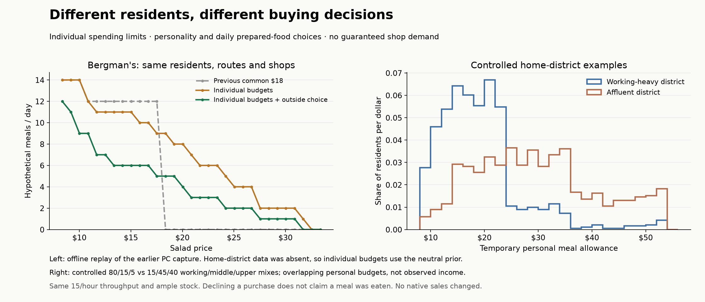

# Personal budgets and optional food purchases — 22 October 2026

Peter approved varied budgets and a food outside option, with an explicit clarification: every business need not be viable. Customers should differ in buying power and preferences; unsuitable offers can fail. This increment implements that principle in the read-only food experiment. It neither guarantees sales nor activates native food journeys or transactions.

## Policy

Each resident receives a stable temporary allowance from their ID and the city seed. When the actual assigned home's district has observed working/middle/upper composition, that mix selects a provisional budget band. The bands overlap: $9–24, $14–36 and $24–54. Individuals vary within every band. A district biases the distribution; it does not give every resident the same budget or assign a measured individual income. Missing district evidence uses a clearly labeled neutral $11–33 personal prior.

The recorder resolves home district from the resident's assigned Home place, never the RLO identity donor's district or the shop's district. The on-demand runtime reader copies already-loaded district composition without calling helpers that create registrations or substitute a global default. Captured distributions are detached. Names, age and sex do not set budgets. Persona affects willingness to buy prepared food, not inferred wealth. These dollar ranges and preference weights are provisional game policy, not empirical estimates of real income.

A food opportunity can compare shop value with preparing food at an observed home stop. At observed work/study, a stable resident/day plan can instead provide a packed-meal preference. Foodies are less likely to plan packed meals and more willing to pay for prepared food; students and parents are more likely to plan one. The choice uses the existing value of time plus provisional personal/day willingness. No home alternative is invented while someone is away from home, and missing origins receive none.

The resulting `DeclinedPurchase` outcome consumes no shop stock, spends no money and creates no trip. It **does not fulfill the meal** or assert that household ingredients exist. The outside-option score is a comparison of willingness, time and convenience, not a quoted grocery bill or money charged. Ingredient purchases, household stock, preparation, nutrition, actual income and expenses remain future work. Unknown evidence remains unresolved where it prevents deciding whether to purchase.

Existing affordability, opening, stock, service, route and deadline constraints still apply. Customer service and district product demand can justify a premium but cannot create buying power. There is no minimum customer count, owner protection, target market share or compensation for an unsuccessful shop.

## Offline replay of retained PC inputs

The [earlier native PC run](2026-10-22-pc-food-demand-curve.md) supplies the same 957 residents, observed routines, routes and bounded eight-shop market. Bergman's Fruit & Produce offers salad at a $16.69 baseline. Stock remains the original controlled 10,000 units per offer and throughput remains 15/hour. These are counterfactual availability inputs, not measured live staffing or stock.

The retained capture predates actual home-district capture. Its identity donor district is not sufficient evidence, so the new-policy curves use the neutral individual prior ($11.04–32.98 in this population). District effects are shown separately with controlled composition examples, not presented as measurements of the PC city.

| Salad price | Previous common $18 | Individual budgets only | Individual budgets + outside choice |
| --- | ---: | ---: | ---: |
| $8.34 | 14 | 14 | 12 |
| $12.52 | 12 | 11 | 7 |
| $16.69 | 12 | 10 | 6 |
| $17.52 | 12 | 9 | 5 |
| $18.36 | 0 | 9 | 5 |
| $20.86 | 0 | 7 | 3 |
| $25.04 | 0 | 4 | 2 |
| $29.21 | 0 | 2 | 1 |
| $33.38 | 0 | 0 | 0 |

Values are hypothetical meals at the target shop per observed day. The shared-$18 cliff becomes a gradual loss of customers. Introducing optional purchases also lowers baseline sales from 12 to 6; preserving this shop's previous sales is not a calibration objective. At high prices it still attracts no customers.

Across the entire bounded market at the baseline price, the new policy produces 38 fulfilled purchases, 494 declined purchases, 385 unmet purchase opportunities and 40 unresolved opportunities. These add to 957; they are not a city hunger rate or proof that 494 residents ate at home.

For the separate district sensitivity, the same IDs and seed receive an 80/15/5 working/middle/upper mix or a 15/45/40 mix. Mean temporary allowances are $19.09 and $29.83 respectively, with broad overlap. This checks the intended distribution mechanism, not native demographic accuracy or business viability.

## Compatibility and checks

- Full suite: **1,003 passed**, including 14 new household-choice cases. Coverage includes stable identity/seed choices, actual-home district attribution, overlapping distributions, personality versus buying power, no home teleport, strict unknown evidence, affordability/quality, zero-customer outcomes, stock/spending conservation and interrupted replay.
- The actual runtime household reader passes **11 checks against native field doubles**: bounded district selection, source scoping, detached/refreshed values, unknown/unloaded data, no global fallback and refusal of malformed/duplicate mixes. This is not native runtime execution.
- Food document schema 4 strictly migrates schemas 1–3 without rerolling their budgets or introducing outside options. All **31 original PC price points reproduce unchanged**. The two new variants add **62 counterfactual replays**, preserving opportunity counts, stock and allowances across price changes.
- The existing six choice-signal checks pass; the coverage control retains 541 meals at the first small shop, 517 at the second and 965 at the single larger shop. Those fixtures explicitly retain their fixed $18 allowance and disable outside choices so they continue isolating their original mechanisms.
- Native-target C# 9 compilation against the retained PC references passes with warnings as errors. Candidate SHA-256: `6e1880e06c9fd3c9443a92764f780b584ebc873c69c20693c0be6bf5f5b09077`. All 59 compiled source files match the frozen manifest. This combined checkout includes other development work and is not a deployment clearance.
- The generated insight view was checked in the browser: separate declined/unmet/unresolved counts, no-stock scenario, resident selection, variable budget evidence and outside-choice explanations. The inspected 24-person subset is labeled separately from full-cohort results. The comparison chart was visually checked.

No rig was contacted, no new native session ran and no profile or live save was changed for this increment. The model remains detached and read-only. Home-district capture still needs in-game validation; actual stock/throughput and sale settlement remain the important next integration work. Stable choices add no route searches or per-frame observer; no native performance claim is made.

Reproduction instructions are in [the comparison tool](../../tools/food-household-comparison/README.md). Ignored source snapshots, manifests, logs, JSON replays and chart exports are under `build/food-household-budgets-20261022/`. Native references and raw captures remain outside Git.
