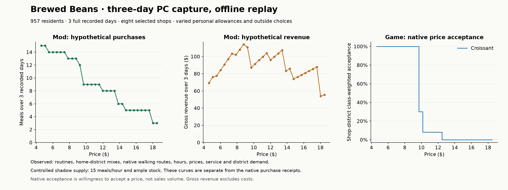

# Native food pilot — 22 October 2026

The isolated PC pilot completed **three actual native purchases and daily settlements**, with one resident's three controlled outings owned by the population scheduler. A separate three-day capture supports a 31-price offline comparison. All **1,007 tests pass**. The rig is stopped, restored and released; normal-play sales remain disabled.

## Scope and implementation

Peter authorized the next food-economy increment and use of the PC rig: observe actual supply and home districts, collect several days of routines, and establish a narrow native purchasing loop. The ordinary mod still does not create native sales. The separate `tools/food-native-pilot` helper is restricted to the isolated agent executable/profile and explicitly named disposable FT city.

`FoodSupplyReader` reads native eligible stocked producers, staffed counters and hourly capacity for one stocked product in a player-owned full-service shop. It uses native simulator setup without simulating customers. Missing rival inventory is unknown, not assumed stock; converted ingredients, shared multi-product resources and replenishment remain outside this first reader. Its result describes the current hour, not future staffing or inventory.

`TryBeginOptionalShopVisit` gives an accepted home-origin walking visit to the existing population scheduler. It refuses occupied residents and insufficient windows, preserves one journey owner, clones the committed route and resumes the ordinary scheduler afterward. No normal runtime caller schedules these visits automatically. Four new tests cover ownership/return, atomic refusal, identical midjourney save/resume with different event budgets, and observation across route rebuilds. All **1,007 tests pass**; the native C# 9 build passes with warnings as errors. All 61 compiled source files match the frozen manifest.

The native run exposed a continuity defect: rebuilding `CitySimulator` after a clock-rate change discarded activity subscribers. The food recorder could silently miss later stops, and the pilot missed its buyer's admission. `RebuildRoutes` now retains the observation channel while rebuilding indexes against the same state. Unsubscription through the original simulator remains effective. The regression checks an actual shop stay through two rebuilds and verifies that removing the original subscription prevents another notification.

The native helper converts one unfurnished rival shop into a clearly controlled fixture: native register with its required supporting furniture, bakery showcase, 300 pastries, 300 paper bags, one native employee with 75 skill, and daily 08:00–18:00 hours. These inputs do not establish the original rival's actual inventory or staffing. Native counter/building rules give the fixture **15 customers/hour**. Only that shop's native hourly customers and customer draws are suppressed.

At most one accepted outing per day is tested, using residents actually at home, actual native outward/return walking routes, personal allowance and outside-option policy, and the next real schedule deadline. Opportunity timing is controlled at 10:00. After actual admission and service time, the helper rechecks supply/hours/affordability and invokes native retail processing. The resident's approved price replaces the detached random customer's price veto for that synchronous purchase. Native code owns stock consumption, the completed order and daily revenue settlement. There is no household cash debit yet.

## Native findings

The discovery capture verifies assigned-home district composition from native game data; this is a game input, not measured real-world income. Rival food shops in the fresh fixture city have no player-style inventory records, so their supply remains unknown.

| Assigned-home district | Working / middle / upper composition |
| --- | --- |
| Garment District | 70 / 22 / 8 |
| Hell's Kitchen | 6 / 82 / 12 |
| Industry City | 80 / 18 / 2 |
| Lower Manhattan | 77 / 19 / 4 |
| Midtown | 0 / 6 / 94 |
| Murray Hill | 65 / 11 / 24 |

The successful fixture was at **49 Third Street**. Native setup confirmed 300 sellable units, one staffed/stocked counter and 15/hour capacity. Empty product stock, empty bags, missing staff and temporary closure each prevented the corresponding availability/service condition. Reading left the serialized registration unchanged; every negative fixture restored exactly afterward.

| Native day | Completed purchases | Pastries / bags after purchase | Revenue settled next day |
| --- | ---: | ---: | ---: |
| 2 | 1 | 299 / 299 | $9.2448 |
| 3 | 1 | 298 / 298 | $9.2448 |
| 4 | 1 | 297 / 297 | $9.2448 |

All three outings returned home. Each sale added exactly one completed order; each daily settlement cleared the pending queue and recorded exactly one customer. Total native revenue was **$27.7344**. The final bank record independently shows the last day's revenue, rounded to $9.24 by the bridge. Forty native hourly batches were suppressed for the fixture, and an explicit native customer-draw call returned an empty list. No minimum-sales rule was added: the harness deliberately limits its connection test to one accepted outing per day. This is not natural demand volume.

The early attempts exposed fixture/protocol problems as well as the observer defect above. A register without its required supporting furniture was correctly excluded by native setup even though its employee assignment was valid. The corrected fixture requires a positive baseline before any zero-stock/staff/closure assertions can count. An earlier continuous fast-forward run recorded approximately 1,563 game minutes of lag; its uncached diagnostic lookups confound attribution to the normal mod. The final helper caches its runtime lookup, waits for full catch-up before selecting residents, and selects candidates with a sufficient free window. Its 27 periodic population samples peaked at 2.5 game minutes of lag, with no runtime-stop message. The campaign still uses ten-minute transaction checkpoints and disabled physical representation, so it is not sustained play/FPS clearance. The observed maximum paired route-query cost was 0.1381 ms and supply-read cost 2.4748 ms; these are narrow helper measurements.

## Three-day demand comparison

The capture contains 957 residents and 7,424 recorded presence spans. It supplies 2,871 meal opportunities, 2,717 with observed origins, and 21,736 native walking quote records, including 10,553 complete outward/return pairs. The geometrically selected target is **Brewed Beans**, with a croissant price of $9.24, saved service score 50 and district product demand 30. Its native catalogue capacity is 11; the separate comparison explicitly supplies every selected shop with a hypothetical 15/hour counter and ample stock. It does not overwrite that rival's capacity or inventory.

| Croissant price | Hypothetical purchases over three days |
| --- | ---: |
| $4.62 | 15 |
| $6.93 | 14 |
| $9.24 | 12 |
| $11.55 | 9 |
| $13.86 | 6 |
| $16.17 | 5 |
| $18.48 | 3 |

Demand decreases across all 31 prices. The native price-acceptance reference also decreases, but in larger class-based steps. These are different quantities: model purchases versus native willingness to accept a price, not a matched mod/no-mod sales benchmark. The model's longer tail follows individual budgets and choices; it is not empirical calibration or a promise of profitability.

At the baseline menu, the eight-shop shadow market has **93 fulfilled, 1,468 declined, 1,156 unmet and 154 unresolved** opportunities. These sum to 2,871. Declining a purchase does not prove a meal was eaten at home; unmet/unresolved counts in this bounded market are not a city hunger rate. Strict unknown-supply mode fulfills zero; current-hour fixture stock does not establish rival stock or three days of future staffing.

The in-game shadow sweep stopped while serializing its full baseline result: repeated choice explanations exceeded the codec's **33,554,432-character limit**. The original capture, input, native price reference and successful native receipts were retained. All 31 prices were then evaluated offline at event budgets 1 and 128, with identical per-person outcomes, conserved stock and the 15/hour service bound. This is not a completed 31-point native replay or a verified final native market/population fingerprint. The codec limit remains unchanged. The diagnostic helper now writes compact baseline outcomes instead of a full duplicate result; that reporting correction compiles but was not rerun on the PC. The offline report uses the unchanged original input.

## Restoration

All **3,586 preexisting profile files** were verified after restoration; 16 changed files were restored. Original preferences and the installation manifest verify, the helper is removed, and a fresh status check shows the rig stopped with no held lock or pending operation. New disposable FT saves and private rollback evidence remain available. The normal game profile was not addressed.

## Interpretation and next gate

This is a bounded connection test, not natural citywide demand, small-shop profitability or a playable economy. Rendering is disabled; logical journeys and admissions do not establish a visually observed walk. Only stocked pastries at one full-service counter are covered. Prepared ingredients, rival finances, replenishment and other retail simulators remain unverified.

Temporary spending allowances still supply purchasing power. The helper has no durable commerce journal or recovery across load, and must not be installed for normal play. Population save/resume tests do not prove native transaction recovery. Before live activation, connect ordinary recurring meal intentions to the existing scheduler, persist decisions and settlement ownership, and demonstrate that purchases remain coherent through catch-up/save/load while replacing overlapping native demand only in the selected scope. The fixture suppresses the whole hourly retail batch, including restocking; normal activation must preserve retail housekeeping outside customer generation. Then close the household income/expense loop before broadening categories.

Evidence is retained privately under ignored `build/food-native-pilot-20261022/`, including frozen sources, native reference/build manifests, full test output, unsuccessful attempts and final campaign receipts. No native DLL, raw save or decompilation belongs in Git.

Tested candidate DLL: `fe3fad03a3760ee4425cdf89c9af38db261e7280faa26a80077c9fb08fee7655`. Tested diagnostic helper (r6): `f3f4df6f75562df65852f83aa93fb49e4691b229f0ceaed987c1c244b91ccf5f`, retained under `Probe-r6-tested/` with its source and manifest. Reporting-only helper correction: `f9a0f00cff99f59148135cf0f5ec01c6c60b0869686e32198d8b2fb8d4c42542`, compiled only. Earlier helpers and the original candidate are retained with their unsuccessful runs, not presented as passing native transaction evidence.
