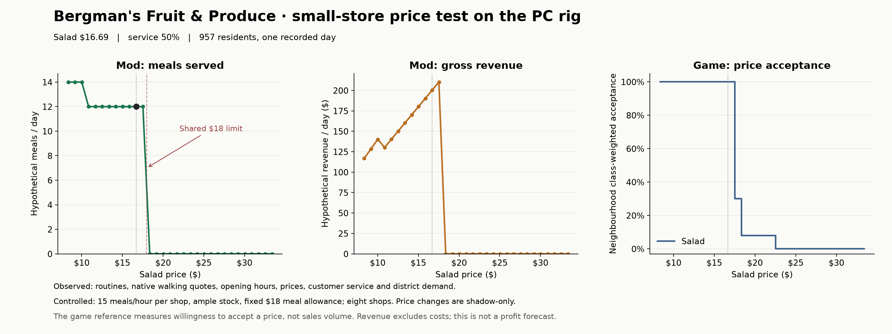

# PC food demand curve — 22 October 2026

The current model responds in the expected direction, but this run exposes a **flat section followed by an artificial shared-budget cliff**. Twelve baseline customers have no other feasible outlet in the tested eight-shop market. They keep buying until the common $18 allowance rules the meal out. This is a useful diagnostic, not a realistic demand calibration or a pricing recommendation.

## Store and controlled experiment

The isolated Windows background rig ran candidate `74c4f01e4ee2324b672ca6672addf90c21f8527d8924d240bbe4e9a04284f658`, identical to the previously validated quality/district candidate. It was rebuilt against references from this PC rig. All 57 compiled source files match the current checkout. Production model code was unchanged.

A new disposable FT city supplied 957 Persistent City residents. Recording ran from day 1 morning through day 3 midnight using native fast-forward and bridge clock multiplier 1. The middle complete day supplied the food opportunities: 3,773 presence spans; 917 known origins and 40 missing origins. Opportunities were categorized as 692 work, 16 study and 249 home, including missing-origin records in those categories. These are observations of the mod's population routines running in the native game, not native shopper decisions.

Before testing prices, the diagnostic selected a small native food premise (nominal capacity at most 30) with the largest count of observed meal origins within 40 world metres. It selected **Bergman's Fruit & Produce, 30 Fifth Avenue, Garment District**, with 33 nearby origins and native nominal capacity 25. Its advertised salad costs **$16.69**, its stored customer-service rating is **50%**, district salad demand is **43%**, and it opens **08:00–17:00 daily**. The seven nearest eligible food shops supplied alternatives. The service field is a native stored rating, potentially an initial default; it is not a new measurement of food quality.

All eight shops received a controlled **15 meals/hour** service rate and **10,000 hypothetical units per offer**. These are explicit assumptions because the catalogue does not establish staffed throughput or inventory. The target is therefore a 15/hour counterfactual at an actual 25-capacity location, not a newly established native 15-capacity business. Native opening hours, advertised prices, customer service and district signals were held fixed, as were residents, their personal choice weights, meal windows and walking quotes. All stores happened to have service 50, so this run does not test a quality premium.

The PC made 9,682 native planner calls across 7,336 candidate round trips; 3,491 complete out-and-back quotes were available. Routes were requested in batches of at most two calls (largest observed batch 3.9496 ms; not a rendering benchmark). The paused game then ran 31 independent shadow replays, changing only the target's food prices from 50% to 200% in 5% steps. No shadow purchase was booked into native inventory, orders or money.

## Results

| Salad price | Price relative to observed | Meals/day | Hypothetical gross revenue/day |
|---|---:|---:|---:|
| $8.34 | 50% | 14 | $116.76 |
| $10.01 | 60% | 14 | $140.14 |
| $10.85 | 65% | 12 | $130.20 |
| $16.69 | 100% | 12 | $200.28 |
| $17.52 | 105% | 12 | $210.24 |
| $18.36 | 110% | 0 | $0 |
| $33.38 | 200% | 0 | $0 |

$17.52 produces the highest gross revenue **among the sampled prices**. Costs, profit, native transaction volume and long-term behavior were not measured.

At the observed price, eight buyers originated at work and four at home; four work-origin buyers were already at this shop's address. All twelve had **zero other eligible shops within the tested set**, and all had **zero queue time**. Their median quoted round trip was 23.02 game minutes. Price cuts therefore gain only two additional buyers; the original twelve retain their sole feasible outlet until the allowance ceiling applies. This cannot establish that they lack alternatives elsewhere in the full city.

Across the bounded eight-shop market, the baseline fulfills 57 opportunities, leaves 860 unmet and 40 unresolved. Halving the target price fulfills 58 overall; raising it 10% fulfills 45. These figures describe this restricted catchment experiment, not total city hunger or total demand. In the strict observation-only replay, unknown stock/service permits zero purchases: 358 unmet and 599 unresolved.

The separate native reference calls actual `CitizenData.IsPriceAcceptable` on detached citizens in the same installed mod configuration. With the district's 70/22/8 working/middle/upper shares, class-weighted acceptance is 100% at $16.69, 30% at +5%, 8% at +10% through +30%, and zero from the sampled +35% point. This is **price acceptance, not sales volume**, and is not an unmodded baseline. The native model has class steps; our present experiment instead synchronizes all customers at $18.

## Implication for the next increment

Keep the local-access and throughput approach. This test's limiting factors were feasible local access and identical buying power; queues stayed at zero. Before tuning numerical price sensitivity, give residents **varied meal spending limits** and a meaningful **alternative to purchasing**, such as eating at home. Spending limits can later derive from household resources when wages and household finances are modeled. The goal is heterogeneous choices and a smoother aggregate response, not an artificially smoothed chart or exact native symmetry. This is a proposed next increment; it was not implemented by this test.

## Verification and restoration

- All 31 native-executed price points reproduced offline with event budgets 1 and 128. Baseline per-person outcomes match the PC; every replay conserves stock and respects 15/hour service spacing.
- Serialized population and observed native market fields (prices, schedules, satisfaction, district entries, orders and inventory) remained unchanged during the paused sweep.
- All 3,539 preexisting rig-profile files, the original install manifest and preferences were verified after restoration. The helper was removed, the rig stopped, and its ownership lock released. The normal game profile was untouched; no normal-game process was running at the before/after checks.
- Earlier transfer-size failures and an idle/lifecycle sequencing refusal were harness failures, retained separately. Each restored and released the rig; none is demand evidence. The successful run uses diagnostic ownership permits for its live diagnostic requests and normal lifecycle permits for installation/restoration.

Reproduction code: `tools/food-demand-curve/`. Ignored evidence: `build/food-demand-curve-20261022/`, including `native-result.json`, captured input/final states, `replay-checks.json`, `diagnosis.json`, `source-receipt.json`, build/reference manifests, cleanup receipts, `curve.csv`, and PNG/SVG/PDF exports. Raw native files and FT saves remain outside Git. The previous 989-test result belongs to the unchanged candidate's earlier validation; this turn added the PC experiment and replay checks rather than rerunning the entire suite.
