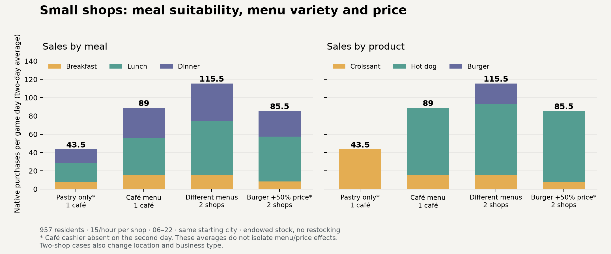

# Bounded food menus — native Mac results

Candidate **0.9.0 / schema 12** adds meal-sensitive product choice within a small verified menu. Croissants, hot dogs and burgers now produce different breakfast, lunch and dinner roles. Prices can move customers between products, between nearby shops, or back to home food. The eight comparison days produced **667 confirmed native purchases** with reconciled stock, bags, resident money and native accounts. This completes the bounded menu increment; replenishment, normal-play usability and broader performance clearance remain the next gate.

## What changed

An enrolled shop can advertise several supported products, with product-specific reservations and one shared service queue. Bags remain a shared native resource, rechecked at checkout rather than reserved per product. A last-bag loser refuses cleanly. One paid requested product at the agreed price, one product unit and one bag must reconcile; other menu stocks must remain unchanged. Unknown products cannot enroll, and an unsupported menu edit visibly pauses the affected shop after reload. Sold shops are no longer suppressed (verified by directly toggling fixture ownership, rather than completing an in-game business sale).

Schema 12 preserves existing meal identities, held money, uncertain transactions and history; original single-product history migrates to its original product. Management feedback adds sales by product and meal. Known unavailable offers are rejected before route planning. This changes some earlier unresolved outcomes to home-food declines, including routine-mode detached replays; the shadow schema remains unchanged, but replay classifications need not be identical to older code.

The supported products are croissant, hot dog and burger, subject to native furniture and business rules. The café fixture offers croissant/hot dog; the fast-food fixture offers burger/hot dog. Salad was removed from this slice because the selected small buildings have no verified native salad-bar layout. Meal-fit values remain explicit gameplay assumptions, described in [the economy guide](../neighborhood-economy.md), rather than measured nutritional or taste calibration.

## Actual game comparison

All four cases reload the same pre-food Mac checkpoint: 957 residents, one-third calendar speed, 15/hour capacity per shop, 06–22 hours and skill-75 staffed counters. The café is at 30 Third Street and the fast-food shop at 46 Third Street. Each starts with 300 units per product and 300 bags, valued at native wholesale prices. Equipment and opening inventory are explicit test endowments; no replenishment is supplied during the comparison. Inventory never runs out: the busiest shop still finishes with 122 bags. Endowment limits conclusions about replenishment and cash runway; it did not cause a stockout in these results. Native rent, wages, sick pay, resource consumption and sales remain authoritative.

| Scenario | Day 2 purchases | Day 3 purchases | Day 2 operating result | Day 3 operating result |
| --- | ---: | ---: | ---: | ---: |
| One café, croissant only | 87 | 0* | $84.61 | −$362.00 |
| Same café, croissant + hot dog | 94 | 84 | $121.14 | $51.29 |
| Café + overlapping burger/hot-dog shop | 123 | 108 | −$90.12 | −$198.53 |
| Same pair, burger $12.50 → $18.75 | 116 | 55* | −$152.92 | −$406.68 |

**\* The café cashier was off sick on Day 3.** The native log records $173 sick pay; all observed café service capacity was zero, with stock still present. In the higher-price case, the fast-food shop made all 55 purchases. Staffing was not overridden. These absences confound two-day mean comparisons: the menu did not establish a doubling of demand, and the higher price did not establish the entire two-day sales decline.

The first-day comparisons are directional observations with one sample each, and are more informative about the intended mechanisms:

- The café menu serves **16 breakfast croissants, 42 lunch hot dogs and 36 dinner hot dogs**. The pastry-only first day serves 16 / 41 / 30 meals. On the café menu's second day, the same meal roles remain, with 14 / 39 / 31 purchases.
- With the second shop, the café falls from 94 to **70** purchases and the fast-food shop adds **53**, including **26 dinner burgers**. Combined sales grow, but there is cannibalization and both shops lose money with 16-hour staffing. Ownership gives no protection from competition. This comparison also changes location, business type, investment and rent; it is not a menu-only causal estimate.
- At the higher burger price, **no burgers sell**. The first day gives **81 café purchases and 35 fast-food purchases**, versus 70 / 53 in the ordinary-price pair. Substitution crosses both products and shops, and combined purchases fall from 123 to 116.

These are selected-shop scenario results, not calibrated citywide demand or guaranteed sustainable profitability. Operating results include native resource and operating expenses but exclude initial investment, loans and personal taxes. The fixture's single employee is scheduled for 112 hours/week; this deliberately held availability assumption is unsuitable as a realistic staffing plan. Practical shift coverage belongs in the next normal-play test. No existing-stop purchases appeared in the eight-day comparison.

## Price mechanism with other inputs held fixed

A separate detached replay reproduces **all 5,095 original two-shop choice records exactly**, including meal kind and refusal reasons. It then raises only the burger price, retaining observed origins, walking quotes, queues, stock, service and wallets. Another 5,099 café-menu records reproduce exactly.

| Burger price | Selected burger offers | Original burger choices switching to hot dog | Switching to home food |
| --- | ---: | ---: | ---: |
| $12.50 | 48 | 0 | 0 |
| $15.00 | 35 | 11 | 2 |
| $18.75 | 0 | 43 | 5 |
| $22.50 | 0 | 43 | 5 |

These are independent offer decisions, potentially including repeat intentions. They do not book native sales or simulate new trips, queues, stock depletion or market equilibrium. The actual pair sold 45 burgers; a chosen offer can still fail to become a completed purchase. The replay isolates the price mechanism without attributing a cashier absence to price.

## Validation and performance

**1,110 offline tests pass**, including migration with active/uncertain purchases, shared-stock contention, daily cash conservation and identical 1,200-resident results across update budgets and an intermediate reload. The actual supply reader passes 15 checks against native field doubles, the catalogue adapter passes 27, and the live-hours harness passes. The native-target build uses warnings as errors.

Native checks confirm all three products, changed-price refusal, last-bag contention, unchanged other-product stock, receipt replay and sold-shop ownership. The direct checkout fixture does not itself exercise the complete journey/wallet path; offline contention tests cover held funds, and generated native routines reconcile real resident spending. A native-valid cupcake edit survives reload: only the café is excluded, the adapter stays active, and the other shop remains enrolled.

All eight measured days conserve each resident's cash, reconcile spending to native revenue and paid receipts, and match per-product stock, bag deductions and actual wholesale-plus-bag expenses. Every measured shop remains enrolled; advertised menus and native suppression counters are captured. All four settled save/reloads and per-meal/product native receipt replays preserve money, stock, history and receipts. The original base file hashes are checked before every case.

Individual decision p95 ranges **0.56–1.38 ms**, with a maximum of **81.96 ms**. These measurements include native route requests within the decision, but exclude journey commitment, checkout and rendering. Known unavailable candidates avoid those route requests. The earlier 0.8 hidden-skip durations were also audited: their timer ran from before dispatch to completed/caught-up day-end state, not to the command acknowledgement; all six snapshots advance 1,440 minutes. Those historical timings stand, but differ in rendering mode and are not a matched performance baseline.

A **62.6-second** focused Mac observation at 1920×1080, Low quality and a 30 FPS cap advances 20.6 game minutes with 957 persistent residents and zero final backlog. Population Update p95 is **3.80 ms**, maximum **41.23 ms**. Whole-frame p95 is **63.93 ms**, maximum **655.19 ms**, with 34 frames above 100 ms. Stutters remain. Only eight pedestrians and zero persistent cars were observed, below the configured 48/24 body limits. GPU and allocation counters were unavailable; whole-game managed memory grew about 80 MB without a collection during this short sample. Camera Tools onboarding/phone overlays were present in the final capture; the economy panel's product/meal text was visually checked. This is a limited stability observation, without a matched baseline, body-cap saturation, unobstructed play session or fun/performance clearance.

## Review, provenance and next step

Independent review used the real **Claude Opus 5.5** session `9d529137-4f9d-4748-b08e-a03456b79a21`. Seven review rounds agreed to close this increment with the reported daily results, staffing confounds, uniform product choice and performance limits. Opus confirmed the final wording and next gate; the root reviewer agrees. The reviewer receives supplied source/evidence without tools and has not independently executed the game.

Successful campaign: local ignored `build/food-menus-mac-r5-20261023/`. Failed fixture attempts are retained separately; corrections concerned native equipment requirements, supported layouts and waiting for actual time-skip completion. The successful run uses DLL **`ec5ccf4f9d03c56f7b3447eb791a4119c316b3f4cc506ed6875c310823f78129`**, with all 78 compiled source files matching the frozen inputs. The base HSG hash is `f004b31fbb68d3933c5a9c4c0a7ce66677ab021b753c1d9305ff8caf6cc2f74d`.

The Mac stopped and released ownership after restoring/verifying **3,713 preexisting files**, preferences and the installation manifest; the probe was removed. Windows and normal profiles were untouched. The private candidate stays disabled by default.

Next, test real replenishment through native suppliers and ordinary play with practical staffing/opening hours. Expose unstaffed/sick service separately in management feedback, observe cash runway over several days, and measure frame pacing near meal peaks. Establish understandable stock, cash and service consequences and acceptable pacing before expanding categories, general detours, rival finances or payroll. Within-shop product choice is almost all-or-nothing: with hot dogs available, café croissants never win lunch or dinner, and burgers stop winning above the observed substitution threshold. Shared fit priors make the roles explainable but too uniform to call realistic product demand. Stable individual food tastes are a likely refinement soon after the operations gate, rather than another feature in this slice.
