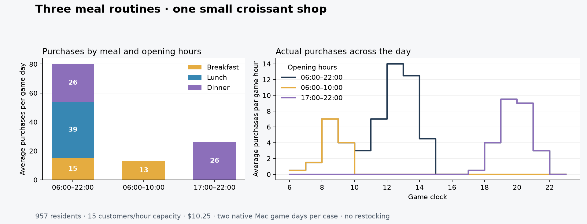

# Breakfast, lunch and dinner — 23 October 2026

Peter requested distinct breakfast, lunch and dinner times and preferences, retaining realistic routines, game mechanics and performance for 1,000+ citizens. The implementation extends the existing neighborhood food economy without adding another resident population or income source.

## Implemented model

Version **0.8.0**, population schema **11**, meal policy **1**. Each resident cycles through breakfast, lunch and dinner in one event record. Preferred times follow waking hours, stable personal habits and small daily changes. The [policy table](../neighborhood-economy.md#breakfast-lunch-and-dinner--meal-policy-1) lists the explicit assumptions. Breakfast prioritizes speed and price; lunch fits actual work/study breaks; dinner allows more leisure time and values service quality more highly. Each opportunity can end in a purchased meal, a choice of the paid home-food alternative, or a missed purchase window. These outcomes are not nutritional accounting.

All meals use the same saved wallet. Daily income, essentials and the household basket post once; no new purchasing power appears when the next meal starts. Temporary allowances are likewise shared across the day. Trip, service, opening-hours, cash and stock constraints remain. The native scope is still explicitly enrolled full-service croissant shops. Croissants receive a stronger suitability penalty at dinner than lunch, affecting perceived value without changing the actual price. Product variety and further calibration remain later work.

Legacy single-meal records keep their current identity, timing and receipt. Completed legacy records schedule next-day breakfast instead of waiting until lunch. Active trips finish before their record advances. An uncertain checkout keeps its exact receipt and any reserved funds through later meals and days. New native receipt keys include the meal and day. History and Ctrl+F8 management show purchases by meal.

## Offline and build evidence

**1,088 tests pass**, including separate meal identities, ordered waking-hour windows across personas and days, spending across three meals, single daily postings, low-fund exclusion of later meals, interrupted travel/service and reloads, legacy schema migration, uncertain checkout ownership, strict malformed-state rejection and receipt pruning. A 1,200-resident comparison produces identical saved state and sales with ordinary versus single-event updates and an intermediate reload. A controlled choice test makes the same resident select quick/cheap service at breakfast and higher quality at dinner.

The frozen native DLL compiles with warnings treated as errors. SHA256: `bcfe7eabdc87a37aea3ef3f195c9c706824980a4c93e3d540cdbb818ffadaa7a`. The manifest records all 77 production source files; eleven differ from the completed 0.7.0 candidate. The detached food-shadow schema and historical single-meal experiments remain unchanged.

## Native Mac comparison

Campaign: `build/meal-rhythm-mac-20261023`. Same disposable pre-food checkpoint, 957 residents, one 15/hour shop at 30 3rd Street, croissants priced at $10.25, staff skill 75 and one-third game clock. Three opening-hour cases run for two native days each. Opening equipment and 300 croissants/bags are endowed test fixtures; there is no replenishment. The game owns stock, sales and daily business accounting. Physical actors are off in this headless run.

| Opening hours | Purchases, days 1 / 2 | Breakfast/day | Lunch/day | Dinner/day | Native operating result/day |
| --- | ---: | ---: | ---: | ---: | ---: |
| 06:00–22:00 | 86 / 74 | 15 | 39 | 26 | $34.76 |
| 06:00–10:00 | 14 / 12 | 13 | 0 | 0 | $-182.91 |
| 17:00–22:00 | 30 / 22 | 0 | 0 | 26 | $-111.95 |

All six days reconcile resident prepared-food debits, confirmed native receipts, actual croissant and paper-bag stock consumption, history and native revenue. Resident cash conservation and daily posting counts pass; no resident buys more than once per meal. No existing-stop purchase occurred in these cases. The 160 purchases from the all-day case belong to 70 and 63 distinct residents on its two days, so the increase includes repeat customers at different meals.

Saved/reloaded all-day accounts, stock and receipts match. Replaying one confirmed native receipt for each of breakfast, lunch and dinner after reload changes neither inventory nor accounts. Restricted-hours cases likewise retain distinct meal receipts. The history matches expected opening hours: breakfast-only sales belong to breakfast and evening-only sales to dinner. The early closure loses two late breakfasts per day; evening-only retains the all-day case's dinner sales. Higher customer counts do not make every schedule profitable.

The all-day shop averages **80 purchases/day**, compared with about **42–43** in the prior single-meal, long-hours campaign. That earlier result is historical context, not a new paired control. Lunch remains strongest. Dinner still supplies 26 pastry purchases/day despite the meal-fit penalty, so a larger menu and calibration are needed before interpreting the mix as realistic cuisine demand. More generous evening time and different daily locations also change the reachable catchment; a food-fit penalty alone does not determine total sales.

All-day preferred times among evaluated opportunities had second-day medians of **07:49:30, 12:23 and 18:54**; respective ranges were **05:59–10:33, 10:06–15:23 and 16:27–22:05**. These summarize actual evaluated residents, not a fixed timetable or all potential meal needs.

Across the six days, measured food-decision work totaled **0.26–1.29 seconds/game day**, with per-case 95th percentiles **0.24–1.59 ms**. The largest individual observed decision was **81.3 ms** in the breakfast-only case; native route calls are not preemptible. The full hidden skips took **29.8–70.1 seconds/day**, including diagnostics. Closed/unstaffed-shop decisions still spend time evaluating access and are a future optimization opportunity. These measurements are headless and do not certify rendered performance. Rechecked after the 0.9 skip-driver fix: this earlier timer starts before command dispatch and ends after `ready()` reports completion, with a two-second wait before polling. All six end snapshots are caught up and advance 1,440 game minutes; the acknowledgement was not the endpoint. The recorded durations therefore stand. The later windowed campaign is not a matched timing comparison.

The runner restored and hash-checked **3,600 preexisting files**, preferences and installation manifest, removed the helper, stopped the game and released the reservation at **16:58:37 UTC**. A fresh status check confirms stopped, unheld and zero pending work. Windows and the normal Mac profile were untouched.

Evidence: `summary.json`, `verification.log`, `offline-tests.log`, `source-manifest.json`, native/probe build manifests, per-day native/state snapshots, `all-day-before-reload.json`, `all-day-after-reload.json`, the three receipt-replay records, `cleanup.json` and `released.json` in the campaign directory. Raw game saves and diagnostic assemblies stay outside the distributable package.

## Boundaries

The numerical preferences are provisional design choices. Only croissants are enrolled, so this is not evidence that all breakfast/lunch/dinner menus are balanced. There are no physical pantry, cooking, family meal or nutritional models. Native employers still do not fund resident income. The added meal history is not a measure of all district demand.

The candidate remains a disabled private package. No normal profile is enrolled, and the Windows rig is not contacted. This increment has no new rendered-frame campaign or human playtest; headless decision timings do not establish smooth gameplay or fun. Existing full-modpack frame spikes and loading delays remain separate limitations.
